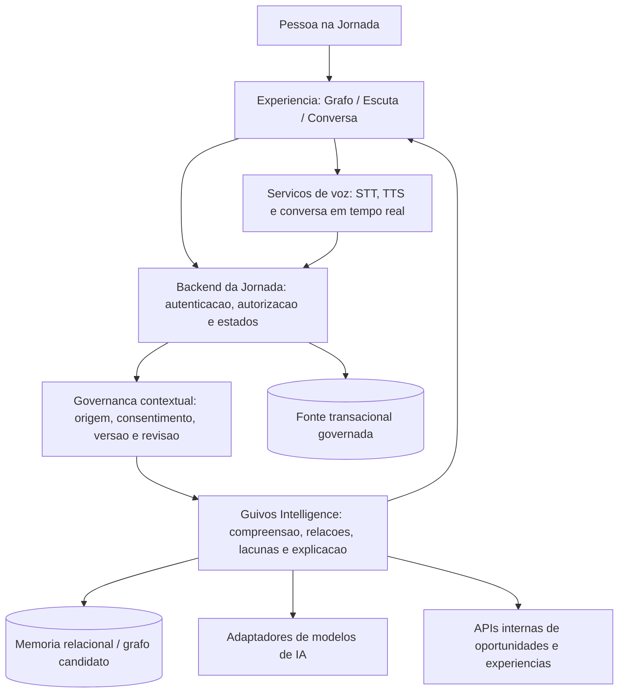

# Grafo Vivo da Jornada — Arquitetura Conceitual e Integrações Candidatas

> **Documento de exploração, não normativo.** Decisões sobre provedores, interfaces, contratos, autorização, bases físicas, APIs e implantação permanecem pendentes. Não converter proposta em especificação operacional automaticamente.

## 1. Escopo e relação com as autoridades

Escopo **exclusivo da Jornada da Pessoa**. O Grafo Vivo é uma forma de apresentação, exploração e explicação da compreensão contextual governada por Guivos Intelligence; **não é** novo produto, fonte única de verdade, perfil público, score humano, nem autorização para expor contexto a terceiros.

Autoridades a confrontar antes da materialização: GPA-006 (Guivos Intelligence), GIA-COG-001, PAS-001, PER-007 (compreensão revisável e decisão independente sobre persistência/personalização), PER-008 (Hoje), PER-010 (Objetivos), PER-011 (Próximos Passos), PER-012 (Evolução), documentos de orquestração, Surface Registry e Transition Registry.

Especialmente: **PER-008 — Hoje ≠ dashboard de performance humana**. Esta proposta não substitui sua finalidade de síntese nem autoriza criar uma superfície nova. A posição exata da experiência exige adjudicação funcional.

## 2. Arquitetura lógica (candidata)



**Separar**: interface, orquestração/autoridade, inteligência, contexto persistido, representação relacional e fontes de dados. O grafo não deve gravar como fato uma relação inferida simplesmente porque foi desenhada.

## 3. Modalidades de experiência

1. **Exploração visual:** nós, conexões explicáveis, filtros, expansão progressiva, perspectivas (contexto, possibilidades, evolução), origem e incerteza.
2. **Relatório narrado:** roteiro contextual em linguagem natural, transcrição acessível, opção de escuta isolada e eventual sincronização com destaques no grafo. Narração originada de uma versão de análise identificável.
3. **Conversa com Intelligence:** perguntas por texto ou voz, aprofundamentos, interrupção opcional da narração e reavaliação quando novas informações legitimamente puderem integrar o contexto.

Uma mesma versão autorizada de compreensão deve sustentar as três perspectivas; avaliações temporárias não podem sobrescrever automaticamente essa versão.

## 4. Fluxo conceitual de atualização do contexto

```text
MENSAGEM / VOZ / ANEXO AUTORIZADO
→ REPRESENTACAO DA ENTRADA (E TRANSCRICAO, QUANDO APLICAVEL)
→ EXTRACAO DE AFIRMACOES E RELACOES CANDIDATAS
→ CLASSIFICACAO: DECLARACAO / PREFERENCIA / OBJETIVO / INFERENCIA / HIPOTESE
→ CHECAGEM DE AUTORIZACAO, SENSIBILIDADE, PROVENIENCIA E CONTRADICAO
→ CONFIRMACAO QUANDO NECESSARIA
→ PERSISTENCIA OU USO TEMPORARIO CONFORME DECISAO VIGENTE
→ REAVALIACAO DOS ELEMENTOS AFETADOS
→ PROJECAO NO GRAFO + SINTETIZACAO / NOVA NARRACAO OPCIONAIS
```

**Invariante crítico:** compreensão revisável, autorização de persistência e autorização de personalização são decisões diferentes. O comportamento híbrido desejado de atualização discreta **não substitui** as escolhas exigidas por PER-007 ou outras autoridades vigentes; só pode ocorrer dentro de autorizações válidas e escopos de finalidade apropriados.

Hipóteses de simulação ("e se eu...") devem ficar isoladas do contexto confirmado. Correções devem gerar reavaliação rastreável, não apagamento silencioso de proveniência.

## 5. Matriz de integrações candidatas

| Integração/camada | Alternativas de avaliação | Entrada / saída conceitual | Dependência/gate |
| --- | --- | --- | --- |
| Motor cognitivo / orquestrador | Guivos Intelligence consumindo modelos por adaptadores | Eventos autorizados → compreensão, hipóteses, lacunas, explicações | GIA-COG-001; política de modelos, segurança, limites e auditoria |
| Modelos de linguagem | GPT (OpenAI), Claude (Anthropic), Gemini (Google) | Contexto mínimo necessário → respostas estruturadas e narrativas | Roteamento, custos, validação de saídas, minimização, fallback; uso simultâneo não obrigatório em cada interação |
| Memória relacional | Neo4j Aura (sandbox existente), alternativas a examinar | Entidades/relações versionadas com proveniência e revogação | Modelo lógico, isolamento por Pessoa, expiração, proveniência, índices e revisão jurídica |
| Registros operacionais | Fonte transacional canônica da Jornada; tecnologia a confirmar | Identidade, estados, permissões e objetos de domínio | Não assumir que Neo4j substitui registros oficiais |
| Visualização do grafo | Cytoscape.js / Sigma.js / React Flow / alternativas | Subgrafo filtrado autorizado → interações na interface | Escalabilidade, acesso por teclado, mobile, legibilidade, latência e licenças |
| Transcrição de áudio | Gemini (preferência experimental anterior), Grok STT e alternativas | Voz autorizada → transcrição revisável | Consentimento, qualidade em português, pontuação, retenção e falhas |
| Síntese de voz / TTS | **Grok/xAI — candidato prioritário de avaliação**, OpenAI e alternativas | Roteiro versionado → áudio com transcrição associada | Custos por duração, acessibilidade, cache, privacidade e política de voz |
| Conversação por voz | **Grok Voice Speech-to-Speech — candidato prioritário de avaliação**; alternativas de áudio em tempo real ou STT → modelo → TTS | Voz ↔ diálogo contextual | Turnos, interrupções, correção de transcrição, autenticação, segurança, custos e latência |
| Catálogo de oportunidades | Serviços internos Guivos Journey e contratos de elegibilidade | Consulta autorizada → oportunidades verificadas, atualizadas e contextualizadas | Fonte de verdade, vigência, não inventar disponibilidade nem prioridade |
| Experiências e evolução | Serviços internos responsáveis por experiências e PER-012 | Estados verificáveis → marcos contextualizados | Não inferir comprovação, conclusão ou reputação a partir de conversa |
| Eventos e sincronização | Eventos internos ou filas, se necessários | Mudança autorizada → invalidação/reprocessamento de projeções | Idempotência, ordenação, observabilidade, versões e rollback |
| Identidade e permissões | Provedor autenticador vigente da Jornada da Pessoa | Sessão → escopo de acesso a contexto individual | Não presumir uso de Clerk/Drizzle ou stack do Profissional nesta Jornada |
| Telemetria e observabilidade | Logs técnicos protegidos e métricas de serviço | Eventos operacionais minimizados | Evitar captura indevida de narrativas e dados pessoais em logs |

**Direcionamento de 07/11/2026:** a direção propõe Grok/xAI para voz de saída e conversação por voz, devendo ser incluído prioritariamente na avaliação. A documentação pública da xAI informa endpoints TTS (\`/v1/tts\`), STT (\`/v1/stt\`) e conversação em tempo real (\`/v1/realtime\`), inclusive português brasileiro no TTS. Referências: https://docs.x.ai/developers/rest-api-reference/inference/voice e https://x.ai/api/voice. A confirmação de capacidades não comprova compatibilidade com a infraestrutura Guivos, custo total, qualidade de voz ou autorização de dados pessoais. A Guivos Intelligence deve conservar a autoridade sobre contexto, memória e atualizações, independentemente do motor de voz.\n\nNenhuma linha acima configura seleção definitiva de tecnologia ou integração aprovada. Custos, limites contratuais, compatibilidade e versões devem ser revistos antes de especificações técnicas.

## 6. Fronteiras de dados e fontes de verdade

- **Contexto da Pessoa:** afirmações declaradas, datas, origem, finalidade, correções, consentimentos e condições de uso — autoridade definida fora deste estudo.
- **Relações no grafo:** projeções consultáveis, com tipo, origem, validade, grau de incerteza e vínculo com a versão de compreensão; não equivalem a fatos externos comprovados.
- **Relatório narrado:** derivado identificável de um snapshot autorizado; atualização posterior não deve reescrever o áudio sem versão.
- **Simulação:** trilha separada, efêmera ou explicitamente salva conforme autorização; nunca registrada automaticamente como estado real.
- **Oportunidades:** apenas as fontes operacionais competentes confirmam existência, elegibilidade e estado.
- **Experiências:** somente evidências e autoridades apropriadas podem confirmar realização; referência verbal não equivale a comprovação.
- **Terceiros:** não compartilhar contexto individual por simples proximidade no grafo, plano, relação Business ou nova integração.

## 7. Dependências, riscos e verificações

### Gates para evolução de proposta a contrato
1. Examinar a compatibilidade de PER-007/008/010/011/012 e Registries com os novos comportamentos, sem criar tela por inferência.
2. Resolver a política governada de memória contextual: captura, aviso, consentimento/autoridade, correção, rejeição, exclusão, revogação, temporalidade e retenção.
3. Desenhar o modelo lógico mínimo de nós e relações com estados de evidência e proveniência; separar fatos, inferências e cenários.
4. Determinar a interface técnica governada entre Journey, Intelligence e fontes operacionais sem ceder autoridade ao grafo.
5. Comparar mecanismos de visualização e acessibilidade para desktop/mobile, inclusive alternativa não visual.
6. Comparar arquiteturas de voz: narração pré-gerada versus conversação de baixa latência, transcrição, interrupções e consistência contextual.
7. Definir observabilidade, custo máximo por sessão/áudio e controles de segurança antes de integração externa.
8. Somente após adjudicações, solicitar autorização própria para protótipos, testes sintéticos e engenharia.

### Riscos
- Exposição indevida de contexto pessoal por cruzamento de dados;
- Memória permanente derivada de hipótese ou transcrição errada;
- Grafo visualmente convincente, mas sem suporte causal/evidencial;
- Recomendações comerciais apresentadas como orientação neutra;
- Latência, custo e escalabilidade de áudio e múltiplos modelos;
- Acessibilidade insuficiente para pessoas que não usam grafos.

## 8. Sequência de aprofundamento sugerida

**Fase A — Contrato conceitual:** mapa de responsabilidades e fronteiras com PER-008 e Intelligence.

**Fase B — Modelo contextual:** catálogo candidato de entidades/relações, proveniência, revisão e estados.

**Fase C — Experiência multimodal:** entrada, modos, narração, diálogo e continuidade.

**Fase D — Integrações:** contratos de entrada/saída, segurança, qualidade, custo e escolha de provedores.

**Fase E — Gate de prontidão:** verificar pendências e solicitar novas autorizações, sem promoção automática.

## 9. Situação

**Concepção em aprofundamento; nenhuma autorização de implementação, nova superfície, API operacional, testes, migração de dados reais, alteração normativa ou publicação do produto.**
