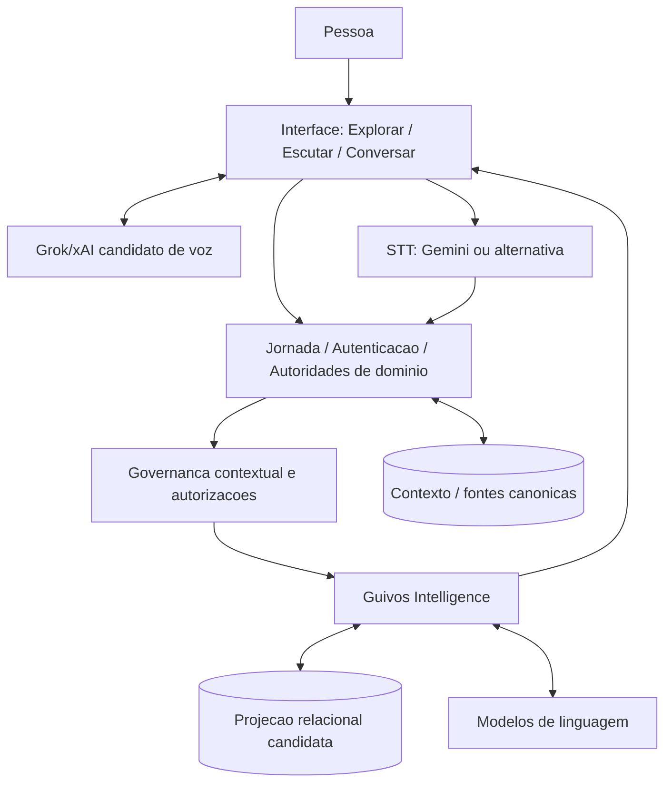

# Grafo Vivo — Confronto de Competências e Fluxos de Integração

> **Estudo diagnóstico não normativo.** Não cria ou altera autoridades, superfícies, transições, APIs, tecnologias aprovadas, autorização de tratamento de dados nem contratos de integração. Referências locais deste documento não são IDs oficiais.

## 1. Pergunta central

Que informações podem circular conceitualmente entre **Jornada da Pessoa**, **Guivos Intelligence**, **memória contextual e grafo**, **Grok/xAI**, **transcrição**, **visualização** e **fontes oficiais**, e em que pontos a arquitetura deve verificar competência, finalidade, autorização, revisão e temporalidade?

## 2. Confronto com os Registries

Documentos consultados diretamente na branch do estudo:
- `docs/journeys/surface-registry.md` — `GKR-JOURNEY-SURFACE-REGISTRY-001`, v0.36.22;
- `docs/journeys/transition-registry.md` — `GKR-JOURNEY-TRANSITION-REGISTRY-001`, v0.29.26;
- `docs/experience-architecture/person-journey/ux-ui-orchestration-master.md` — `GKR-UX-PERSON-JOURNEY-ORCHESTRATION-001`, v0.4.0;
- `PER-007/008/010/011/012` — Documentos Mestres correntes;
- `GPA-006`, `GIA-COG-001`, `PAS-001` — autoridades temáticas a preservar.

### 2.1 Superfícies pertinentes

| Superfície | Responsabilidade no Registry | Implicação para o Grafo Vivo |
| --- | --- | --- |
| PER-007 | Compreensão inicial revisável | Não dispensar revisão ou escolhas independentes de persistência/personalização |
| PER-008 | Hoje, síntese contextual | Ponto de exame para explicações opcionais, sem virar dashboard de performance humana |
| PER-010 | Meus Objetivos | Não criar, alterar, aceitar ou priorizar objetivo por seleção de nó |
| PER-011 | Meus Próximos Passos | Não converter conexão/sugestão em passo assumido, executado ou concluído |
| PER-012 | Minha Evolução | Não reconhecer evolução sem baseline, evidência, temporalidade e autoridade |
| Grafo Vivo expandido | **Não localizado como superfície própria nesses registros** | Exige exame de competência e navegação antes de qualquer materialização |

### 2.2 Transições existentes

| Transição | Origem → destino | Estado observado no Registry | Limite |
| --- | --- | --- | --- |
| TRN-006 | PER-006 → PER-007 | Localmente validada | Não implica compreensão confirmada |
| TRN-007 | PER-007 → PER-008 | Integralmente validada | Não amplia consentimentos |
| TRN-008/009 | PER-008 ↔ PER-010 | Integralmente validadas | Entrada e retorno neutros de Objetivos |
| TRN-010/011 | PER-008 ↔ PER-011 | Integralmente validadas | Entrada/retorno não aceitam ou concluem passo |
| TRN-012/013 | PER-008 ↔ PER-012 | Integralmente validadas | Entrada neutra e retorno sem reconhecimento automático de evolução |

O Registry observa que os acessos desde PER-008 a PER-010/011/012 valem para a **variante recorrente** e somente quando os affordances forem aplicáveis. Não existem handoffs diretos contratados entre PER-010, PER-011 e PER-012. O grafo não cria transições implícitas.

## 3. Camadas e limites de competência

O desenho é **candidato**, não um diagrama de infraestrutura implantada. O fluxo concreto de sessão, áudio, autenticação e dados precisa de contrato posterior.

## 4. Matriz focal de troca de informações

| Ligação | Entrada mínima candidata | Saída candidata | Verificação indispensável | Autoridade preservada |
| --- | --- | --- | --- | --- |
| Jornada → Intelligence | Identidade opaca, escopo, contexto autorizado/vigente e finalidade | Pedido de compreensão contextual | Autenticação, permissão, minimização, temporalidade | Journey / autoridades de domínio |
| Intelligence → memória governada | Afirmações candidatas, classificação, proveniência, tempo | Persistência autorizada ou pendência/recusa | Finalidade, autorização, validação necessária, retenção | Dados/Journey, PER-007 e contratos aplicáveis |
| Memória → grafo (Neo4j candidato) | Entidades e relações projetáveis, referência de versão, escopo | Projeção relacional consultável | Isolamento por Pessoa, proveniência, expiração, correções | Fonte canônica não é substituída |
| Intelligence → visualizador | Subgrafo filtrado, explicações e incertezas | Nós, arestas, filtros e contexto explicável | Acesso, densidade, acessibilidade, versões | Intelligence explica; UI apenas apresenta |
| Intelligence → Grok TTS | Roteiro mínimo autorizado, formato e referência da análise | Áudio narrado | Proteção de dados, retenção, custos e equivalente textual | Intelligence governa conteúdo |
| Grok Voice → Intelligence | Transcrição/representação de fala e contexto mínimo da sessão | Pergunta, resposta ou afirmação candidata | Precisão, interrupção, escopo, confirmação e segurança | Voz não persiste memória autonomamente |
| Gemini STT ou alternativa → Journey | Áudio autorizado | Transcrição revisável | Aviso, finalidade, falhas, correção e retenção | Transcrição ≠ fato confirmado |
| Intelligence → Jornada | Síntese, interpretação, proposta de atualização | Exibição/ação potencial sob autoridade competente | Efeitos declarados, validação e decisão da Pessoa | Objetivos/Passos/Evolução não mudam por inferência |
| Jornada → catálogo de Oportunidades | Consulta elegível e escopo | Oportunidades reais com estado verificável | Atualidade e finalidade; sem inventar elegibilidade | Fonte oficial de Oportunidades |
| Journey → Experiências/Evolução | Objetos e evidências elegíveis | Trajetórias/interpretações contextualizadas | Evidência, baseline, contestação e proteção | PER-012/PAS-001 |

As relações acima não pressupõem seleção final de APIs, topologia, provedores ou regras jurídicas.

## 5. Cinco gates transversais

### G-A — Antes de usar o contexto
Autenticar a Pessoa, delimitar finalidade, recuperar decisões válidas de persistência/personalização e minimizar a seleção de dados. A mera abertura de Hoje, de um nó ou de um relatório não amplia a permissão.

### G-B — Antes de enviar dados a provedor externo
Examinar finalidade, necessidade, minimização de dados, cláusulas/retenção do fornecedor, segurança e base legal aplicável. Não presumir que Grok, Gemini ou outros serviços estejam habilitados para receber o contexto pessoal completo.

### G-C — Antes de consolidar nova informação
Distinguir **declaração explícita**, inferência, transcrição incerta, correção, contradição e hipótese contrafactual. Consultar autorizações e solicitar validação quando necessário. A conversa não é contrato de memória permanente.

### G-D — Antes de refletir alterações em grafo e relatório
Verificar versão, proveniência, autoridade da fonte, impacto da mudança, permissões vigentes e invalidação de projeções desatualizadas. Mudança de relação não constitui evolução reconhecida.

### G-E — Antes de produzir efeito sobre objeto de domínio
Checar contrato específico de Objetivos, Próximos Passos, Evolução, Oportunidades ou Experiências; somente a responsabilidade competente pode validar a ação. Grafo, IA e voz não executam ações silenciosamente.

## 6. Cenários ponta a ponta — evidência esperada

### Cenário 1 — Escutar sem navegar
Uma Pessoa acessa Hoje após fluxo legítimo, escolhe voluntariamente uma síntese narrada, escuta conteúdo correspondente à versão autorizada e pode continuar sem ativar grafo ou personalização. Resultado: **acesso inclusivo**, não nova autorização.

### Cenário 2 — Nova informação declarada por voz
A Pessoa diz que começou um curso. O serviço de voz ou transcrição entrega uma representação à Intelligence, que classifica a frase como **autodeclaração**; a camada de governança verifica autorização e, quando necessário, pede confirmação. Somente a consolidação legítima pode gerar versão de contexto e subgrafo atualizados. Não inferir conclusão do curso nem competência comprovada.

### Cenário 3 — Hipótese de cenário
A Pessoa pergunta “e se eu tivesse mais tempo disponível?”. A Intelligence cria exploração temporária distinguível da memória real. Não altera objetivos, horários, evidências ou estado canônico.

### Cenário 4 — Correção após relatório gerado
A Pessoa corrige informação anterior. A atualização governada pode invalidar partes da projeção e sinalizar que áudio antigo corresponde a um snapshot anterior. Não alterar silenciosamente o relatório existente nem guardar material revogado como se fosse vigente.

### Cenário 5 — Falha da voz
Falha de Grok ou do microfone não impede acesso à síntese textual e não produz transcrição inventada. Retomada não duplica mensagens ou eventos de atualização.

## 7. Lacunas de autoridade e decisão

| Lacuna | Exame necessário | Efeito de não resolver |
| --- | --- | --- |
| R-01 — Posição do Grafo Vivo | Surface Registry, PER-008, orquestração | Não criar entrada ou expansão operacional |
| R-02 — Navegação e handoffs | Transition Registry e contratos locais | Não inventar transições entre PER-010/011/012 |
| R-03 — Contexto pós-entrada | PER-007, dados, privacidade e GIA | Não persistir por inferência |
| R-04 — Modelo de projeção | PAS-001, GIA e fontes canônicas | Não transformar nós em objetos oficiais |
| R-05 — Contrato de voz | Segurança, privacidade, finalidade e fornecedores | Não transmitir contexto pessoal a provedores |
| R-06 — Versões e correções | Journey, dados, Intelligence e retenção | Não reutilizar derivativos desatualizados |
| R-07 — Elegibilidade e provas | Oportunidades, Experiências e PER-012 | Não afirmar oportunidade ativa nem evolução por inferência |
| R-08 — Acessibilidade | UX e desenho de alternativas não visuais | Não tornar grafo/voz obrigatórios |
| R-09 — Custos e planos | Autoridades comerciais, Engenharia e GIA | Não definir quotas ou restringir capacidade por suposição |

Estes R-xx são marcadores locais deste estudo e **não constituem IDs oficiais**.

## 8. Parecer focal e sequência recomendada

O confronto demonstra **base documental para continuidade contextual e síntese em Hoje**, mas não prova autorização para nova superfície de grafo expandido, conversação persistente ou novos contratos de integração. Transições vigentes continuam específicas e limitadas.

A próxima investigação deve elaborar uma **Matriz de Ciclo de Vida da Informação Contextual**, da declaração/transcrição até validação, atualização, versão, uso na narração, correção e revogação, articulada com as decisões independentes de persistência e personalização.

**Sem efeitos normativos, novas telas, IDs oficiais, APIs, Design operacional, testes, implementação ou publicação.**
