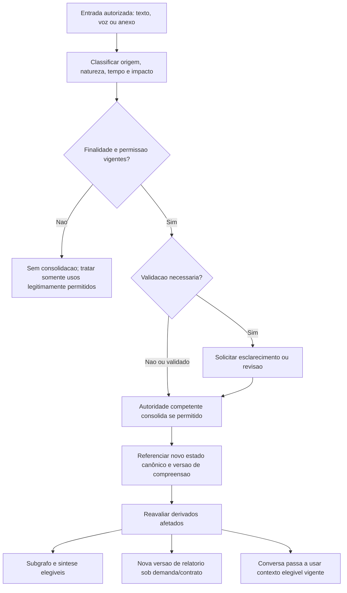

# Grafo Vivo — Contrato Conceitual de Sincronização e Versionamento

> **Contrato exclusivamente conceitual e candidato.** Não equivale a contrato técnico, protocolo de eventos, aprovação de armazenamento, esquema de dados, seleção de provedor, política de retenção ou autorização de implementação. Não cria IDs oficiais.

## 1. Problema que o estudo procura resolver

A compreensão contextual pode evoluir enquanto a Pessoa explora o grafo, conversa, ouve uma narração ou consulta um relatório anterior. Sem uma referência explícita à origem, à vigência e à versão, cada modalidade poderia apresentar uma interpretação diferente como se fosse atual.

**Princípio proposto:** as modalidades não precisam atualizar na mesma velocidade; precisam **declarar a qual versão autorizada da compreensão se referem**, reconhecer quando estão desatualizadas e respeitar alterações de permissão imediatamente no limite da competência vigente.

## 2. Autoridades preservadas

- `PER-007`: revisão e escolhas independentes de persistência e personalização. Entrar em Hoje, falar por voz ou consultar relatório não concede nova permissão.
- `PER-008`: síntese atual, primeira entrada e estado recorrente, sem performance humana ou avanço presumido.
- `PER-010`, `PER-011`, `PER-012` e `PAS-001`: gestão canônica de objetivos, próximos passos e evolução; representações gráficas não os alteram.
- `GPA-006` / `GIA-COG-001`: Intelligence auxilia compreensão e explicações, não decide pela Pessoa.
- `Surface Registry` e `Transition Registry`: nenhum estado do visualizador, player ou chat cria superfície ou transição.
- Privacidade, Segurança e Dados: competências sobre processamento, armazenamento, retenção, revogação, transferência e eliminação não são adjudicadas aqui.

## 3. Objetos lógicos candidatos para controle de coerência

| Referência lógica | Conteúdo essencial em tese | Autoridade/fonte | Proteção |
| --- | --- | --- | --- |
| Contexto autorizado | Afirmações permitidas, origem, vigência, finalidade, decisões independentes de uso | Dados/Jornada/autoridades de domínio | Não armazenar apenas porque a interface leu |
| Versão de compreensão | Referência temporal e conjunto de fontes elegíveis considerados na análise | Guivos Intelligence sob sua governança | Não confundir hipótese com declaração ou evidência |
| Projeção do grafo | Nós/arestas derivados, referência à versão de compreensão e suas fontes | Representação candidata, não registro canônico | Invalidação/filtragem após correção ou perda de permissão |
| Sessão de conversa | Contexto mínimo autorizado, pergunta atual, hipóteses temporárias | Interação/Intelligence, competência final pendente | Voz/transcrição não geram memória duradoura automaticamente |
| Versão de relatório | Roteiro, contexto de referência, momento de geração e possíveis limitações | Intelligence e responsável pelo conteúdo, a definir | Versões anteriores não se tornam fatos atuais |
| Narração gerada | Conteúdo falado, referência ao roteiro, trecho/posição, tratamento de áudio | Adaptador candidato Grok/xAI ou outro | Minimização e retenção específica; voz sem competência semântica |
| Estado de autorização | Escopos e finalidade efetivamente válidos no instante do uso | Autoridades de identidade/dados | Não assumir que autorização antiga ainda vale |

**Não são entidades novas de PAS-001 nem nomes de campos ou IDs de API.** Um mesmo conteúdo pode ter nova versão de projeção sem nova versão de fonte canônica, e vice-versa.

## 4. Invariantes candidatos

1. **Origem verificável:** toda explicação material deve poder remeter a informações permitidas e sua natureza (declarada, inferida, contestada, confirmada, hipotética).
2. **Versões explícitas:** uma resposta ou relatório não deve afirmar ser atual quando se baseia em versão anterior conhecida.
3. **Permissões prevalecem sobre snapshots:** revogação ou perda de permissão impede novo uso incompatível, mesmo que o áudio ou grafo tenham sido produzidos antes.
4. **Simulações isoladas:** “e se...” não atualiza contexto real nem o histórico canônico.
5. **Nenhuma atualização silenciosa de domínio:** grafo e voz não aceitam objetivos, concluem passos ou reconhecem evolução.
6. **Consistência explicável, não sincronização absoluta:** atrasos técnicos podem existir; devem ser seguros e perceptíveis quando materiais.
7. **Recuperação sem duplicação:** tentativas repetidas não podem multiplicar fatos ou efeitos no domínio competente.
8. **Conteúdo essencial acessível:** falha de player/visualização não impede a alternativa textual pertinente.
9. **Minimização:** só enviar ao fornecedor o conteúdo legitimamente necessário para a modalidade.
10. **Correção proporcional:** tratar projeções dependentes e relatórios antigos sem afirmar exclusão automática além das regras aplicáveis.

## 5. Fluxo conceitual de atualização

O diagrama **não** define atualização automática permanente. Se o conteúdo não puder ser consolidado ou a validação faltar, o caminho de confirmação/uso temporário permanece sujeito à autoridade vigente. A seta de revisão para consolidação não presume sucesso.

## 6. Matriz de consistência entre modalidades

| Mudança de referência | Grafo Vivo | Conversa | Relatório narrado | Diretriz de integridade |
| --- | --- | --- | --- | --- |
| Novo dado permitido, sem impacto material | Pode não alterar exibição | Responder com contexto vigente quando necessário | Não exigir nova geração | Evitar mudanças cosméticas como falsa evolução |
| Novo dado com impacto relevante | Reavaliar relações dependentes e indicar atualização | Usar versão vigente ou sinalizar atualização em curso | Manter referência à versão antiga e oferecer nova análise quando legítimo | Não manter recomendações antigas como atuais |
| Contradição não resolvida | Não promover novo nó como fato | Pedir esclarecimento ou preservar incerteza | Não incorporar a conclusão contestada como confirmada | Bloquear consolidação prematura |
| Simulação ativa | Exibir cenário claramente separado, se autorizado | Delimitar resposta como hipótese | Narração hipotética separada da análise vigente | Não alterar memória real |
| Correção de dado | Invalidar projeções afetadas após autoridade corrigir | Evitar uso de interpretação reconhecidamente incorreta | Sinalizar desatualização/invalidação conforme conteúdo | Preservar proveniência e direitos aplicáveis |
| Revogação de uso | Remover/restringir visualização incompatível | Não continuar usando dado revogado | Bloquear reprodução/novo uso incompatível; tratamento do arquivo conforme política | Permissão atual supera versão antiga |
| Falha de Neo4j/projeção | Mostrar indisponibilidade ou alternativa autorizada | Não fingir que consulta ao grafo ocorreu | Usar somente fontes e versão realmente elegíveis | Ausência de projeção não cria dado fictício |
| Falha de Grok/áudio | Grafo pode seguir, se permitido | Alternativa textual | Texto equivalente e erro claro, sem afirmar reprodução concluída | Voz é canal, não fonte de verdade |
| Dois dispositivos/sessões | Reconsultar estado apropriado e detectar mudança material | Referenciar versão elegível mais recente | Diferenciar análise em reprodução de estado atual | Não sobrescrever alterações concorrentes |

## 7. Alterações concorrentes — casos candidatos

### A. Pessoa corrige disponibilidade em outra sessão durante narração

1. A correção passa pelo domínio e pelas permissões pertinentes.
2. A versão de compreensão usada pelo áudio em andamento torna-se potencialmente desatualizada.
3. A interface deve avaliar se pode continuar narrando sem enganar ou infringir nova autorização.
4. Se material, sinaliza a mudança e oferece retomada contextual ou novo relatório, caso legítimo.
5. Não reescreve o conteúdo do relatório original silenciosamente.

### B. Nova informação chega enquanto o grafo é explorado

A projeção atual pode permanecer por instantes identificada como versão anterior; quando a atualização for confirmada e autorizada, a UI deve evitar trocar abruptamente o foco da Pessoa sem explicação. O padrão de atualização automática ou por ação permanece **pendente**, não escolhido.

### C. Duas afirmações divergentes são recebidas quase ao mesmo tempo

A Intelligence não escolhe uma por ordem de chegada arbitrária. É necessário verificar versão, origem, período a que cada frase se refere, autoridade e eventual confirmação da Pessoa. Se não houver base suficiente, manter conflito explícito sem eleger fato vigente.

### D. Retry de transcrição ou consolidação

O componente técnico futuro deverá demonstrar que uma mesma entrada/decisão não provoca múltiplos efeitos de domínio. Idempotência e detecção de replay são requisitos de avaliação, **não contratos de eventos já definidos**.

## 8. Falhas, revogação e recuperação

| Situação | Comportamento esperado no estudo | Proibição |
| --- | --- | --- |
| Conexão perdida durante conversa | Estado de interrupção identificável; recuperação dentro das permissões | Inventar resposta ou continuar gravando sem base |
| Saída de voz interrompida | Preservar posição somente se finalidade e persistência permitirem | Tratar reprodução parcial como validação de conteúdo |
| Conteúdo do relatório fica desatualizado | Mostrar contexto temporal e alternativa de revisão | Reproduzir como análise corrente sem qualificação |
| Revogação em sessão ativa | Interromper novos usos incompatíveis e reavaliar derivados | Confiar em cache de permissão antigo |
| Exclusão solicitada | Encaminhar a autoridade; verificar bases, cópias e fornecedores | Prometer remoção imediata de todos os sistemas |
| Versão canônica indisponível | Admitir limitação ou operar apenas modo expressamente permitido | Construir continuidade fictícia |
| Reprocessamento em atraso | Confirmar estado elegível antes de aplicar resultado | Substituir contexto mais recente por saída antiga |
| Falha parcial de integração | Isolar a falha e manter modalidades alternativas, quando legítimas | Promover dados incompletos à fonte de verdade |

## 9. Matriz de dependências de integração

| Componente candidato | Responsabilidade técnica a examinar | Não pode decidir |
| --- | --- | --- |
| Backend da Journey | Escopo de sessão, autorização, acesso ao estado governado | Consentimento presumido por navegação |
| Guivos Intelligence + modelos | Compreensão, explicação, interpretação e referência a versões | Autoridade sobre escolhas da Pessoa |
| Neo4j Aura | Relações/projeções com referência à proveniência e vigência | Fonte única ou autorização para armazenar tudo |
| Visualizador | Apresentar subgrafo elegível e indicar alterações relevantes | Alteração de objetos por clique |
| Grok/xAI Voice/TTS | Gerar/reproduzir fala e transmitir interação autorizada | Memória duradoura, domínio, consentimento |
| Gemini STT ou alternativa | Transcrever áudio autorizado com controle de qualidade | Certificação automática do conteúdo |
| Armazenamento de relatórios/áudio | Guardar somente versões/artefatos elegíveis sob retenção válida | Preservação ilimitada por conveniência |
| Observabilidade | Diagnosticar falhas, concorrência e custo com dados minimizados | Perfilamento pessoal não autorizado |

## 10. Decisões pendentes para futura adjudicação

| Referência local | Questão | Consulta necessária |
| --- | --- | --- |
| S-01 | Qual objeto ou registro guarda a versão de compreensão e sua proveniência? | Dados/Journey, GIA, PAS-001 |
| S-02 | Qual semântica indica análise vigente, anterior, obsoleta e invalidada? | GIA/Intelligence, UX, Dados |
| S-03 | Quando atualizar grafo automaticamente ou mediante escolha? | UX/Journey e acessibilidade |
| S-04 | Como resolver alterações concorrentes entre sessões sem perda de contexto? | Engenharia, Dados, Segurança |
| S-05 | Qual política para pausar/regenerar narração quando a análise muda? | UX, Intelligence, Privacidade |
| S-06 | Como propagar revogação a caches, áudios e fornecedor externo? | Privacidade, Jurídico, Segurança, Dados |
| S-07 | Qual duração permitida para sessão, snapshot e artefatos de voz? | Privacidade, Dados, contratos de fornecedores |
| S-08 | Que parte do contexto pode ser enviada a Grok/Gemini/outros? | GIA, Segurança, Jurídico/Privacidade |
| S-09 | Como preservar alternativa textual e leitores assistivos sob mudanças? | UX/Acessibilidade |
| S-10 | Como demonstrar idempotência/recuperação e integridade sem testes reais prematuros? | Arquitetura, Engenharia, governança de testes |

As referências S-xx são **marcadores internos deste exame**, não novos identificadores oficiais.

## 11. Parecer e próxima atividade

A coerência da experiência deve depender de **versões identificáveis, autoridade de origem, permissões vigentes e tratamento explícito de derivações**, não da ilusão de que todas as interfaces se atualizam simultaneamente. Grok é candidato para o canal de voz; Neo4j é candidato para relações; a Guivos Intelligence mantém o papel cognitivo governado, sem substituir os domínios da Journey.

**Próximo exame sugerido:** Matriz de Estados de Coerência e Recuperação Multimodal, confrontando retorno após interrupção, mudanças de contexto durante a narração e indisponibilidade parcial de provedores com alternativas acessíveis.

**Estado:** exclusivamente documental e condicionado. Nenhum novo PER-ID, contrato operacional, API, Design, integração real, teste, alteração normativa, merge ou publicação autorizado por este documento.
