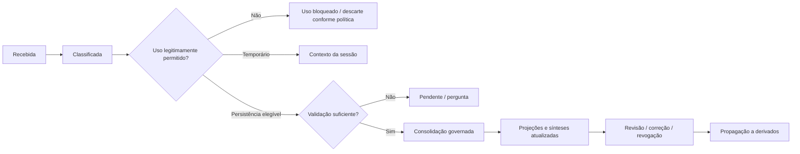

# Grafo Vivo — Matriz do Ciclo de Vida da Informação Contextual

> Estudo **não normativo e não operacional** da proposta de Aprendizado Contextual Contínuo. Não institui coleta, armazenamento, retenção, transferências para terceiros, tratamento de dados sensíveis, regras jurídicas, APIs, novos PER-IDs ou mudanças nos registros vigentes.

## 1. Objetivo

Descrever, com foco em proveniência e controle da Pessoa, como uma informação **poderia** atravessar captura, representação, interpretação, validação, uso temporário, consolidação autorizada, projeção no grafo, geração de narrativas, correção e revogação.

A conversa e a síntese de voz são **modalidades de interação**; a legitimidade da persistência e da personalização vem das autoridades da Jornada e das decisões da Pessoa, não do motor de IA ou do dispositivo de gravação.

## 2. Autoridades preservadas

- `GKR-UX-PER007-MASTER-001`: compreensão inicial revisável e **decisões independentes** de persistência e personalização. “Usar somente nesta sessão” não equivale a persistência posterior. “Excluir esta compreensão” é decisão distinta.
- `GKR-UX-PER008-MASTER-001`: Hoje usa somente informação apropriada, autorizada e vigente; sua finalidade é síntese, sem converter navegação em permissão.
- `PER-010/011/012` e PAS-001: Objetivos, Próximos Passos e Evolução possuem autoridades próprias; declaração ou conexão não confirma objeto de domínio.
- `GPA-006` e `GIA-COG-001`: Intelligence interpreta e explica, sem decidir pela Pessoa.
- Surface Registry, Transition Registry e orquestração: nenhuma extensão de fluxo ou responsabilidade por inferência.
- Segurança/Privacidade/Dados: bases, retenção, eliminação e transferência internacional exigem análise específica.

## 3. Matriz focal do ciclo de vida

| Fase | Entrada candidata | Saída conceitual | Gate de autoridade / verificação | Erro a evitar |
| --- | --- | --- | --- | --- |
| 0. Escopo da sessão | Identidade, finalidade e escolhas vigentes | Limites de acesso e processamento | Autenticação **não** implica persistência ou personalização | Tratar sessão como consentimento universal |
| 1. Expressão | Texto, áudio ou anexo voluntário | Conteúdo de origem | Finalidade, aviso, minimização e permissão para processamento | Coleta oculta ou indiscriminada |
| 2. Transcrição | Áudio elegível | Representação textual com referência ao áudio e incertezas | Qualidade, possibilidade de revisão e política de retenção | Atribuir à Pessoa palavras transcritas incorretamente |
| 3. Identificação | Conteúdo/trecho autorizado | Afirmações candidatas | Classificar declaração, pergunta, hipótese e intenção | Transformar pergunta contrafactual em fato |
| 4. Interpretação | Afirmações e contexto permitido | Relações, lacunas e inferências candidatas | GPA-006/GIA-COG-001, proveniência e incerteza | Apresentar inferência como conhecimento comprovado |
| 5. Confronto | Candidata versus estado canônico permitido | Compatibilidade, conflito ou dúvida | Vigência, autoria, temporalidade, sensibilidade | Substituir valor existente sem verificar contradição |
| 6. Validação | Afirmação explícita ou ambígua | Confirmada, contestada, rejeitada ou aberta | Confirmação proporcional e escolha da Pessoa quando necessária | Perguntar toda vez ou aceitar informação crítica sem conferir |
| 7. Decisão de uso | Candidata com proveniência | Uso temporário, persistência elegível ou nenhuma gravação | **Persistência e personalização independentes**, finalidade e retenção | Supor que conversar permite memorizar |
| 8. Consolidação | Informação elegível e autorizada | Atualização na autoridade apropriada ou pendência | Competência do objeto, idempotência, versão, auditabilidade | Neo4j ou Grok gravarem estados oficiais sem contrato |
| 9. Projeção relacional | Contexto governado atualizado | Subgrafo mínimo e explicável | Filtragem por Pessoa/finalidade, origem, validade, correção | Expor contexto íntimo por conexões derivadas |
| 10. Reavaliação | Evento autorizado de alteração | Análises afetadas e incertezas reavaliadas | Escopo de mudança, evitamento de causalidade inventada | Reconhecer evolução automaticamente |
| 11. Apresentação | Versão de análise e permissões | Síntese em Hoje, grafo e explicação | PER-008/autoridades especializadas e acessibilidade | Exibir conteúdo revogado ou desatualizado |
| 12. Narração | Roteiro derivado de contexto elegível | Áudio e equivalente textual versionados | Minimização ao provedor, controle da Pessoa e retenção específica | Confundir escuta com validação |
| 13. Correção | Contestação ou informação retificadora | Revisão pelo domínio competente; dependentes marcados | Autoria, permissão e propagação de invalidações | Reescrever silenciosamente a fonte |
| 14. Revogação/exclusão | Mudança legítima de autorização ou pedido de retirada | Restrição de novos usos e tratamento dos derivados segundo regras aplicáveis | Base legal, retenção, exclusão, terceiros e auditoria | Manter caches/áudios utilizáveis contra estado vigente |
| 15. Encerramento | Fim de sessão ou término da finalidade | Descarte/retensão autorizada, conforme política | Temporalidade e políticas vigentes | Memória infinita por omissão |

A tabela explicita **operações candidatas**, não define uma máquina de estados implementável.

## 4. Distinções que devem permanecer verificáveis

```text
MENSAGEM ORIGINAL
  ≠ TRANSCRIÇÃO
  ≠ AFIRMAÇÃO EXTRAÍDA
  ≠ HIPÓTESE DO MODELO
  ≠ FATO VERIFICADO INDEPENDENTEMENTE
  ≠ OBJETO DE DOMÍNIO CANÔNICO

AUTORIZAÇÃO DE PROCESSAR
  ≠ AUTORIZAÇÃO DE PERSISTIR
  ≠ AUTORIZAÇÃO DE PERSONALIZAR
  ≠ AUTORIZAÇÃO DE COMPARTILHAR

SIMULAÇÃO
  ≠ CONTEXTO REAL

NOVA CONEXÃO NO GRAFO
  ≠ EXPERIÊNCIA COMPROVADA
  ≠ EVOLUÇÃO RECONHECIDA
```

Proveniência deve permitir explicar, em nível proporcional e sem expor raciocínio interno de modelos, **de onde veio a afirmação, quando ela era pertinente, qual seu status e o que foi revisado**.

## 5. Quatro tratamentos de informação na conversa

| Situação fictícia | Classificação | Tratamento candidato |
| --- | --- | --- |
| “Comecei um curso de programação há dois meses” | Declaração explícita | Considerar como curso iniciado, não como curso concluído, sob escopo e persistência permitidos |
| “Talvez eu queira trabalhar com tecnologia” | Preferência/intenção incerta | Manter como hipótese declarada, pedir esclarecimento somente se relevante |
| “E se eu tivesse dez horas livres?” | Cenário contrafactual | Explorar temporariamente; não substituir disponibilidade real |
| “Corrigindo: tenho quatro horas, não seis” | Correção explícita | Submeter à autoridade competente, versionar e reavaliar derivados afetados, se autorizado |

Se a modalidade for voz e houver baixa confiança na transcrição, a validação deve considerar a **incerteza da transcrição**, mesmo quando a frase aparentar ser explícita.

## 6. Máquina de estados ilustrativa — não normativa



**Alerta:** “uso legitimamente permitido” e “validação suficiente” são gates sujeitos a regras futuras e à autoridade aplicável; o diagrama não determina automaticamente em qual caso a autorização existe.

## 7. Derivações e versões

Para impedir divergência entre grafo, diálogo e áudio, examinar referências de:
- **versão de compreensão** usada em cada análise;
- **fonte** e natureza das afirmações;
- **versão de subgrafo** resultante, distinguindo projeção e verdade canônica;
- **versão de relatório** e trecho associado, quando houver;
- **momento da autorização** e finalidade de uso;
- **estado da correção/revogação** e efeito nos resultados dependentes.

Exemplo: se a Pessoa corrige a disponibilidade semanal após o relatório narrado, a próxima consulta deve indicar que o áudio anterior refletia outra versão, podendo oferecer atualização quando legitimamente permitida. Não sobrescrever silenciosamente o relatório anterior ou conservar acesso indevido a áudio contendo informação retirada.

## 8. Integrações e limites de transferência

| Serviço candidato | Dados necessários em tese | Proteção a examinar |
| --- | --- | --- |
| Jornada/serviço de identidade | Referência de Pessoa, sessão, escopo | Escopo isolado e gestão de acesso |
| Guivos Intelligence / modelos | Contexto mínimo necessário e classificação | Minimização, auditoria, inferência marcada |
| Armazenamento governado | Informação autorizada, origem e estado | Persistência, correção, exclusão, retenção |
| Neo4j Aura | Identificadores opacos, relações/proveniência filtradas | Isolamento por Pessoa, revogação e invalidação |
| Motor visual | Subgrafo filtrado e rótulos estritamente necessários | Proteção contra exposição acidental |
| Gemini STT / alternativa | Trecho de áudio com finalidade legítima | Privacidade, transcrição, descarte e revisão |
| Grok TTS / Voice | Roteiro mínimo, contexto necessário ao diálogo e referência do trecho | Transferências, cláusulas, retenção, custo, interrupções |
| Cache de relatórios/áudio | Identificador de versão e conteúdo legitimamente guardável | Expiração, correção, revogação e não reuso |

Não selecionar, contratar, configurar ou transmitir informações reais aos serviços apenas em razão deste estudo.

## 9. Propagação de correção e revogação — cadeia candidata

Uma correção/revogação legítima deve produzir exame de dependentes, não apenas alteração de um campo de memória.

```text
CORREÇÃO OU REVOGAÇÃO
  → AUTORIDADE DO DADO/FINALIDADE
  → RESTRIÇÃO DE NOVOS USOS
  → PROJEÇÃO DO GRAFO
  → CONTEXTO DE CONVERSAS EM CURSO
  → CACHES E SNAPSHOTS
  → RELATÓRIOS TEXTUAIS / NARRADOS
  → FORNECEDORES EXTERNOS, SE HOUVER OBRIGAÇÃO/CAPACIDADE APLICÁVEL
  → COMUNICAÇÃO E AUDITORIA PROPORCIONAIS
```

Retenção legal e obrigações de auditoria podem exigir tratamentos diferentes para original, interpretação, transcrição, índice, áudio e logs. **Não prometer exclusão absoluta ou imediata de cópias em todos os provedores sem contrato e base jurídica examinados.**

## 10. Casos de falha a cobrir em análise posterior

1. Áudio transcrito incorretamente como uma mudança significativa de contexto.
2. Mesma mensagem processada duas vezes e gerando nós duplicados.
3. Pessoa declara novo fato e abandona a conversa antes da validação exigida.
4. Perda de autorização durante uma sessão de voz aberta.
5. Cache de grafo ou áudio mantém dado corrigido ou retirado.
6. Atualização produz duas versões concorrentes da compreensão.
7. Resposta por IA representa inferência como fato comprovado.
8. Simulação contrafactual altera a memória vigente.
9. Indisponibilidade do Neo4j não deve falsificar informações.
10. Falha do Grok não deve impedir acesso textual ao conteúdo essencial.

## 11. Lacunas documentais e gates de continuidade

| Lacuna local | Questão | Autoridade a consultar |
| --- | --- | --- |
| C-01 | Como governar informações novas após PER-007 sem reabrir indevidamente sua função inicial? | Jornada/UX, PER-007, dados e privacidade |
| C-02 | Quais decisões permitem sessão, persistência e personalização recorrente? | Autoridades de dados, GIA, PER-007 |
| C-03 | Qual a fonte canônica de cada família de informação? | PAS-001, Journey e domínios especializados |
| C-04 | Qual semântica distingue fato declarado, evidência e inferência? | GIA/GPA-006, PAS-001 |
| C-05 | Quais gatilhos demandam confirmação e quais admitem registro discreto? | Produto/UX, Segurança, privacidade |
| C-06 | Qual política de retenção por tipo de dado e derivado? | Jurídico/Privacidade/Dados |
| C-07 | Que evento de correção/revogação alcança grafo, caches e relatórios? | Dados/Engenharia/GIA |
| C-08 | Qual interface mínima para Grok e provedores externos? | Segurança, GIA, contratos de fornecedor |
| C-09 | Qual política de concorrência e versão da compreensão? | Dados/Engenharia, Journey, Intelligence |
| C-10 | Como demonstrar equivalência entre áudio, texto e grafo? | UX, acessibilidade, Intelligence |

Marcas C-xx são identificadores internos de análise, **não IDs oficiais do GKR**.

## 12. Parecer condicionado

O aprendizado contextual contínuo requer um **ciclo governado de informações**: identificar novas afirmações durante o diálogo é plausível; persistir, personalizar, projetar e narrar exigem controles distintos. PER-007 e PER-008 não devem ser reinterpretados como consentimento geral ou como autorização de memória perpétua.

Próxima etapa sugerida: **Matriz de Gatilhos de Revalidação e Impacto Contextual**, distinguindo atualização sem impacto material, contradição, alteração relevante de orientação, sensibilidade e revogação, para apoiar decisão posterior de Produto/UX, GIA, Dados e Privacidade.

**Estado:** diagnóstico documental condicionado; nenhuma alteração normativa, novos IDs, implementação, testes, APIs, Design operacional, transferência de dados reais ou publicação.
