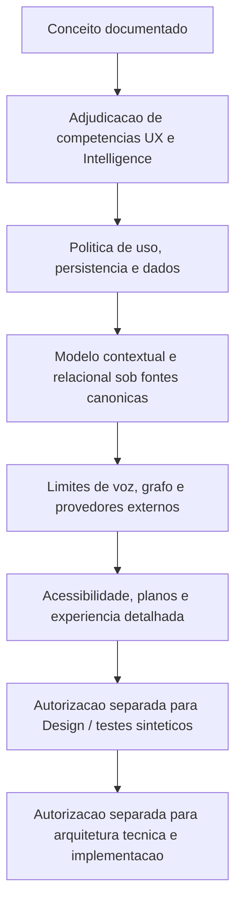

# Grafo Vivo — Quadro Consolidado de Prontidão Conceitual e Pendências de Adjudicação

> **Diagnóstico documental consolidado, condicionado e não normativo.** “Pronto conceitualmente” significa que existe material suficiente para análise e decisão — **não** que uma funcionalidade, tela, contrato, integração ou produto esteja autorizado para Design, engenharia, teste ou publicação. Não adjudica competências, não cria IDs oficiais nem altera autoridades vigentes.

## 1. Finalidade

Consolidar os treze estudos precedentes da seção **Grafo Vivo da Jornada da Pessoa**, identificando:
- proposições de experiência suficientemente descritas para nova decisão documental;
- limites de competência não resolvidos;
- bloqueios de privacidade, dados, segurança, acessibilidade e produto;
- dependências entre autorizações e implementação futura;
- roteiro de próximos dossiês, preservando fontes de verdade do GKR.

**Escopo:** somente Jornada da Pessoa, não outros participantes nem a Home pública. Separar Grafo Vivo individual do gráfico público de Oportunidades em Movimento.

## 2. Inventário de evidências documentais

| Nº local | Estudo existente | Contribuição consolidada | Alcance / limite |
| --- | --- | --- | --- |
| 01 | Leia Primeiro | Tese, decisões de estudo, fontes preservadas | Não é ato normativo |
| 02 | Visão Conceitual | Alternativa C: explorar, escutar e conversar; Contexto Vivo | Hipótese de produto |
| 03 | Arquitetura Conceitual e Integrações | Camadas, provedores candidatos e gates | Nenhum provedor definitivamente selecionado |
| 04 | Modelo de Nós, Relações e Memória | Famílias, relações, proveniência, simulações | Não cria ontologia PAS-001 |
| 05 | Experiência nos Quatro Momentos | Primeiro acesso, retorno, nova informação, relato narrado | Não aprova telas |
| 06 | Matriz de Responsabilidades e Fronteiras | Responsabilidades de Journey/Intelligence e canais | RACI apenas didática |
| 07 | Exame de Compatibilidade com PER-008 | Síntese Hoje versus exploração ampliada; alternativas A/B/C | Nenhuma alternativa adjudicada |
| 08 | Quadro Focal de Fronteiras Funcionais | F1 síntese; F2 grafo expandido; F3 narração; F4 conversa; F5 persistência | Não autoriza operações |
| 09 | Confronto dos Registries e Integrações | PER-007/008/010/011/012, TRN-006..013, dados entre camadas | Não cria novos handoffs |
| 10 | Ciclo de Vida da Informação Contextual | Captura, classificação, uso, persistência, correção e revogação | Não define política de dados |
| 11 | Gatilhos de Revalidação e Impacto | Confirmação proporcional, contradição, sensibilidade e impacto | Não define algoritmo nem thresholds |
| 12 | Sincronização e Versionamento | Snapshots, coerência, concorrência, derivativos e revogação | Não cria eventos ou APIs |
| 13 | Estados de Coerência e Recuperação | Falhas de voz/grafo, retomada, alternativas acessíveis | Não cria estados oficiais ou SLA |

A numeração acima serve somente ao índice deste estudo.

## 3. Termos de maturidade usados neste quadro

- **Documentado para exame:** existe hipótese e fundamento suficientes para confrontar competências.
- **Condicionado:** depende de regras ou decisões ainda não tomadas.
- **Bloqueado para materialização:** não é permitido inferir autorização operacional com base no material disponível.
- **Fora de escopo:** requer estudo separado, sem expansão automática.

Nenhuma marca significa “aprovado em produção” ou “pronto para engenharia”.

## 4. Matriz de prontidão por capacidade

| Capacidade | Maturidade documental | Dependência material | Pode avançar para Design/Engenharia? |
| --- | --- | --- | --- |
| Conceito do Grafo Vivo como representação de compreensão útil | Documentado para exame | Compatibilidade superior com GPA-006 / GIA-COG-001 | **Não**; apenas continuidade documental |
| Três modalidades Explorar / Escutar / Conversar | Documentado para exame | Posição funcional, responsabilidades e acessibilidade | **Não** |
| Síntese contextual em PER-008 — Hoje | Base vigente para síntese; modalidade adicional condicionada | Exame de CTA/estado permitido e extensão de finalidade | **Não** para o recurso novo |
| Exploração de subgrafo expandido | Condicionado | Surface/Transition Registry; fronteiras de domínio | **Não** |
| Nós/arestas temporais e explicáveis | Condicionado | Modelo PAS-001, proveniência, autorização de uso | **Não** |
| Cenários “e se...” isolados | Documentado para exame | Regras de sessão, reversibilidade e identificação | **Não** |
| Aprendizado Contextual Contínuo | Condicionado | Política recorrente de persistência e personalização; competência | **Não** |
| Gatilhos de confirmação proporcional | Condicionado | Critérios de risco, materialidade e sensibilidade | **Não** |
| Relatório narrado versionado | Condicionado | Fonte do conteúdo, proteção de áudio, escopo, acessibilidade | **Não** |
| Conversação por voz e interrupção | Condicionado | Direitos sobre dados, competência, latência, provedores | **Não** |
| Neo4j como memória/projeção relacional | Candidato técnico | Isolamento, modelo lógico, retenção e estado do sandbox | **Não** |
| Grok/xAI para TTS e Speech-to-Speech | Candidato priorizado para avaliação | Segurança/privacidade, contrato, custo, qualidade, integração | **Não** |
| Gemini STT / alternativas | Candidato pré-existente | Qualidade, revisão, processamento e fornecedor | **Não** |
| GPT/Claude/Gemini como motores cognitivos | Candidatos | Orquestração GIA, proveniência, privacidade, roteamento | **Não** |
| Sincronização, versões e recuperação | Documentado para exame | Protocolos, estados oficiais, observabilidade, revogação | **Não** |
| Aplicação a outras Jornadas ou participantes | Fora de escopo | Nova avaliação e decisão expressa | **Não** |

## 5. Gates consolidados de adjudicação

| Gate local | Decisão necessária | Autoridades/consultas | Consequência enquanto aberto |
| --- | --- | --- | --- |
| **G-UX** | Definir lugar funcional de síntese, grafo expandido, narração, conversa | UX/Journey, PER-008, Surface Registry e Transition Registry | Nenhum novo acesso ou superfície |
| **G-COG** | Delimitar compreensão, atualização, inferência e competência semântica | GPA-006, GIA-COG-001, Guivos Intelligence | Nenhum motor pode decidir por domínio |
| **G-DATA** | Regras de captura, sessão, persistência, personalização, correção e revogação | PER-007, Dados, Privacidade, Jornada, PAS-001 | Não consolidar fatos automaticamente |
| **G-GRAPH** | Resolver entidade, relação, proveniência, temporalidade e fonte canônica | PAS-001, Dados, GIA, ADR-007 | Não transformar projeção em fonte de verdade |
| **G-VOICE** | Dados mínimos a provedores, TTS, diálogo, transcrição, retenção, custo e falhas | GIA, Segurança, Jurídico/Privacidade, Engenharia | Não enviar dados pessoais a Grok/Gemini |
| **G-ACCESS** | Equivalência entre grafo, texto e voz; mobile e tecnologias assistivas | UX, Acessibilidade | Não tornar modalidade única obrigatória |
| **G-COMM** | Verificar aderência aos planos e limites vigentes | Autoridades de Planos e Produto | Não inventar preço, quota ou entitlement |
| **G-ENG** | Arquitetura de integração, rollback, segurança, observabilidade e validação | Engenharia, Segurança, Dados, GIA | Sem API, deploy, teste real ou migração |

Os nomes G-* são **marcadores locais de análise**, não IDs oficiais ou gates já adotados pela governança da Guivos.

## 6. Dependências e ordem lógica de resolução

O fluxograma representa **dependência documental sugerida**, não processo de aprovação já vigente. Uma etapa posterior não pode ser considerada autorizada pela mera conclusão de uma anterior.

## 7. Fronteiras decisórias — o que a direção ainda não escolheu

### 7.1 Posicionamento na Journey

- **A:** modalidades discretas de explicação em Hoje;
- **B:** Hoje como entrada, expansão sob competência que exige adjudicação;
- **C:** distribuição em superfícies existentes com coordenação de Intelligence.

A alternativa B foi sugerida para novo exame, **não escolhida**. Não criar PER-ID nem navegação direta entre PER-010, 011 e 012.

### 7.2 Persistência recorrente

A proposta de aprender com novas informações na conversa não altera PER-007. É necessário estabelecer, por autoridade competente, quais usos temporários/recorrentes são permitidos e quais exigem ação consciente. Um aviso discreto pode facilitar transparência, mas nunca ser tratado como autorização inexistente.

### 7.3 Modelo técnico

Nenhum componente foi contratado como solução final. A distinção **contexto governado / projeção Neo4j / visualizador / motor de voz** é conceitual. O Grok/xAI continua candidato preferencial para avaliação de voz, não fonte autônoma de memória.

### 7.4 Atualização multimodal

Definir critérios formais para versão vigente, versão anterior, conflito, revogação, correção, interrupção e nova narração. Não exigir sincronização instantânea quando ela comprometer segurança ou veracidade.

## 8. Riscos residuais prioritários

| Risco | Possível consequência | Evidência exigida antes de materialização |
| --- | --- | --- |
| Interpretação de fala como fato | Memória incorreta e recomendações equivocadas | Controles de transcrição e confirmação |
| Persistência indevida | Violação de finalidade e confiança | Autorizações distintas e retenção definida |
| Inferência sem proveniência | Grafo enganoso, causalidade presumida | Fonte, versão e natureza da relação |
| Confusão entre nós e objetos de domínio | Objetivos ou experiências alterados sem decisão | Integração sob PAS-001 e contratos de superfície |
| Vazamento em provedores de voz/modelos | Exposição de contexto pessoal | Contratos, minimização e segurança |
| Revisão/revogação incompleta | Reuso de dados em áudio/cache e outras sessões | Política de derivados e propagação |
| Falhas e versões concorrentes | Relatórios contraditórios apresentados como atuais | Governança de versões, idempotência e recuperação |
| Experiência visual inacessível | Barreiras a pessoas que não usam grafos | Equivalência textual/voz, teclado e mobile |
| Ampliação comercial indevida | Restrições ou incentivos sem base vigente | Confronto com contratos de Planos |

## 9. Critérios de suficiência documental para decisão futura

Um pedido de avanço a Design/Engenharia deveria, antes de mais nada, demonstrar documentalmente:
1. quais superfícies e transições abrigam cada ação e em que estado;
2. qual autoridade governa cada informação e efeito;
3. quais permissões válidas distinguem sessão, persistência, personalização e eventual compartilhamento;
4. como fatos, inferências, evidências e hipóteses são distinguíveis;
5. como versões, correções, revogações, falhas e retomadas são tratadas;
6. qual conteúdo mínimo pode atravessar cada integração externa;
7. como a Pessoa acessa o mesmo essencial por grafo, texto e voz;
8. quais diferenças por plano têm fundamento oficial, se aplicáveis;
9. quais riscos técnicos permanecem abertos e quem os avalia;
10. qual ato expresso e competente autoriza a etapa seguinte.

**Nenhum dos critérios é declarado satisfeito para implementação neste quadro.**

## 10. Próxima atividade recomendada

Preparar um **Dossiê de Competências e Adjudicação de Entrada Funcional**, confrontando PER-008, os Registries e a Guivos Intelligence, com alternativas A/B/C e seus efeitos, **sem selecionar uma alternativa por inferência**. Depois, preparar exames separados de memória/privacidade e de integrações de voz.

Evitar produzir uma nova sequência de documentos que repita conclusões sem resolver competências: os próximos dossiês devem buscar **decisões explícitas, dependências verificáveis e responsáveis pela resolução**.

## 11. Parecer de consolidação

A **concepção do Grafo Vivo está suficientemente descrita para exame arquitetural dirigido**, mas **não está pronta para Design operacional, integração, prototipação autorizada, testes ou Engenharia**.

O bloqueio dominante não é carência de opções tecnológicas. É falta de adjudicação sobre **posição na Jornada, autoridade para consolidar novas informações e circulação de dados entre os componentes**.

**Estado final:** consolidação documental em rascunho, sem seleção final de alternativas, novos IDs oficiais, alterações normativas, testes, implementação, merge, publicação ou uso de dados reais em provedores.
