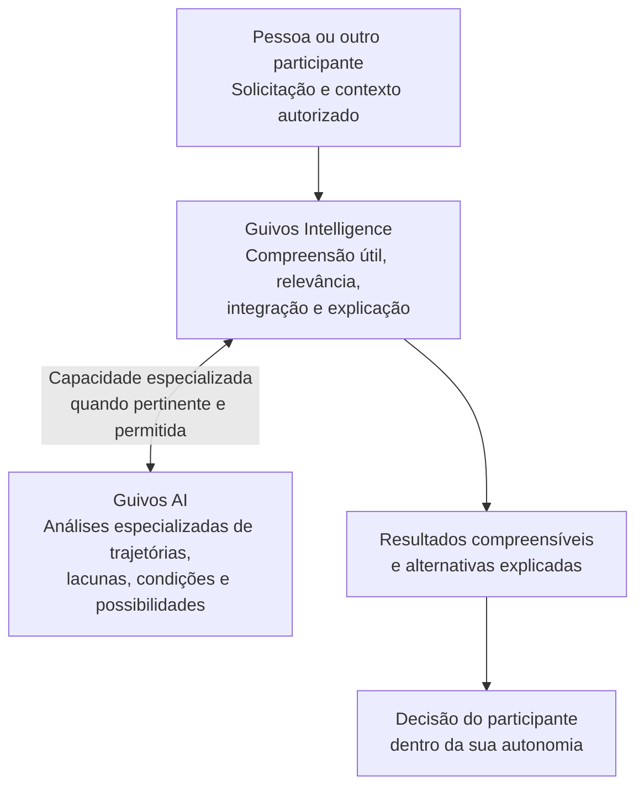

# Apresentação da Guivos AI

## **Inteligência de Trajetórias, Possibilidades e Evolução**

> **Compreender o presente, aprender com a trajetória e identificar as condições e oportunidades que podem tornar novas possibilidades futuras mais acessíveis.**

**Uma inteligência que busca compreender não apenas o que uma pessoa faz, mas também o que viveu, o que deseja, quais caminhos considera possíveis e o que pode ajudá-la a avançar.**

A Guivos AI foi concebida para transformar informações autorizadas, experiências, conhecimentos e relações em **análises fundamentadas sobre trajetórias, contextos, lacunas e possibilidades**. Não se limita a responder perguntas: sua especialização é ajudar a compreender a ligação entre o momento atual, os caminhos já percorridos e os futuros que uma pessoa gostaria de construir.

Esta é uma apresentação de leitura simples da visão e das capacidades pretendidas. **Os exemplos mostram como a Guivos AI poderá funcionar**, não funcionalidades já comprovadamente disponíveis.

---

## 1. Por que a Guivos AI existe?

Pessoas não vivem apenas uma atividade de cada vez. Elas estudam, trabalham, viajam, compram, praticam esportes, convivem, aprendem e mudam de planos. Também mantêm desejos que ainda não realizaram: visitar outro lugar, cursar uma faculdade, começar a correr, melhorar de profissão, organizar a vida financeira ou participar de uma experiência nova.

Essas informações costumam ficar dispersas: um interesse em viajar aparece em uma conversa; um curso desejado, em outra plataforma; um objetivo profissional, em um currículo; uma corrida realizada, no histórico de experiências. Isoladas, contam apenas parte da história.

A proposta da Guivos AI é **compreender relações relevantes entre essas informações, dentro das permissões concedidas**, para ajudar a identificar o que já faz parte da trajetória, o que a pessoa procura e quais condições poderiam aproximá-la de seus objetivos.

**A Guivos AI não define o que é uma vida melhor. Ela busca ampliar a compreensão para que cada pessoa faça suas próprias escolhas.**

## 2. O que a Guivos AI é?

A Guivos AI é a **Inteligência de Trajetórias, Possibilidades e Evolução**: a identidade das capacidades governadas de inteligência artificial do ecossistema Guivos, com foco em especialização e análise.

Seu papel central é **produzir conhecimento analítico fundamentado**. Ela examina contextos, trajetórias, evidências, oportunidades, lacunas, compatibilidades e hipóteses sobre caminhos possíveis.

Pode apoiar a Guivos Intelligence e, conforme contratos e autorizações específicos, poderá fornecer análises especializadas a sistemas externos.

Uma distinção importante: **Guivos AI e Guivos Intelligence não são a mesma coisa.** Guivos AI concentra capacidades analíticas especializadas; Guivos Intelligence é o produto transversal que transforma dados e conhecimento autorizados em compreensão útil para as experiências do ecossistema, preservando as responsabilidades de cada participante e produto.

## 3. O que é a Guivos Intelligence e para que ela existe?

A **Guivos Intelligence** é o **Produto Especializado transversal da Guivos**, também chamado de **Intelligence Layer** do ecossistema. Sua função é transformar dados autorizados, conhecimentos, evidências, contextos e relações em **compreensão útil e contextualizada**.

Em palavras simples, a Guivos Intelligence procura ajudar cada participante a entender **o que é relevante para seu momento e quais possibilidades merecem ser examinadas**, considerando a finalidade e as condições da experiência. Para isso, pode relacionar informações, interpretar contextos, avaliar relevância, identificar possibilidades, apresentar análises e explicar suas conclusões.

**Sua finalidade não é escolher pela pessoa, e sim ampliar a capacidade de compreensão para decisões mais conscientes.**

### Duas frentes de valor

A Guivos Intelligence tem, em sua arquitetura de produto, duas frentes superiores de atuação:

- **Pessoa / Journey:** apoiar a compreensão do contexto individual autorizado, a descoberta de possibilidades e as escolhas da própria Pessoa, respeitando sua autonomia.
- **Business / População:** ajudar a compreender movimentos, tendências e necessidades coletivas por meio de informações **agregadas e protegidas**, sem expor a intimidade das jornadas individuais a empresas.

Pessoas, **Profissionais**, Organizações e Coletivos também fazem parte do ecossistema como participantes ou contextos de atuação. A inclusão do Profissional como ofertador de oportunidades **não cria automaticamente uma terceira frente superior de produto na Guivos Intelligence**, nem autoriza compartilhar dados de jornadas privadas.

A Intelligence pode servir diferentes produtos do ecossistema, como Journey, Mall, Travel, Business, Media e Ads, **dentro das autoridades e contratos de cada um**. Ela não se reduz a um painel de indicadores, chatbot, modelo de linguagem ou banco de dados.

### A finalidade de cada uma — Guivos AI e Guivos Intelligence

| Questão | **Guivos AI** | **Guivos Intelligence** |
| --- | --- | --- |
| **O que é?** | Conjunto governado de capacidades de IA com especialização analítica | Produto transversal e Intelligence Layer do ecossistema |
| **Finalidade** | Compreender trajetórias, contextos, lacunas e condições para possibilidades futuras | Transformar informações e conhecimentos autorizados em compreensão útil para participantes e produtos |
| **Papel principal** | **Especializar e analisar** | **Conectar, contextualizar e servir compreensão** |
| **O que pode produzir?** | Análises, evidências, hipóteses e relatórios especializados | Insights, análises, avaliações de relevância, possibilidades e recomendações explicáveis |
| **Para quem?** | Guivos Intelligence e, futuramente, sistemas externos autorizados por API | Pessoas em sua Journey, frente Business com informação agregada e outros consumidores legítimos do ecossistema |
| **O que não faz?** | Não decide pela Pessoa nem assume autoridade de produto | Não assume decisões dos participantes nem expõe dados individuais a terceiros por mera conveniência |

Há responsabilidades que se encontram, como interpretar e explicar. **A diferença não é que uma analisa e a outra jamais analisa:** a Intelligence tem responsabilidades analíticas próprias enquanto produto. A Guivos AI representa capacidades **especializadas** que podem contribuir com análises para ela ou outros consumidores autorizados. A Intelligence mantém a autoridade sobre a finalidade do seu produto e a forma como a compreensão é oferecida.

### Como elas se relacionam na prática?

Imagine uma pessoa que **já participou de corridas**, deseja **fazer uma meia maratona**, tem interesse em **viajar para outra cidade** e gostaria de aproveitar essa viagem para participar de um evento esportivo.

1. **A Pessoa expressa sua intenção** na experiência apropriada do ecossistema, juntamente com informações que decida fornecer.
2. **A Guivos Intelligence considera a solicitação e o contexto autorizado**, identificando o tipo de compreensão que poderia ajudar aquela Pessoa.
3. **A Guivos AI pode contribuir com análise especializada:** relacionar o histórico informado, a intenção futura, oportunidades existentes, requisitos e condições relevantes, sem interpretar desejos como realizações nem assegurar resultados.
4. **A Guivos Intelligence pode integrar essa contribuição** com outros conhecimentos e condições autorizadas e apresentar à Pessoa explicações, perguntas, opções e oportunidades pertinentes.
5. **A Pessoa decide** se deseja seguir alguma possibilidade, corrige interpretações e determina seus próprios próximos passos.

O exemplo descreve **uma relação funcional possível**, não um fluxo de software já implementado nem a obrigação de que toda solicitação passe por dois sistemas separados.

### Por que essa separação é importante?

Ela evita confundir **a capacidade analítica especializada** com **o produto responsável por oferecer compreensão**. Também impede presumir que uma tecnologia possa, sozinha, decidir quem deve receber uma oportunidade, quais informações poderão ser compartilhadas ou o que é melhor para alguém.

A Guivos AI tem ainda uma **direção estratégica de disponibilizar inteligência especializada a parceiros e plataformas externas por API**, mediante contratos e autorizações futuros. Essa via não equivale a disponibilizar a Guivos Intelligence inteira a terceiros, nem concede acesso automático a informações pessoais de participantes.

Em ambas, o princípio é o mesmo: **compreender não é decidir; compreender profundamente não é autorizar exposição profunda**.

Para a definição oficial de produto, consulte [GPA-006 — Guivos Intelligence](../product-architecture/intelligence.md). Para a identidade da Guivos AI, consulte [Inteligência de Trajetórias, Possibilidades e Evolução](inteligencia-de-trajetorias-possibilidades-e-evolucao.md).

## 4. O que a Guivos AI busca compreender?

Ela considera duas dimensões da vida que devem ser distinguidas:

- **O que já aconteceu ou está acontecendo:** experiências realizadas, cursos concluídos ou em andamento, viagens feitas, atividades praticadas, compras registradas em contexto autorizado, mudanças e resultados.
- **O que ainda é intenção, desejo ou possibilidade:** lugares que a pessoa gostaria de conhecer, algo que pretende comprar, cursos que deseja fazer, atividades que quer experimentar, oportunidades que procura e o lugar a que espera chegar na vida.

**Querer fazer não é o mesmo que já ter feito.** Uma intenção não pode ser registrada como experiência concluída; um interesse não comprova uma necessidade; uma compra não revela, sozinha, a motivação de quem a fez.

### Exemplos do cotidiano

| Área | O que viveu ou faz | O que deseja ou considera | Como a análise poderia ajudar |
| --- | --- | --- | --- |
| **Viagens e lugares** | Conheceu uma cidade, participou de um passeio ou realizou uma viagem | Gostaria de visitar outro destino, fazer intercâmbio ou conhecer uma cultura | Relacionar interesses, experiências, período disponível, custos, acessibilidade e condições para viajar |
| **Shopping, produtos e serviços** | Comprou um produto ou utilizou um serviço em ambiente autorizado | Quer adquirir outro produto, comparar alternativas ou planejar uma compra | Compreender preferências declaradas, requisitos, orçamento e opções pertinentes, sem presumir consumo por simples interesse |
| **Cursos e faculdades** | Fez cursos, estudou determinada área ou concluiu uma formação | Deseja ingressar em uma faculdade, obter certificação ou aprender outra habilidade | Identificar requisitos, conhecimentos prévios, lacunas, recursos e caminhos de aprendizagem |
| **Corridas, esportes e saúde** | Participou de uma corrida, praticou atividade física ou registrou uma experiência | Quer correr determinada distância, iniciar uma prática ou participar de um evento | Relacionar experiência, disponibilidade e oportunidades, sem substituir orientação profissional de saúde |
| **Trabalho e carreira** | Ocupou funções, desenvolveu competências e participou de projetos | Pretende mudar de área, conquistar uma oportunidade ou empreender | Identificar competências, exigências, possibilidades de preparação e oportunidades compatíveis |
| **Ações e participação** | Participou de ações sociais, encontros, coletivos ou atividades comunitárias | Quer contribuir com uma causa, encontrar um coletivo ou realizar nova ação | Descobrir iniciativas e formas de participação alinhadas ao interesse e às condições declaradas |
| **Vida pessoal e projetos** | Viveu experiências, adquiriu hábitos e redefiniu prioridades | Deseja organizar tempo, melhorar a vida financeira ou realizar um projeto | Tornar mais visíveis etapas, recursos necessários, alternativas e restrições |

Esses exemplos **não autorizam monitoramento contínuo de localização, histórico de compras, saúde, dispositivos ou plataformas externas**. Cada fonte precisa ter uma finalidade legítima, uma base adequada de autorização e controles compatíveis com a sensibilidade da informação.

## 5. Como ela aprende?

Aprender, na Guivos AI, não significa vigiar pessoas ou simplesmente guardar tudo o que fazem. Significa **aprimorar a compreensão por meio de informações apropriadas, evidências e correções**, dentro de regras de privacidade, finalidade e governança.

### 4.1 O que a própria pessoa informa

A pessoa pode expressar, por exemplo: “Quero conhecer Lisboa”, “Gostaria de voltar a estudar”, “Pretendo fazer minha primeira corrida de 10 km” ou “Quero organizar uma compra importante”.

Essas declarações ajudam a compreender **objetivos, interesses e intenções**, que continuam sendo revisáveis.

### 4.2 O que a pessoa efetivamente vive

Quando uma experiência relevante é registrada legitimamente, é possível diferenciar o desejo anterior do acontecimento real. Uma pessoa pode ter buscado um curso, realizado a matrícula e concluído a formação. Cada etapa produz uma informação diferente.

O mesmo vale para viajar, comprar, praticar atividades, participar de encontros, desenvolver projetos ou aproveitar oportunidades.

### 4.3 O conhecimento disponível no mundo

Estudos, informações técnicas, universidades, instituições, especialistas e fontes confiáveis podem oferecer contexto para análises. Essas fontes precisam ser avaliadas: nem toda informação publicada é verdadeira, atual ou adequada para uma pessoa específica.

### 4.4 O que o ecossistema aprende de forma protegida

Experiências e resultados podem revelar padrões agregados e tendências, respeitando privacidade, limitações de uso e proteção de informações individuais. Um padrão coletivo não deve ser convertido em afirmação sobre alguém sem fundamento.

### 4.5 O que muda com o tempo

As pessoas mudam. Um objetivo pode deixar de fazer sentido; uma preferência pode ser corrigida; uma oportunidade pode acabar; um novo interesse pode surgir.

Por isso, a Guivos AI deve tratar a compreensão como **viva, temporal e corrigível**, e não como um perfil definitivo.

## 6. Como ela transforma informações em possibilidades?

Imagine uma pessoa que pretende fazer uma viagem internacional, deseja aprender um idioma e procura melhorar suas oportunidades profissionais. Em vez de tratar cada desejo isoladamente, a análise poderia:

1. **Ouvir e compreender:** identificar o que a pessoa deseja, seu momento atual e suas prioridades.
2. **Consultar informações autorizadas:** considerar experiências declaradas, disponibilidade, orçamento, formação e fontes relevantes.
3. **Relacionar:** perceber que idioma, destino, estudos e carreira podem se conectar, sem presumir que essa conexão seja verdadeira para todas as pessoas.
4. **Identificar lacunas e condições:** reconhecer o que ainda falta esclarecer — por exemplo, requisitos, custos, prazo ou nível do idioma.
5. **Examinar possibilidades:** apresentar alternativas de preparação, experiências e oportunidades potencialmente pertinentes.
6. **Explicar:** mostrar o que sustenta a análise, o que é hipótese e o que ainda não se sabe.
7. **Aprender com a resposta:** permitir que a pessoa aceite, rejeite ou corrija as interpretações e atualize seu contexto, dentro das regras de uso e retenção.

O resultado não precisa ser uma única recomendação. Pode ser **uma explicação, uma pergunta importante, uma comparação, um conjunto de caminhos ou a constatação de que ainda faltam informações**.

## 7. Uma inteligência que conecta momentos diferentes

A especialização da Guivos AI considera três perguntas complementares:

| Olhar | Pergunta | Para que serve |
| --- | --- | --- |
| **Trajetória — retrospectivo** | O que aconteceu? | Compreender experiências registradas e aprendizados possíveis |
| **Momento atual — contextual** | O que está acontecendo? | Interpretar objetivos, recursos, condições e dificuldades presentes |
| **Possibilidades — prospectivo** | O que pode acontecer? | Examinar alternativas, condições e oportunidades futuras sem prometer resultados |

Essas são **perspectivas de análise**, não três sistemas obrigatórios nem mecanismos de previsão infalíveis.

Uma pessoa que já fez três corridas, por exemplo, pode desejar participar de uma meia maratona. O histórico ajuda a contextualizar a conversa; o momento atual permite reconhecer disponibilidade e limitações; o futuro envolve hipóteses e condições a verificar. A Guivos AI não deve concluir automaticamente que essa pessoa está pronta para a prova ou indicar condutas clínicas.

## 8. O que ela entrega?

A Guivos AI tem como entregas conceituais:

- **Análises:** compreensão fundamentada de contextos, relações e trajetórias.
- **Evidências:** informações e fontes que sustentam uma conclusão, quando disponíveis.
- **Hipóteses:** explicações e cenários possíveis, claramente identificados como hipóteses.
- **Relatórios:** organização compreensível de achados, lacunas, condições, limites e possibilidades.

Uma análise confiável deve distinguir o que foi informado, o que foi observado de modo legítimo, o que foi calculado e o que foi inferido. Também deve reconhecer incertezas e evitar apresentar uma hipótese como certeza.

## 9. Como a Guivos AI se relaciona com o ecossistema?

No relacionamento conceitual definido pela Direção:

**Ecossistema Guivos (Pessoas, Profissionais, Organizações e Coletivos) ⇄ Guivos Intelligence ⇄ Guivos AI**

Pessoas, Profissionais, Organizações, Coletivos e produtos fazem parte do ambiente de experiências e oportunidades. A Guivos Intelligence pode consumir capacidades especializadas da Guivos AI por interfaces controladas para apoiar compreensão, coordenação e apresentação de resultados, sempre segundo as autoridades de cada produto.

A Guivos AI também tem uma **direção estratégica de oferecer inteligência especializada por API** a parceiros e plataformas externas autorizados. Isso permitiria consumir certos serviços analíticos sem necessariamente utilizar a mesma interface da Guivos Intelligence.

**Não significa** que parceiros tenham acesso à vida privada das pessoas nem que APIs, produtos comerciais e integrações estejam disponíveis hoje. Esses serviços dependem de contratos, controles e decisões posteriores.

## 10. O que torna a Guivos AI diferente de uma IA que apenas responde perguntas?

Seu diferencial conceitual não é simplesmente conversar ou responder com rapidez. É **trabalhar com relações, contexto, tempo, evidência e possibilidades**.

Uma resposta isolada pode explicar como entrar em uma faculdade. Uma análise contextual — quando solicitada e autorizada — pode considerar qual curso a pessoa deseja, o que já estudou, sua disponibilidade, os requisitos de ingresso e diferentes caminhos de preparação.

Da mesma forma, pode analisar uma viagem desejada considerando experiências anteriores e condições atuais, ou uma compra pretendida considerando necessidades declaradas e recursos disponíveis.

Em todos os casos, a inteligência **apoia a compreensão, mas não assume o controle das escolhas**.

## 11. E a evolução das pessoas?

Para a Guivos, evolução não deve ser confundida com acumular compras, diplomas, viagens ou resultados padronizados.

Uma pessoa pode considerar uma mudança importante viajar para um novo lugar; outra, começar a estudar; outra, participar de uma comunidade; outra, encontrar maior estabilidade; outra, realizar um projeto pessoal. **O significado de evolução pertence ao contexto e às escolhas da própria pessoa.**

A Guivos AI busca compreender como experiências, intenções, oportunidades, condições e aprendizados se relacionam ao longo do tempo. Seu papel não é impor um destino, mas contribuir para que as pessoas enxerguem **mais possibilidades reais e os passos necessários para explorá-las**.

## 12. Confiança, liberdade e limites

A proposta da Guivos AI depende de princípios fundamentais:

- **Escolha e controle:** a pessoa deve poder corrigir, contestar ou rejeitar interpretações.
- **Privacidade:** dados pessoais só podem ser utilizados dentro de finalidades, permissões e restrições legítimas.
- **Transparência:** análises devem separar fatos, opiniões, hipóteses e incertezas.
- **Respeito ao contexto:** uma ação não comprova intenção; um desejo não comprova decisão; uma correlação não prova causa.
- **Sem manipulação comercial:** o patrocínio ou interesse econômico não pode redefinir silenciosamente o que é mais relevante para a pessoa.
- **Autonomia preservada:** a Guivos AI não substitui pessoas, especialistas ou instituições responsáveis.
- **Aprendizado responsável:** armazenamento, atualização, compartilhamento e eventual treinamento de modelos exigem bases e controles próprios; não são autorizados automaticamente por uma interação.

## 13. O futuro que a Guivos AI pretende tornar possível

Imagine compreender sua trajetória sem precisar reconstruir toda a sua história a cada nova pergunta. Imagine poder relacionar um curso que deseja fazer, um lugar que gostaria de visitar, uma corrida que pretende completar, uma oportunidade de trabalho e um projeto de vida — **sem tratar essas escolhas como acontecimentos garantidos ou transformá-las em obrigações**.

A Guivos AI foi concebida para aproximar essas informações por meio de conhecimento, análise e contexto, revelando perguntas e caminhos que talvez não fossem tão claros quando vistos separadamente.

**Seu propósito é compreender o presente, aprender com a trajetória e contribuir para que novas possibilidades futuras se tornem mais acessíveis — sempre com a liberdade de escolha da pessoa.**

---

## A participação do Profissional como ofertador

Profissionais também fazem parte do ecossistema como **ofertadores de oportunidades**, conforme suas competências, responsabilidades e condições aplicáveis. A Guivos AI poderá examinar, de modo autorizado, conhecimentos, atividades e oportunidades desses Profissionais em conjunto com outros caminhos possíveis, sem acesso automático à trajetória privada de quem procura oportunidades. A inclusão não significa que todos os fluxos e permissões do Profissional já estejam disponíveis.

Consulte o [participante Profissional](../participants/professional.md).

## Sobre esta apresentação

**Natureza:** apresentação institucional e explicativa da visão da Guivos AI, destinada a qualquer leitor.

**Base documental:** [Diretriz conceitual Guivos AI](inteligencia-de-trajetorias-possibilidades-e-evolucao.md), [GAI-001 — Modelo de conhecimento](../intelligence-architecture/knowledge-model.md), [GAI-002 — Manifesto](../intelligence-architecture/manifesto.md), [GPA-006 — Guivos Intelligence](../product-architecture/intelligence.md) e [GIA-COG-001 — Arquitetura cognitiva](../intelligence-architecture/cognitive-reference-architecture.md).

**Limite:** descreve a concepção e as capacidades pretendidas. Não declara disponibilidade comercial, implementação de sistemas, captura automática de compras ou deslocamentos, acesso a dados externos, integração efetiva por API ou autorização operacional. Esta apresentação não altera os documentos normativos.
