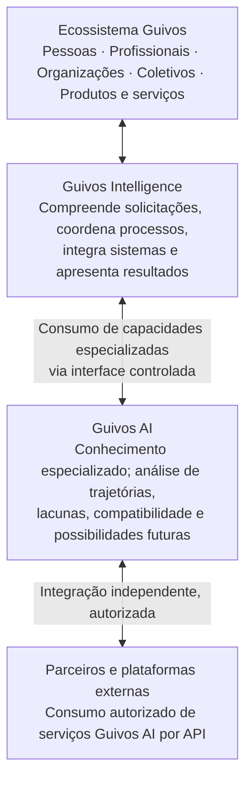

# Guivos AI — Inteligência de Trajetórias, Possibilidades e Evolução

## O que é a Guivos AI

> **Compreender o presente, aprender com a trajetória e identificar as condições e oportunidades que podem tornar novas possibilidades futuras mais acessíveis.**

Este enunciado é a formulação central fornecida pela Direção em 13/11/2026, preservada literalmente.

**Título conceitual principal:** **Inteligência de Trajetórias, Possibilidades e Evolução**.

A Guivos AI é tratada como a identidade das capacidades governadas de IA do ecossistema, com especialização analítica em trajetórias, contextos, lacunas, compatibilidade e possibilidades futuras. Esta definição detalha a alternativa A anteriormente aprovada; a especialização **não constitui por si só novo produto, nova unidade independente ou autoridade superior à Guivos Intelligence**.

## 1. Papel de cada componente — Guivos AI

| Dimensão | Diretriz apresentada |
| --- | --- |
| **Papel central** | Especialização e análise |
| **Responsabilidade** | Produzir conhecimento analítico fundamentado |
| **Foco** | Trajetórias, contextos, possibilidades, lacunas e evolução |
| **Entrega** | Análises, evidências, hipóteses e relatórios |
| **Consumidores** | Guivos Intelligence e sistemas externos autorizados |
| **Comercialização** | Inteligência especializada por API |
| **Evolução** | Métodos e qualidade das análises |

**Interpretação de governança:** “comercialização por API” é uma **direção estratégica registrada**, não afirma que já exista oferta comercial, contratos, endpoint, preço, SLA, autenticação externa ou serviço implantado.

## 2. Como os componentes se relacionariam

O modelo abaixo registra a arquitetura **conceitual proposta pela Direção**, não um diagrama de implantação nem uma cadeia de autoridade universal.

### 2.1 Ecossistema Guivos

Pessoas, Profissionais, Organizações, Coletivos, produtos e serviços constituem o contexto em que informações, necessidades, experiências e oportunidades podem ser apresentadas e interpretadas segundo suas próprias permissões e autoridades.

**Profissionais** integram os participantes ofertadores de oportunidades, com identidade, atuação e condições próprias. Sua presença não altera automaticamente os contratos de outros participantes. Consulte [Profissional](../participants/professional.md).

### 2.2 Guivos Intelligence

No modelo de relacionamento fornecido, compreende solicitações, coordena processos, integra sistemas e apresenta resultados. **Essa descrição não substitui ou altera a autoridade GPA-006**, que define as responsabilidades do produto e seus limites. Orquestração, ferramentas e integração concreta dependem dos contratos competentes.

### 2.3 Guivos AI

Produz conhecimento analítico fundamentado, incluindo leitura de trajetórias, lacunas, compatibilidade, condições e possibilidades futuras. Seu papel é **especializado**, e seus outputs devem indicar fundamentos, evidências, hipóteses, incerteza e limites. **Não decide pela Pessoa nem pelos produtos consumidores**.

### 2.4 Parceiros e plataformas externas

Poderão consumir capacidades Guivos AI **por API, quando explicitamente autorizados**, com segregação de contexto, finalidade, identidade, escopo, controle de acesso, condições contratuais e limitações de divulgação.

**Integração independente** significa um canal de consumo conceitualmente distinto da experiência via Intelligence; **não significa independência da governança, acesso livre a dados da Journey ou serviço público já disponível**.

## 3. Perspectivas temporais compatíveis com o propósito

| Perspectiva | Pergunta orientadora | Entrega possível | Ressalva |
| --- | --- | --- | --- |
| Retrospectiva | O que aconteceu? | Trajetória registrada, experiências, evidências e mudanças | Histórico não prova intenção nem causalidade |
| Contextual | O que está acontecendo? | Momento atual, recursos, restrições, oportunidades e lacunas | Contexto pode ser incompleto ou mudar |
| Prospectiva | O que pode acontecer? | Condições, hipóteses, cenários e caminhos possíveis | Possibilidade não é certeza nem promessa |

O enunciado central integra naturalmente passado, presente e futuro. As três perspectivas constam também de [estudos não normativos](../experience-architecture/home-intelligence-guivos-ai-temporal-reconciliation-proposed.md); **a diretriz atual não as transforma em três motores, fluxos obrigatórios ou soluções já implementadas**.

## 4. Distinções fundamentais

| Guivos AI | Guivos Intelligence |
| --- | --- |
| Especialização e produção de conhecimento analítico fundamentado | Produto transversal com responsabilidade pela compreensão útil no ecossistema |
| Análises de trajetórias, lacunas, condições, hipóteses e possibilidades | Consumo e apresentação governados de inteligência no contexto de seus produtos e participantes |
| Capacidades potencialmente consumíveis por interfaces internas e APIs externas autorizadas | Mantém identidade e autoridade de produto próprias conforme GPA-006 |
| Qualidade metodológica, evidências, incerteza e explicabilidade das análises | Finalidade, experiência e contratos de consumo governados por sua autoridade |

**Não sobreposição:** Guivos AI não absorve Guivos Intelligence; Guivos Intelligence não transforma por si a Guivos AI em produto independente; nenhum consumidor ganha autoridade sobre dados pelo simples uso de API.

## 5. Diretrizes de qualidade das análises

- Distinguir **fato registrado**, **informação declarada**, **interpretação**, **inferência**, **hipótese** e **projeção**.
- Referenciar proveniência, temporalidade, finalidade, limitações e evidências quando aplicáveis.
- Analisar **condições que tornam possibilidades acessíveis**, não prometer resultados ou atribuir destinos a pessoas.
- Preservar a autonomia, correção e contestação por participantes.
- Não converter relevância em publicidade oculta nem acesso ampliado a dados individuais.
- Apoiar aprimoramento dos métodos e qualidade das análises, com avaliações e critérios ainda a especificar.

## 6. Fronteiras técnicas e comerciais pendentes

A direção de **Inteligência especializada por API** requer exames posteriores sobre: público e elegibilidade, catálogo de serviços, interfaces, consentimento, autenticação e autorização, classes de dados, anonimização/segregação, formato de evidências, níveis de serviço, auditabilidade, preços e modelo econômico, riscos, testes e gates de produção.

Nenhum desses itens é automaticamente aprovado ou implantado por este registro.

## 7. Proveniência e compatibilidade com o GKR

**Origem:** diretrizes textuais e dois esquemas apresentados pela Direção em 13/11/2026, incluindo a matriz de sete dimensões e o diagrama de relacionamento dos quatro componentes.

- [GAI-001 — Modelo de conhecimento da inteligência artificial](../intelligence-architecture/knowledge-model.md)
- [GAI-002 — Manifesto da Inteligência do Ecossistema](../intelligence-architecture/manifesto.md)
- [GPA-006 — Guivos Intelligence](../product-architecture/intelligence.md)
- [GIA-COG-001 — Arquitetura cognitiva de referência](../intelligence-architecture/cognitive-reference-architecture.md)
- [ADR-008 — Ownership da arquitetura cognitiva](../adr/ADR-008-cognitive-reference-architecture-placement-and-ownership.md)
- [Proposta temporal não normativa](../experience-architecture/home-intelligence-guivos-ai-temporal-reconciliation-proposed.md)

## 8. Estado e limites desta formalização

**Registrado como diretriz conceitual e estratégica expressa da Direção**, com título e propósito apresentados literalmente.

**Não autoriza:** merge automático de outras propostas, criação de nova unidade/produto, mudanças nas autoridades existentes, operação comercial, disponibilização de APIs, uso de dados reais, contratação de provedores, implantação, testes ou publicação funcional.

O registro documental na `main` serve à consulta no GKR; **publicação documental não constitui release de produto**.
