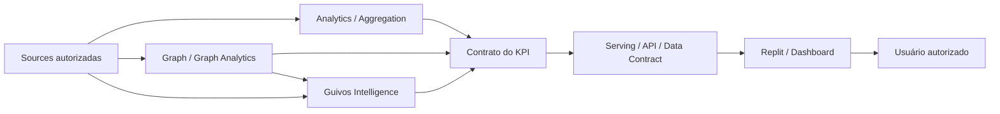

# Dashboards, KPIs e Analytics — Documento Mestre de Especificação para Construção

## 1. Finalidade

Este documento é a **autoridade documental mestre, pré-implementação, para a família de dashboards, KPIs e superfícies analíticas da Guivos**.

Ele organiza o que deverá ser entregue futuramente a uma superfície de construção — inicialmente indicada como **Replit** — sem obrigar Engenharia, Design ou fornecedores a reconstruir significado, fórmulas, acesso ou contexto a partir de conversas, tabelas isoladas ou inferências.

Regra de consumo:

> **Para construir qualquer dashboard da Guivos, comece por este master global e, em seguida, consuma o master especializado correspondente. A ferramenta materializa a especificação; ela não define a verdade do indicador.**

Este master:

- preserva a tabela original desta frente como **proveniência de trabalho**, não como autoridade canônica;
- governa regras comuns à família de dashboards;
- define a arquitetura master global + masters especializados;
- preserva o inventário candidato inicial de necessidades analíticas;
- define o envelope mínimo de contrato de KPI;
- define o modelo transversal de acesso e disclosure;
- define a cadeia lógica de dados, Graph, Intelligence, serving e Replit;
- define requisitos mínimos de handoff, qualidade, exceção e aceite;
- preserva autoridades especializadas de Produto, Journey, Business, Ads, Economia, Privacidade, Graph, Intelligence e Governança;
- **não autoriza**, por si só, dados reais, integração física, backend, persistência, produção, publicação ou acesso irrestrito a dados individuais.

---

## 2. Arquitetura documental da família

```text
GKR-INTELLIGENCE-DASHBOARD-KPI-001
→ MASTER GLOBAL
→ regras comuns
→ inventário / contexto transversal
→ KPI contract envelope
→ access / disclosure
→ integração lógica
→ handoff Replit

MASTERS ESPECIALIZADOS
→ um documento por dashboard / participante / grupo analítico
→ escopo próprio
→ catálogo próprio de KPIs e indicadores
→ filtros / dimensões / drill-down
→ acesso específico
→ fontes e integrações aplicáveis
→ instruções de construção
→ critérios de aceite
```

Regra estrutural:

```text
MASTER GLOBAL
≠ SOMA DOS KPIs DE CADA DASHBOARD

MASTER ESPECIALIZADO
≠ NOVA SOURCE OF TRUTH
≠ AUTORIZAÇÃO AUTOMÁTICA DE IMPLEMENTAÇÃO
```

### 2.1 Registry documental

| Anexo | Documento | Estado nesta versão |
|---|---|---|
| A | `GKR-INTELLIGENCE-DASHBOARD-GUIVOS-001` — Dashboard Guivos | MATERIALIZED DOCUMENTARILY / PRE-IMPLEMENTATION MASTER |
| B | `GKR-INTELLIGENCE-DASHBOARD-BUSINESS-001` — Dashboard Guivos Business | MATERIALIZED DOCUMENTARILY / PRE-IMPLEMENTATION MASTER |
| C | `GKR-INTELLIGENCE-DASHBOARD-ORGANIZATION-001` — Dashboard Organização | MATERIALIZED DOCUMENTARILY / PRE-IMPLEMENTATION MASTER |
| D | `GKR-INTELLIGENCE-DASHBOARD-COLLECTIVE-001` — Dashboard Coletivo | MATERIALIZED DOCUMENTARILY / PRE-IMPLEMENTATION MASTER |
| E | `GKR-INTELLIGENCE-DASHBOARD-PERSON-001` — Dashboard Pessoa | MATERIALIZED DOCUMENTARILY / PRE-IMPLEMENTATION MASTER |
| F | `GKR-INTELLIGENCE-DASHBOARD-ADS-001` — Ads / Opportunity Boost Analytics | MATERIALIZED DOCUMENTARILY / PRE-IMPLEMENTATION MASTER |

`MATERIALIZED DOCUMENTARILY` indica autoridade documental pré-implementação materializada; não cria, por si só, superfície operacional, dado real ou implementação.

### 2.2 Inventário candidato de necessidades analíticas

O escopo corrente reconhece seis necessidades analíticas candidatas. Elas permanecem sujeitas à adjudicação individual e não equivalem a dashboards implementados ou dados reais disponíveis.

#### Dashboard Guivos

Finalidade candidata: visão transversal do ecossistema e da empresa Guivos, incluindo, quando legitimamente definidos e disponíveis:

- Pessoas;
- Organizações;
- Coletivos;
- escolhas/declarações das Pessoas (apenas como necessidade candidata histórica, atualmente **bloqueada para analytics interno** pelo Anexo A; não constitui autorização de tratamento ou disclosure);
- oportunidades;
- dados demográficos;
- dados geográficos;
- vendas de planos;
- cadastros ativos/inativos;
- demais indicadores transversais autorizados.

O Anexo A detalha esse escopo sem autorizar dados reais ou implementação.

#### Dashboard Guivos Business

Finalidade candidata: KPIs do Guivos Business conforme a população legitimamente abrangida por cada relação Business, incluindo tendências, evolução temporal, distribuições e comparações permitidas.

```text
BUSINESS
→ PODE CONSUMIR LEITURA POPULACIONAL AUTORIZADA
→ NÃO RECEBE POR PADRÃO UM "INTELLIGENCE POR PESSOA"
→ NÃO HERDA CONTEXTO PRIVADO INDIVIDUAL
```

O Anexo B detalha esse escopo sem autorizar dados reais, implementação ou acesso individual além da autoridade aplicável.

#### Dashboard Organização

Finalidade candidata: leitura quantitativa da própria atuação da Organização e da população/relações sob autoridade aplicável, incluindo oportunidades, vendas, demografia, geografia e cadastros quando legitimamente definidos.

O Anexo C detalha esse escopo sem autorizar dados reais, implementação, materialização da Home autenticada ou acesso individual além da autoridade aplicável.

```text
DOCUMENTAÇÃO DO ANEXO C
≠ HOME AUTENTICADA DEFINIDA
≠ SURFACE MAP / STATE MAP
≠ DASHBOARD OPERACIONAL IMPLEMENTADO
```

#### Dashboard Coletivo

Finalidade candidata: leitura quantitativa de participação e atuação do Coletivo, incluindo Pessoas relacionadas, oportunidades, inscrições/participações, demografia, geografia e cadastros quando autorizados.

O Anexo D detalha esse escopo sem autorizar dados reais, implementação, materialização do Início autenticado ou acesso individual além da autoridade aplicável. `Inscrições` e `cadastros` permanecem proveniências candidatas separadas e bloqueadas até contrato semântico próprio; não são automaticamente solicitação, conta técnica, vínculo, pertencimento ou participação.

`Reputação` permanece bloqueada até possuir definição, fórmula, finalidade, autoridade de leitura, contestação e governança próprias.

```text
DOCUMENTAÇÃO DO ANEXO D
≠ INÍCIO AUTENTICADO DEFINIDO
≠ SURFACE MAP / STATE MAP
≠ DASHBOARD OPERACIONAL IMPLEMENTADO

REPUTAÇÃO
→ BLOCKED / NOT DEFINED
```

#### Dashboard Pessoa

Finalidade candidata: oferecer compreensão individual autorizada da própria trajetória, históricos, contextos, evolução, participações, relações, eventos e outputs de Graph Analytics/Intelligence quando legitimamente autorizados e explicáveis.

```text
DECLARADO ≠ OBSERVADO ≠ CALCULADO ≠ INFERIDO ≠ PREDITO
```

O Anexo E detalha esse escopo sem autorizar dados reais, implementação, redefinição de `Hoje`, `Meus Objetivos`, `Meus Próximos Passos` ou `Minha Evolução`, nem disclosure a terceiros além da autoridade aplicável.

```text
DOCUMENTAÇÃO DO ANEXO E
≠ HOJE / MEUS OBJETIVOS / MEUS PRÓXIMOS PASSOS / MINHA EVOLUÇÃO
≠ SURFACE MAP / STATE MAP
≠ DASHBOARD OPERACIONAL IMPLEMENTADO
```

#### Ads / Opportunity Boost Analytics

Necessidade candidata: dados de anúncios e Opportunity Boost do anunciante.

O Anexo F detalha esse escopo sem autorizar dados reais, implementação, pricing operacional, attribution, campaign manager, checkout, billing ledger ou acesso individual à Journey da Pessoa.

```text
MASTER ESPECIALIZADO
→ GKR-INTELLIGENCE-DASHBOARD-ADS-001
→ MATERIALIZED DOCUMENTARILY

CURRENT KPI CANDIDATES
→ 50
→ ALL proposed / NOT_READY

ATTRIBUTION
→ BLOCKED / MODEL NOT DEFINED
→ NO ADS-KPI-ATT-* MATERIALIZED

DOCUMENTAÇÃO DO ANEXO F
≠ HOME ADS
≠ CAMPAIGN MANAGER
≠ CHECKOUT
≠ BILLING LEDGER
≠ IMPLEMENTAÇÃO AUTORIZADA
```

---

## 3. Estado e limites

```text
DOCUMENTO MESTRE GLOBAL
→ ACTIVE
→ PRE-IMPLEMENTATION SPECIFICATION
→ NÃO NORMATIVO SOBRE FÓRMULAS NÃO ADJUDICADAS

REPLIT
→ TARGET INICIAL DE MATERIALIZAÇÃO / CONSTRUÇÃO
→ NÃO SOURCE OF TRUTH
→ NÃO DEFINE KPI
→ NÃO DEFINE AUTORIDADE

REAL DATA / REAL INTEGRATIONS / PRODUCTION
→ NÃO AUTORIZADOS POR ESTE DOCUMENTO

DASHBOARD DOCUMENTADO
≠ DASHBOARD IMPLEMENTADO
≠ DASHBOARD PUBLICADO
≠ DADO REAL CONECTADO
```

Quando uma autoridade de domínio mantiver uma superfície, relação, métrica ou capacidade como não definida, este master e seus anexos devem preservar esse estado.

A existência dos masters de Organização, Coletivo e Pessoa **não deve ser interpretada como materialização de Home/Início/Hoje autenticado, Surface Map, State Map, navegação, wireframe ou implementação desses participantes**.

---

## 4. Princípio arquitetural

```text
GKR / PRODUTO / GOVERNANÇA
→ define significado, finalidade, autoridade e limites

MASTER ESPECIALIZADO DO DASHBOARD
→ define escopo de consumo e catálogo analítico pretendido

CONTRATO DO KPI
→ define pergunta, fórmula, população, unidade, granularidade e fonte autorizada

DADOS / GRAPH / INTELLIGENCE / ANALYTICS
→ produzem ou disponibilizam inputs e outputs autorizados

SERVING / API / DATA CONTRACT
→ entrega o resultado na forma autorizada

REPLIT / OUTRA SUPERFÍCIE
→ materializa componentes, filtros, estados e visualizações

USUÁRIO AUTORIZADO
→ consome somente o recorte permitido por sua autoridade
```

Invariantes:

```text
DASHBOARD ≠ SOURCE OF TRUTH
VISUALIZAÇÃO ≠ DEFINIÇÃO DO KPI
FERRAMENTA ≠ PRODUTO
FERRAMENTA ≠ AUTORIDADE
OUTPUT AUTORIZADO ≠ DATASET DE ORIGEM
AGREGADO ≠ AUTOMATICAMENTE SEGURO
AUTORIDADE PARA PERSONALIZAR ≠ AUTORIDADE PARA COMPARTILHAR
ACESSO INTERNO ≠ ACESSO IRRESTRITO
CORRELAÇÃO ≠ CAUSALIDADE
INFERÊNCIA ≠ FATO
COMPREENDER ≠ DECIDIR
```

---

## 5. Modelo transversal de acesso

O acesso a um dashboard ou métrica não deve ser decidido somente por uma `role` técnica.

```text
IDENTIDADE AUTENTICADA
+
TIPO DE PARTICIPANTE / GRUPO
+
PAPEL FUNCIONAL
+
TENANT / PARTICIPANT SCOPE
+
RELAÇÃO LEGÍTIMA
+
FINALIDADE
+
SENSIBILIDADE DO DADO
+
AUTORIDADE DE DISCLOSURE
=
ESCOPO MÁXIMO DE LEITURA
```

### 5.1 Princípios

- um usuário pode possuir mais de um contexto legítimo, mas cada acesso deve operar no contexto selecionado;
- Organização não herda dados de outra Organização;
- Coletivo não herda dados de outro Coletivo;
- uma relação Business não dá acesso automático ao contexto privado de uma Pessoa;
- acesso interno da Guivos continua sujeito à finalidade, necessidade e classificação do dado;
- service accounts e integrações recebem apenas o mínimo necessário;
- filtros e drill-down respeitam a mesma política de acesso do indicador principal;
- exportação não pode ampliar disclosure.

### 5.2 Classes funcionais de consumo

As classes abaixo são funcionais e **não constituem RBAC técnico implementado**:

| Classe | Escopo conceitual |
|---|---|
| Guivos — visão executiva | visão transversal agregada necessária à governança |
| Guivos — operação/domínio | recorte operacional sob responsabilidade |
| Guivos — Data/Intelligence | dados necessários à finalidade analítica autorizada |
| Guivos — Financeiro/Economia | métricas econômicas autorizadas e auditáveis |
| Business | população e relação Business legitimamente abrangidas |
| Organização | dados próprios e relações sob sua autoridade |
| Coletivo | dados próprios e relações sob sua autoridade |
| Pessoa | próprios dados, Journey, históricos e outputs autorizados |
| Anunciante | próprias campanhas / Opportunity Boost e agregados autorizados |
| Replit / service account | somente payloads necessários à renderização autorizada |

---

## 6. Envelope mínimo do contrato de KPI

Nenhum KPI está pronto para implementação apenas porque seu nome aparece em tabela, conversa, planilha ou mockup.

Cada KPI deverá possuir, no mínimo:

| Campo | Obrigatoriedade | Função |
|---|---|---|
| KPI ID | obrigatória | identificador estável |
| Nome | obrigatória | nome humano |
| Pergunta que responde | obrigatória | compreensão/decisão suportada |
| Família / tipo | obrigatória | classificação |
| Dashboard consumidor | obrigatória | superfície consumidora |
| Público autorizado | obrigatória | quem pode consumir |
| Entidade / população | obrigatória | universo medido |
| Unidade de análise | obrigatória | entidade/evento elementar |
| Fórmula | obrigatória | definição matemática/lógica |
| Numerador | quando aplicável | componente superior |
| Denominador | quando aplicável | base da razão/taxa |
| Unidade | obrigatória | número, %, moeda, tempo, índice etc. |
| Direcionalidade | quando aplicável | maior/melhor, menor/melhor, faixa, contextual ou guardrail |
| Exclusões | obrigatória | o que não entra |
| Janela temporal | obrigatória | período de observação |
| Base de comparação | quando aplicável | baseline / período / grupo |
| Granularidade | obrigatória | pessoa, evento, dia, mês, população etc. |
| Dimensões / segmentos | quando aplicável | cortes autorizados |
| Filtros | quando aplicável | filtros autorizados |
| Fonte de verdade / fontes | obrigatória | origem autorizada |
| Natureza da evidência | obrigatória | declarada, observada, operacional, calculada, inferida, predita, estimada, proxy etc. |
| Freshness / atualização | obrigatória | frequência e atraso aceitável |
| Quality checks | obrigatória | verificações mínimas |
| Sensibilidade / access class | obrigatória | classificação de proteção |
| Accountable owner | obrigatória antes de operação | responsável pelo significado/uso |
| Calculation owner | obrigatória antes de operação | responsável pelo cálculo |
| Review cadence | quando aplicável | cadência de revisão |
| Retention rule | quando aplicável | retenção pertinente |
| Change log | obrigatória quando operacional | rastreabilidade de alterações |
| Regra de agregação | quando aplicável | forma de composição |
| Threshold de proteção | quando aplicável | mínimo para exposição agregada |
| Tratamento de nulos | obrigatória | regra para ausência |
| Proveniência | obrigatória | origem e transformação |
| Claims suportados | obrigatória | interpretações permitidas |
| Claims proibidos | obrigatória | interpretações não sustentadas |
| Confounders | quando aplicável | fatores de distorção |
| Incerteza | quando material | limites / intervalos / qualificação |
| Validações aplicáveis | obrigatória | conceptual, data, financial, accounting, legal/privacy/security conforme domínio |
| Visualização semântica | obrigatória antes do handoff | forma esperada de leitura |
| Critério de aceite | obrigatória | condição objetiva de validação |
| Status | obrigatória | proposed / defined / source_pending / approved-equivalent |
| Contratos de domínio | obrigatória | autoridades especializadas aplicáveis |

Regra de composição:

```text
CROSS-DOMAIN MINIMUM
+ APPLICABLE DOMAIN CONTRACT
= REQUIRED CONTRACT FOR READINESS
```

Indicadores econômicos — incluindo vendas de planos, vendas de oportunidades, receita ou métricas equivalentes — devem compor com `GEM-009-MEASUREMENT-CONTRACT-001` na versão/status aplicável. Este master não promove o estado de `GEM-009`.

Exemplo de bloqueio:

```text
"USUÁRIOS ATIVOS"
→ janela não definida
→ evento qualificante não definido
→ população não definida
→ source of truth não definida

RESULTADO
→ NÃO IMPLEMENTAR COMO KPI CANÔNICO
```

---

## 7. Requisitos transversais de dados e leitura

### 7.1 Temporalidade

```text
TOTAL ATUAL
≠ NOVOS NO PERÍODO
≠ ATIVOS 7D
≠ ATIVOS 30D
≠ MÊS CORRENTE
≠ ACUMULADO HISTÓRICO
```

Cada KPI temporal deve explicitar janela, timezone aplicável e regra de fechamento.

### 7.2 Granularidade

A superfície deve expor a menor granularidade necessária à finalidade autorizada, não a maior disponível tecnicamente.

### 7.3 Proveniência

Quando materialmente relevante, a leitura deve distinguir:

```text
DECLARADO
≠ OBSERVADO
≠ OPERACIONAL
≠ CALCULADO
≠ INFERIDO
≠ PREDITO
≠ AGREGADO
≠ CONHECIMENTO EXTERNO
≠ CONHECIMENTO GOVERNADO
```

`CONHECIMENTO EXTERNO` e `CONHECIMENTO GOVERNADO` são naturezas distintas: o primeiro provém de fora do corpus/contexto governado da Guivos; o segundo deriva de conhecimento interno ou de referência submetido à governança aplicável. Nenhum dos dois é sinônimo de dado pessoal observado.

### 7.4 Privacidade e disclosure

Antes de produção devem existir, quando aplicáveis:

- population scope;
- thresholds mínimos;
- supressão de células pequenas;
- regras de segmentação;
- controles de acesso;
- finalidade legítima;
- retenção;
- rastreabilidade;
- regras de exportação;
- regras de drill-down.

### 7.5 Explicabilidade

Quanto maior o impacto potencial de uma leitura, recomendação, score, tendência ou inferência, maior deve ser a explicabilidade exigida.

---

## 8. Arquitetura lógica de integração



As fontes autorizadas podem alimentar Analytics, Graph e/ou Intelligence conforme finalidade e autoridade aplicáveis. **Graph não é pré-requisito universal para um output de Intelligence.**

O desenho é lógico. Ele não determina topologia física, banco específico, API, serviço, linguagem ou infraestrutura.

### 8.1 Mapa de ferramentas — leitura governada da tabela de arquitetura

| Ferramenta / família | Papel indicado nesta frente | Estado governado |
|---|---|---|
| Neo4j | banco de dados grafo / memória; Graph Analytics | tecnologia primária de referência para grafo; não prova provisionamento/produção |
| GPT | IA/inteligência do ecossistema | candidato de provedor/modelo; não selecionado por este master |
| Anthropic | IA/inteligência do ecossistema | candidato de provedor/modelo; não selecionado por este master |
| Gemini | IA/inteligência do ecossistema | candidato de provedor/modelo; não selecionado por este master |
| Replit | construção de fluxos e dashboards | target inicial de materialização; não source of truth |
| Hostinger | armazenamento/bancos operacionais indicados no input | papel pretendido sujeito a arquitetura física e data contracts futuros |
| Figma | Design System | fonte de Design quando autorizado; não backend nem fonte de KPI |
| A definir | fontes de pesquisa / central de ajuda / elementos adicionais | decisão futura necessária |

```text
NEO4J = REFERENCE_SELECTED
≠ PROVISIONADO
≠ GRAPH ANALYTICS OPERACIONAL

GPT / ANTHROPIC / GEMINI
→ ALTERNATIVAS IDENTIFICADAS
→ NÃO SELECIONADAS POR ESTE MASTER

HOSTINGER
→ PAPEL INDICADO NO INPUT
→ NÃO É AUTOMATICAMENTE SOURCE OF TRUTH DE TODO DADO

REPLIT
→ MATERIALIZA ESPECIFICAÇÃO
→ NÃO INVENTA FÓRMULA, AUTORIDADE OU FONTE
```

---

## 9. Requisitos comuns de um dashboard especializado

Cada master especializado deve definir, quando aplicável:

1. objetivo e público consumidor;
2. escopo e não escopo;
3. catálogo de KPIs/indicadores;
4. entidades e populações;
5. filtros globais e locais;
6. dimensões e segmentações;
7. períodos e comparações;
8. drill-down permitido;
9. exportação permitida/proibida;
10. access/disclosure por grupo;
11. fontes e integrações lógicas;
12. estados de loading, vazio, dado insuficiente, erro e indisponibilidade;
13. qualidade/freshness;
14. semantic visualization contract;
15. critérios de aceite;
16. instruções específicas para o Replit;
17. itens bloqueados/TBD;
18. versão da especificação usada na construção.

---

## 10. Contrato de construção para Replit

Quando uma etapa de construção for explicitamente autorizada, o pacote entregue ao Replit deverá conter:

1. este master global vigente;
2. master especializado correspondente;
3. contratos aprovados/suficientemente definidos dos KPIs selecionados;
4. contratos canônicos de domínio aplicáveis;
5. data/serving contracts autorizados;
6. regras de autenticação, autorização e perfis de acesso;
7. regras de privacidade, agregação e disclosure;
8. Design System/especificações visuais quando autorizados;
9. estados de exceção;
10. critérios de aceite;
11. indicação clara de `mock data` versus `real data`;
12. versão do pacote usado na build.

Instrução obrigatória:

```text
SE KPI ESTÁ COMPLETO E APROVADO
+ CONTRATOS DE DOMÍNIO APLICÁVEIS ESTÃO SATISFEITOS
→ IMPLEMENTAR CONFORME CONTRATO

SE FÓRMULA ESTÁ AUSENTE
→ BLOCKED / TBD
→ NÃO INVENTAR

SE SOURCE OF TRUTH ESTÁ AUSENTE
→ BLOCKED / TBD
→ NÃO ESCOLHER BANCO POR CONVENIÊNCIA

SE AUTORIDADE DE ACESSO ESTÁ AUSENTE
→ NÃO EXPOR

SE ESCOPO AINDA É APENAS CANDIDATO
→ NÃO TRATAR COMO PRODUTO IMPLEMENTADO

SE APENAS MOCK DATA ESTÁ AUTORIZADO
→ SEPARAR MOCK DE INTEGRAÇÃO REAL

SE OUTPUT É INFERIDO / PREDITO
→ PRESERVAR NATUREZA, CONFIANÇA E EXPLICABILIDADE

SE HOUVER DRILL-DOWN
→ NÃO AMPLIAR A AUTORIDADE DO USUÁRIO
```

---

## 11. Definition of Ready de um KPI

```text
[ ] KPI ID definido
[ ] pergunta definida
[ ] família/tipo definido
[ ] população e unidade de análise definidas
[ ] fórmula definida
[ ] numerador/denominador definidos quando aplicáveis
[ ] unidade definida
[ ] direcionalidade definida quando aplicável
[ ] exclusões explicitadas
[ ] janela temporal definida
[ ] base de comparação definida quando aplicável
[ ] granularidade definida
[ ] source of truth / fontes definidas e autorizadas
[ ] natureza da evidência definida
[ ] freshness definida
[ ] quality checks definidos
[ ] sensibilidade / access class definida
[ ] público autorizado definido
[ ] accountable owner definido
[ ] calculation owner definido
[ ] review cadence definida quando aplicável
[ ] retention rule definida quando aplicável
[ ] regra de agregação/disclosure definida quando aplicável
[ ] tratamento de nulos definido
[ ] proveniência definida
[ ] supported / prohibited claims definidos
[ ] confounders registrados quando aplicáveis
[ ] incerteza qualificada quando material
[ ] validações aplicáveis registradas
[ ] contratos de domínio aplicáveis identificados e satisfeitos
[ ] visualização semântica especificada
[ ] estados de exceção definidos
[ ] critérios de aceite definidos
[ ] superfície consumidora documentalmente adjudicada
[ ] implementação explicitamente autorizada pelo gate aplicável
```

Falha material mantém o KPI em especificação, não em implementação canônica.

---

## 12. Handoff entre os masters

```text
MASTER GLOBAL
→ MASTER ESPECIALIZADO
→ KPI CATALOG / CONTRACTS
→ ACCESS + DISCLOSURE
→ DATA / SERVING CONTRACTS
→ DESIGN SPEC, QUANDO AUTORIZADO
→ BUILD HANDOFF
→ IMPLEMENTATION AUTHORIZATION, QUANDO HOUVER
```

Não existe autorização automática entre etapas.

---

## 13. Próximas unidades documentais

```text
ANEXO A — DASHBOARD GUIVOS
→ MATERIALIZED DOCUMENTARILY

ANEXO B — BUSINESS
→ MATERIALIZED DOCUMENTARILY

ANEXO C — ORGANIZAÇÃO
→ MATERIALIZED DOCUMENTARILY

ANEXO D — COLETIVO
→ MATERIALIZED DOCUMENTARILY

ANEXO E — PESSOA
→ MATERIALIZED DOCUMENTARILY

ANEXO F — ADS / OPPORTUNITY BOOST
→ MATERIALIZED DOCUMENTARILY
```

Cada anexo deve ser construído e revisado individualmente para permitir evolução pontual sem reabrir desnecessariamente os demais.

---

## 14. Estado final desta versão

```text
GKR-INTELLIGENCE-DASHBOARD-KPI-001
→ v0.2.11
→ ACTIVE
→ MULTI-DASHBOARD GOVERNED PRE-IMPLEMENTATION MASTER

KNOWLEDGE FROM v0.1.1
→ PRESERVED / RECONCILED

SOURCE TABLE / ARCHITECTURE INPUT
→ WORKING PROVENANCE
→ NOT CANONICAL AUTHORITY

PROVENANCE TAXONOMY
→ EXTERNAL KNOWLEDGE + GOVERNED KNOWLEDGE PRESERVED AS DISTINCT NATURES

REPLIT HANDOFF ARCHITECTURE
→ DEFINED DOCUMENTARILY

ACCESS MODEL
→ DEFINED AT FUNCTIONAL / POLICY LEVEL
→ TECHNICAL RBAC NOT IMPLEMENTED

KPI CONTRACT ENVELOPE
→ PRESERVED + EXTENDED

DASHBOARD GUIVOS MASTER
→ GKR-INTELLIGENCE-DASHBOARD-GUIVOS-001
→ MATERIALIZED DOCUMENTARILY AS ANNEX A

DASHBOARD GUIVOS BUSINESS MASTER
→ GKR-INTELLIGENCE-DASHBOARD-BUSINESS-001
→ MATERIALIZED DOCUMENTARILY AS ANNEX B

DASHBOARD ORGANIZATION MASTER
→ GKR-INTELLIGENCE-DASHBOARD-ORGANIZATION-001
→ MATERIALIZED DOCUMENTARILY AS ANNEX C

DASHBOARD COLLECTIVE MASTER
→ GKR-INTELLIGENCE-DASHBOARD-COLLECTIVE-001
→ MATERIALIZED DOCUMENTARILY AS ANNEX D

DASHBOARD PERSON MASTER
→ GKR-INTELLIGENCE-DASHBOARD-PERSON-001
→ MATERIALIZED DOCUMENTARILY AS ANNEX E

DASHBOARD ADS / OPPORTUNITY BOOST MASTER
→ GKR-INTELLIGENCE-DASHBOARD-ADS-001
→ MATERIALIZED DOCUMENTARILY AS ANNEX F

REAL DATA / PHYSICAL INTEGRATION / BACKEND / PRODUCTION
→ NOT AUTHORIZED

DESIGN / UI IMPLEMENTATION
→ NOT AUTHORIZED BY THIS DOCUMENT
```

---

## 15. Reconciliação transversal dos Anexos A–E — 11/10/2026

### 15.1 Escopo e regra de precedência

Esta verificação documental confronta o master global com os cinco Documentos Mestres especializados já integrados à `main`. Ela não reabre a autoridade de Journey, Economia, Planos, Graph, Intelligence ou Privacidade, não substitui adjudicação de KPI e não inclui auditoria especializada do Anexo F (Ads). Em divergência, prevalece o contrato de domínio mais restritivo; nenhum inventário candidato do master global libera processamento ou divulgação bloqueados em anexo especializado.

| Anexo | Documento | Versão verificada | Estado de escopo |
|---|---|---|---|
| A | Dashboard Guivos (interno) | 0.1.5 | 11 áreas / 10 famílias; reconciliação de status preservada |
| B | Dashboard Guivos Business | 0.1.3 | extensão executiva candidata, sem promoção de KPI |
| C | Dashboard Organização | 0.1.2 | 8 famílias; candidatos não canônicos |
| D | Dashboard Coletivo | 0.1.2 | 9 áreas / 8 famílias; candidatos não canônicos |
| E | Dashboard Pessoa | 0.1.3 | 9 áreas / 8 famílias; candidatos não canônicos |

### 15.2 Resultados da auditoria

| Dimensão | Constatação | Tratamento |
|---|---|---|
| Identidade e navegação | Cinco masters especializados possuem IDs próprios, anexos A–E e entradas individuais no MENU | CONSISTENTE documentalmente |
| Versão global | O front matter indicava `0.2.9` enquanto a seção 14 registrava `v0.2.8` | CORRIGIDO nesta revisão para `0.2.10` |
| Escolhas/declarações pessoais | O inventário global incluía esta necessidade candidata, mas o Anexo A bloqueia seu analytics interno | CLARIFICADO: inventário histórico não concede autorização |
| KPI e maturidade | Extensões executivas não são KPIs canônicos; contratos, fontes e adjudicações seguem pendentes | SEM PROMOÇÃO |
| Acesso e disclosure | Business, Organização e Coletivo não herdam Journey privada da Pessoa; relações bilaterais exigem autoridade específica | LIMITE PRESERVADO |
| Economia e Planos | Métricas econômicas dependem de `GEM-009` e de contratos especializados de planos/capacidades | NÃO INFERIR VALORES OU ENTITLEMENTS |
| Intelligence e Graph | Inferência não substitui declaração legítima; relações e correlações não comprovam causalidade | LIMITE PRESERVADO |
| Dados e implementação | Todos os cinco anexos permanecem pré-implementação, sem dados reais, RBAC técnico ou build Replit autorizados | BLOQUEADO |

### 15.3 Matriz de gates transversais ainda não resolvidos

| Gate | Pendência compartilhada | Anexos afetados |
|---|---|---|
| G-XD-01 | identidade, coortes, eventos, denominadores, deduplicação e janelas | A–E |
| G-XD-02 | fonte, qualidade, freshness, proveniência, lineage e estados de ausência | A–E |
| G-XD-03 | autorização por consumidor, escopo de serving, minimização, disclosure e exportação | A–E |
| G-XD-04 | privacidade da Journey, consentimento, proteção de contraparte e sensibilidade | A–E, segundo a leitura |
| G-XD-05 | reconciliação de candidatos com KPI registry e contratos integrais | A–E |
| G-XD-06 | economia, Planos, benefícios e `GEM-009` quando aplicáveis | A–E, conforme o domínio |
| G-XD-07 | autorização separada de Design, Engenharia, dados reais e produção | A–E |

Estes gates são **referências de acompanhamento documental**, não decisões normativas novas e não substituem os gates especializados de cada anexo. Sua existência não converte um KPI `proposed` em `defined` nem altera status reconciliados no Anexo A.

### 15.4 Estado consolidado

```text
MASTER GLOBAL
→ v0.2.11 / PRE-IMPLEMENTATION

ANNEXES A–E
→ MATERIALIZED / INDIVIDUAL MENU ENTRIES
→ SPECIALIZED AUTHORITIES PRESERVED
→ EXECUTIVE CANDIDATES NONCANONICAL

PERSON CHOICES / DECLARATIONS INTERNAL ANALYTICS
→ BLOCKED BY ANNEX A

REAL DATA / TECHNICAL RBAC / REPLIT BUILD
→ NOT AUTHORIZED

ANNEX F — ADS
→ OUTSIDE THIS FIVE-DASHBOARD AUDIT
```


---

## 16. G-XD-01 — Exame de identidade, populações, eventos e tempo (candidato, não adjudicado)

### 16.1 Propósito e estado

Este exame documenta o primeiro gate transversal aberto na seção 15. Não altera contratos de domínio nem declara conclusão. O objetivo é explicitar quais decisões ainda precisam ser tomadas **por família de KPI e consumidor**, sem universalizar definições próprias de Business, Organização, Coletivo, Guivos interno ou Pessoa.

```text
G-XD-01
→ ANALYTIC EXAMINATION OPEN
→ HUMAN ADJUDICATION PENDING
→ CANONICAL KPI PROMOTIONS = 0
→ IMPLEMENTATION AUTHORIZATION = 0
```

### 16.2 Evidências e diferenças já registradas

| Anexo | Evidência documental | Lacuna que impede fechamento |
|---|---|---|
| A — Guivos | retenção D7/D30/D90 referenciada por coorte ativada e atividade qualificante; venda, transação, inscrição, participação e conclusão são eventos distintos | definição de ativação, evento qualificante, identidade válida, elegibilidade e janela |
| B — Business | elegíveis, participantes distintos e eventos válidos são conceitos separados; PTS-003 usa apenas pontos efetivamente utilizados como denominador | população contratual, marco de ativação, coorte, deduplicação, cancelamento e atribuição |
| C — Organização | oportunidade, manifestação, inscrição, participação e conclusão são estados/eventos diferentes | correspondência de eventos, população autorizada, estados, cancelamentos e denominadores |
| D — Coletivo | solicitação, vínculo, presença e continuidade exigem voluntariedade e elegibilidade | transições válidas, desistência, coorte, deduplicação e privacidade de participantes |
| E — Pessoa | declaração, objetivo, movimento, mudança e evidência não são equivalentes | autoridade de estados e eventos da Journey, temporalidade e autoria; sem score universal |

### 16.3 Matriz de decisões candidatas

| Referência | Decisão a adjudicar | Critério mínimo de exame |
|---|---|---|
| XD01-D01 | identidade analítica por tipo de participante/objeto | chave legítima, escopo, ciclo de vida e tratamento de fusões/duplicatas |
| XD01-D02 | população elegível por KPI e consumidor | inclusão, exclusão, consentimento/contrato e data de elegibilidade |
| XD01-D03 | taxonomia de eventos e estados por domínio | fonte de autoridade, evento versus estado, validação, reversão e autoria |
| XD01-D04 | marcos de entrada, ativação, retorno e saída | sem impor um funil universal; definição especializada e observabilidade |
| XD01-D05 | deduplicação e cardinalidade | pessoa única versus evento, participação, vínculo, oportunidade ou transação |
| XD01-D06 | numerador, denominador e unidade de análise | mesma coorte, elegibilidade, exclusões e denominador zero |
| XD01-D07 | calendário, timezone, janela e granularidade | instante de ocorrência versus registro, janela incompleta e comparabilidade |
| XD01-D08 | correções retroativas e reprocessamento | cancelamento, estorno, mudança de estado, versões e rastreabilidade |
| XD01-D09 | lacunas, ausência de dados e supressão | distinguir zero observado, NO_DATA, INSUFFICIENT_DATA e estados protegidos |
| XD01-D10 | cruzamentos entre produtos e participantes | autorização de relacionamento e prevenção de contagem dupla ou disclosure |

Todas as referências `XD01-D*` são **questões de adjudicação**, não decisões tomadas, contratos canônicos, novos KPIs ou novos eventos oficiais.

### 16.4 Critérios de encerramento do gate

Para cada KPI elegível à adjudicação futura, registrar em autoridade competente: consumidor, finalidade, entidade de contagem, população, elegibilidade, fonte e evento, estados e reversões, chave de deduplicação, fórmula, denominador, timezone, janelas, tratamento de atraso, correções, privacidade e qualidade. A consistência entre dashboards deve ser demonstrada por equivalência contratual explícita, nunca apenas por rótulos idênticos.

**Estado do G-XD-01:** `UNRESOLVED / HUMAN_ADJUDICATION_REQUIRED`. Os gates G-XD-02..07 e os gates especializados permanecem inalterados. Dados reais, RBAC técnico e implementação Replit continuam não autorizados.


## 17. XD01-D01 — Matriz de evidências de identidade analítica (exame, não adjudicação)

### 17.1 Escopo e hierarquia

Esta matriz aprofunda exclusivamente `XD01-D01` da seção 16.3. Evidências de documentos de participantes (`normative: false`) descrevem conceitos, não criam chaves técnicas. O contrato transversal de relações (`status: draft; normative: true; maturity: cross_participant_contract_candidate`) e o Master de superfície `COL-004` (`status: draft; normative: false`) não devem ser promovidos implicitamente a autoridade técnica ou contrato analítico adjudicado. O modelo de domínio de Captura de Contexto (`status: draft; normative: true`) delimita identidades dos objetos de seu próprio domínio, sem generalizá-las a todos os dashboards.

### 17.2 Matriz de evidências e consequências analíticas candidatas

| Fonte / autoridade consultada | Evidência documental | Consequência analítica a examinar — **não adjudicada** |
|---|---|---|
| `GKR-PARTICIPANT-PERSON-001` — `docs/participants/person.md` | Pessoa não é conta, perfil, lead ou conjunto de dados; cadastro e visualização não criam vínculo ou consentimento | Identidade da Pessoa deve ser distinguida de identidade de autenticação e de eventos de cadastro, exposição ou relação |
| `GKR-PARTICIPANT-ORGANIZATION-001` — `docs/participants/organization.md` | Organização é participante institucional; Guivos Business é produto especializado, não sinônimo de Organização | Distinguir unidade institucional, tenant/contrato Business, unidade organizacional e usuário operador antes de contar organizações |
| `GKR-PARTICIPANT-COLLECTIVE-001` — `docs/participants/collective.md` | Coletivo não é Pessoa, Organização, lista de contatos ou audiência; participação e vínculos são governados | Contagem de Coletivos não equivale a quantidade de membros, solicitações ou vínculos |
| `GKR-UX-PARTICIPANT-RELATIONSHIPS-INTERACTIONS-001` — `docs/experience-architecture/participant-relationships-interactions-visibility-contract.md` | Pessoa atua em contextos de Coletivo/Organização somente com papel e autoridade; Pessoa solicita participação e Coletivo avalia; não há lifecycle genérico Coletivo→Pessoa adjudicado | Separar agente humano, contexto de atuação, solicitação, vínculo, papel e relação; não inferir convite ou associação unilateral |
| `GKR-UX-COL-PARTICIPANTS-LINKS-MASTER-001` — `docs/experience-architecture/organizations-collectives-journey/collective-participants-links-master.md` | Solicitação aprovada ≠ vínculo técnico confirmado ≠ papel aceito; `TRN-114` é continuidade funcional, não prova de persistência técnica | Contagens de solicitações aprovadas, vínculos confirmados e papéis aceitos requerem eventos/estados e evidências distintos |
| `PAS-001-CC-UIC-DOMAIN-001` — `docs/product-architecture/pas-001-captura-de-contexto-domain-model.md` | Registro de Captura, sessão e entrada possuem identidades próprias; evento técnico não substitui fato humano | Não utilizar IDs de sessão/entrada/captura como substitutos universais de Pessoa, vínculo ou progresso da Journey |
| `GKR-INTELLIGENCE-DASHBOARD-KPI-001` — seção 5 | Identidade autenticada + contexto + papel + relação legítima + finalidade + sensibilidade + disclosure determinam escopo máximo de leitura | Uma identidade analítica não confere autorização de leitura; agregações e exportações exigem controle contextual próprio |

### 17.3 Pendências que exigem autoridade e adjudicação humana

| Questão | Decisão ainda não tomada | Evidência mínima para decisão futura |
|---|---|---|
| `XD01-D01-A` | Chave analítica estável e escopo por tipo de participante | Contrato de identidade do domínio, ciclo de vida, unicidade e versionamento |
| `XD01-D01-B` | Múltiplas contas, perfis ou operadores relacionados a um participante | Política de vinculação, delegação, auditoria e prevenção de fusões indevidas |
| `XD01-D01-C` | Cardinalidade e simultaneidade de vínculos Pessoa–Coletivo e relações institucionais | Objeto de relação, estados autorizados, validade temporal e chave de contagem |
| `XD01-D01-D` | Identidade em solicitação, aprovação, vínculo confirmado, papel aceito e saída/reingresso | Fontes dos eventos e estados, reversões, datas efetivas e continuidade de histórico |
| `XD01-D01-E` | Duplicatas, fusão, separação e correção retroativa de identidades | Autoridade de reconciliação, rastreabilidade, reversibilidade e impactos em séries históricas |
| `XD01-D01-F` | Identificação transversal entre produtos e participantes | Finalidade, legitimidade do relacionamento, minimização e limites de disclosure |

### 17.4 Limites e encaminhamento

A matriz registra **evidência existente versus hipótese de contrato**, sem estabelecer ID técnico, cardinalidade oficial, evento novo, consentimento presumido ou KPI READY. Não é permitido inferir vínculo a partir de cadastro, aprovação a partir de solicitação, vínculo técnico a partir de aprovação, papel a partir de vínculo ou identidade pessoal a partir de sessão técnica. A futura adjudicação deve ocorrer nas autoridades de domínio competentes, com reconciliação por KPI/consumidor (`XD01-D02..D10`).

```text
XD01-D01 → EXAMINED / HUMAN_ADJUDICATION_REQUIRED
G-XD-01 → UNRESOLVED
CANONICAL KPI PROMOTIONS → 0
IMPLEMENTATION AUTHORIZATION → 0
```


## 18. XD01-D02 — Matriz de população elegível por KPI e consumidor (exame, não adjudicação)

### 18.1 Propósito e limites

Este exame detalha `XD01-D02` da seção 16.3 com base nos cinco Documentos Mestres de dashboards. Não define população canônica universal, não altera as fórmulas candidatas e não presume disponibilidade, consentimento, acesso ou persistência de dados. As referências `*-KPI-*` abaixo identificam indicadores **existentes**, todos sujeitos aos seus próprios gates; não criam novos indicadores.

### 18.2 Matriz de evidências por consumidor

| Consumidor / Documento Mestre | Indicadores existentes e evidência de elegibilidade | Contrato pendente antes de usar população ou denominador |
|---|---|---|
| Guivos interno — `dashboard-guivos-master-specification.md` | `GUV-KPI-POP-001`: Pessoas cadastradas no universo válido; `GUV-KPI-POP-005`: ativadas / elegíveis; `GUV-KPI-ENG-006..008`: retenção D7/D30/D90 de coorte ativada com atividade qualificante; `GUV-KPI-OPP-011..015`: populações por eventos distintos | Validade/exclusões de Pessoa, evento de ativação, coorte, elegibilidade por etapa, janelas, deduplicação, privacidade e autoridade de análise interna |
| Guivos Business — `dashboard-guivos-business-master-specification.md` | `BUS-KPI-PAR-001`: Pessoas legitimamente incluídas no programa/custeio; `BUS-KPI-PAR-002`: participantes únicos com participação válida; `BUS-KPI-PAR-003`: participantes únicos / elegíveis; `BUS-KPI-JNY-002..004`: acesso custeado e agregados autorizados | Escopo do contrato/programa, inclusão e exclusão temporal, elegibilidade de participação e acesso, deduplicação por período, finalidade e limiares de disclosure; não expor Journey individual |
| Organização — `dashboard-organization-master-specification.md` | `ORG-KPI-PAR-001`: elegíveis de objeto institucional; `ORG-KPI-PAR-003`: Pessoas distintas com participação válida; `ORG-KPI-PAR-004`: taxa segundo contrato específico; relações e oportunidades têm universos próprios | Identificar objeto institucional e sua autoridade, população e relação legítimas, eventos qualificantes, estados/cancelamentos, coorte e visibilidade; Organização não equivale a Business |
| Coletivo — `dashboard-collective-master-specification.md` | `COL-KPI-PAR-004`: Pessoas distintas com vínculo/participação válida conforme contrato; candidatos `COL-PAR-C01..C03` distinguem solicitação, vínculo, presença e continuidade | Pertencimento voluntário, solicitação versus vínculo confirmado, desistência, janela, cardinalidade e supressão de dados; candidatos `COL-PAR-C*` não são novos KPIs canônicos |
| Pessoa — `dashboard-person-master-specification.md` | `PER-KPI-CTX-004`: objetos legitimamente mantidos sem `domain_link` confirmado; escopo de análise pessoal e evidências não se confundem com população institucional | Objeto pessoal e autoria, natureza da evidência, período, vínculo/consentimento de contraparte, estados sem classificação, privacidade e limites de compartilhamento; sem score universal |

### 18.3 Perguntas de adjudicação por KPI e consumidor

| Referência | Pergunta ainda aberta | Evidência mínima exigida |
|---|---|---|
| `XD01-D02-A` | Qual entidade/objeto integra o universo elegível e qual é a unidade de análise? | Tipo de participante/objeto, chave legítima e escopo do indicador |
| `XD01-D02-B` | Quais condições determinam inclusão, exclusão, suspensão ou reingresso? | Contrato de domínio, relação/programa, estados e exceções |
| `XD01-D02-C` | Quando a elegibilidade começa, termina ou muda retroativamente? | Data efetiva, timezone, janela, histórico e reprocessamento |
| `XD01-D02-D` | Qual evento qualifica numerador e qual população compõe denominador? | Fonte, taxonomia, coorte, validade, deduplicação e denominador zero |
| `XD01-D02-E` | Quem pode consumir o resultado e em qual granularidade? | Finalidade, classe de acesso, relação legítima, minimização e política de supressão |
| `XD01-D02-F` | Como distinguir zero observado, ausência, atraso, insuficiência e supressão? | Contrato de qualidade, completude, freshness e estados `NO_DATA`, `INSUFFICIENT_DATA`, `SOURCE_DELAYED`, `SUPPRESSED_BY_POLICY` |
| `XD01-D02-G` | Como evitar sobreposição entre contratos, programas, contextos e produtos? | Atribuição, cardinalidade, chaves de vínculo e limites de cruzamento |

### 18.4 Regra de não equivalência

```text
POPULAÇÃO ELEGÍVEL PARA CÁLCULO
≠ PARTICIPANTES COM EVENTO QUALIFICANTE
≠ CONTAS AUTENTICADAS
≠ RELAÇÕES OU VÍNCULOS
≠ POPULAÇÃO AUTORIZADA PARA DISCLOSURE
```

Uma Pessoa pode ser elegível para uma métrica sem ter produzido o evento do numerador; a legitimidade do cálculo não concede automaticamente ao consumidor acesso ao dado individual, ao contexto privado da Journey ou à identidade da contraparte. Uma mesma Pessoa em múltiplos contextos exige deduplicação e atribuição específicas; não há funil universal nem conversão presumida entre participantes/produtos. Os estados de dados ausentes e suprimidos não podem ser tratados como zero observado.

### 18.5 Estado e próximo gate

```text
XD01-D01 → EXAMINED / HUMAN_ADJUDICATION_REQUIRED
XD01-D02 → EXAMINED / HUMAN_ADJUDICATION_REQUIRED
G-XD-01 → UNRESOLVED
CANONICAL KPI PROMOTIONS → 0
IMPLEMENTATION AUTHORIZATION → 0
```

Esta seção é uma matriz de evidências e perguntas, não adjudicação. `XD01-D03` (eventos e estados por domínio) permanece como próximo exame; `G-XD-02..07` e gates especializados permanecem inalterados.
