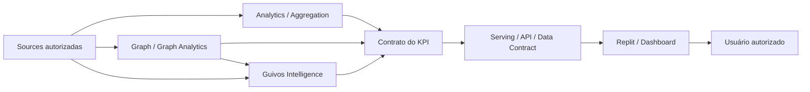

# Dashboards, KPIs e Analytics — Documento Mestre de Especificação para Construção

## 1. Finalidade

Este documento é a **autoridade documental mestre, pré-implementação, para a família de dashboards, KPIs e superfícies analíticas da Guivos**.

Ele organiza o que deverá ser entregue futuramente a uma superfície de construção — inicialmente indicada como **Replit** — sem obrigar Engenharia, Design ou fornecedores a reconstruir significado, fórmulas, acesso ou contexto a partir de conversas, tabelas isoladas ou inferências.

Regra de consumo:

> **Para construir qualquer dashboard da Guivos, comece por este master global e, em seguida, consuma o master especializado correspondente. A ferramenta materializa a especificação; ela não define a verdade do indicador.**

Este master:

- preserva a tabela original desta frente como **proveniência de trabalho**, não como autoridade canônica;
- governa regras comuns à família de dashboards;
- define a arquitetura master global + masters especializados;
- preserva o inventário candidato inicial de necessidades analíticas;
- define o envelope mínimo de contrato de KPI;
- define o modelo transversal de acesso e disclosure;
- define a cadeia lógica de dados, Graph, Intelligence, serving e Replit;
- define requisitos mínimos de handoff, qualidade, exceção e aceite;
- preserva autoridades especializadas de Produto, Journey, Business, Ads, Economia, Privacidade, Graph, Intelligence e Governança;
- **não autoriza**, por si só, dados reais, integração física, backend, persistência, produção, publicação ou acesso irrestrito a dados individuais.

---

## 2. Arquitetura documental da família

```text
GKR-INTELLIGENCE-DASHBOARD-KPI-001
→ MASTER GLOBAL
→ regras comuns
→ inventário / contexto transversal
→ KPI contract envelope
→ access / disclosure
→ integração lógica
→ handoff Replit

MASTERS ESPECIALIZADOS
→ um documento por dashboard / participante / grupo analítico
→ escopo próprio
→ catálogo próprio de KPIs e indicadores
→ filtros / dimensões / drill-down
→ acesso específico
→ fontes e integrações aplicáveis
→ instruções de construção
→ critérios de aceite
```

Regra estrutural:

```text
MASTER GLOBAL
≠ SOMA DOS KPIs DE CADA DASHBOARD

MASTER ESPECIALIZADO
≠ NOVA SOURCE OF TRUTH
≠ AUTORIZAÇÃO AUTOMÁTICA DE IMPLEMENTAÇÃO
```

### 2.1 Registry documental

| Anexo | Documento | Estado nesta versão |
|---|---|---|
| A | `GKR-INTELLIGENCE-DASHBOARD-GUIVOS-001` — Dashboard Guivos | MATERIALIZED DOCUMENTARILY / PRE-IMPLEMENTATION MASTER |
| B | `GKR-INTELLIGENCE-DASHBOARD-BUSINESS-001` — Dashboard Guivos Business | MATERIALIZED DOCUMENTARILY / PRE-IMPLEMENTATION MASTER |
| C | `GKR-INTELLIGENCE-DASHBOARD-ORGANIZATION-001` — Dashboard Organização | MATERIALIZED DOCUMENTARILY / PRE-IMPLEMENTATION MASTER |
| D | `GKR-INTELLIGENCE-DASHBOARD-COLLECTIVE-001` — Dashboard Coletivo | MATERIALIZED DOCUMENTARILY / PRE-IMPLEMENTATION MASTER |
| E | `GKR-INTELLIGENCE-DASHBOARD-PERSON-001` — Dashboard Pessoa | MATERIALIZED DOCUMENTARILY / PRE-IMPLEMENTATION MASTER |
| F | `GKR-INTELLIGENCE-DASHBOARD-ADS-001` — Ads / Opportunity Boost Analytics | MATERIALIZED DOCUMENTARILY / PRE-IMPLEMENTATION MASTER |

`MATERIALIZED DOCUMENTARILY` indica autoridade documental pré-implementação materializada; não cria, por si só, superfície operacional, dado real ou implementação.

### 2.2 Inventário candidato de necessidades analíticas

O escopo corrente reconhece seis necessidades analíticas candidatas. Elas permanecem sujeitas à adjudicação individual e não equivalem a dashboards implementados ou dados reais disponíveis.

#### Dashboard Guivos

Finalidade candidata: visão transversal do ecossistema e da empresa Guivos, incluindo, quando legitimamente definidos e disponíveis:

- Pessoas;
- Organizações;
- Coletivos;
- escolhas/declarações das Pessoas (apenas como necessidade candidata histórica, atualmente **bloqueada para analytics interno** pelo Anexo A; não constitui autorização de tratamento ou disclosure);
- oportunidades;
- dados demográficos;
- dados geográficos;
- vendas de planos;
- cadastros ativos/inativos;
- demais indicadores transversais autorizados.

O Anexo A detalha esse escopo sem autorizar dados reais ou implementação.

#### Dashboard Guivos Business

Finalidade candidata: KPIs do Guivos Business conforme a população legitimamente abrangida por cada relação Business, incluindo tendências, evolução temporal, distribuições e comparações permitidas.

```text
BUSINESS
→ PODE CONSUMIR LEITURA POPULACIONAL AUTORIZADA
→ NÃO RECEBE POR PADRÃO UM "INTELLIGENCE POR PESSOA"
→ NÃO HERDA CONTEXTO PRIVADO INDIVIDUAL
```

O Anexo B detalha esse escopo sem autorizar dados reais, implementação ou acesso individual além da autoridade aplicável.

#### Dashboard Organização

Finalidade candidata: leitura quantitativa da própria atuação da Organização e da população/relações sob autoridade aplicável, incluindo oportunidades, vendas, demografia, geografia e cadastros quando legitimamente definidos.

O Anexo C detalha esse escopo sem autorizar dados reais, implementação, materialização da Home autenticada ou acesso individual além da autoridade aplicável.

```text
DOCUMENTAÇÃO DO ANEXO C
≠ HOME AUTENTICADA DEFINIDA
≠ SURFACE MAP / STATE MAP
≠ DASHBOARD OPERACIONAL IMPLEMENTADO
```

#### Dashboard Coletivo

Finalidade candidata: leitura quantitativa de participação e atuação do Coletivo, incluindo Pessoas relacionadas, oportunidades, inscrições/participações, demografia, geografia e cadastros quando autorizados.

O Anexo D detalha esse escopo sem autorizar dados reais, implementação, materialização do Início autenticado ou acesso individual além da autoridade aplicável. `Inscrições` e `cadastros` permanecem proveniências candidatas separadas e bloqueadas até contrato semântico próprio; não são automaticamente solicitação, conta técnica, vínculo, pertencimento ou participação.

`Reputação` permanece bloqueada até possuir definição, fórmula, finalidade, autoridade de leitura, contestação e governança próprias.

```text
DOCUMENTAÇÃO DO ANEXO D
≠ INÍCIO AUTENTICADO DEFINIDO
≠ SURFACE MAP / STATE MAP
≠ DASHBOARD OPERACIONAL IMPLEMENTADO

REPUTAÇÃO
→ BLOCKED / NOT DEFINED
```

#### Dashboard Pessoa

Finalidade candidata: oferecer compreensão individual autorizada da própria trajetória, históricos, contextos, evolução, participações, relações, eventos e outputs de Graph Analytics/Intelligence quando legitimamente autorizados e explicáveis.

```text
DECLARADO ≠ OBSERVADO ≠ CALCULADO ≠ INFERIDO ≠ PREDITO
```

O Anexo E detalha esse escopo sem autorizar dados reais, implementação, redefinição de `Hoje`, `Meus Objetivos`, `Meus Próximos Passos` ou `Minha Evolução`, nem disclosure a terceiros além da autoridade aplicável.

```text
DOCUMENTAÇÃO DO ANEXO E
≠ HOJE / MEUS OBJETIVOS / MEUS PRÓXIMOS PASSOS / MINHA EVOLUÇÃO
≠ SURFACE MAP / STATE MAP
≠ DASHBOARD OPERACIONAL IMPLEMENTADO
```

#### Ads / Opportunity Boost Analytics

Necessidade candidata: dados de anúncios e Opportunity Boost do anunciante.

O Anexo F detalha esse escopo sem autorizar dados reais, implementação, pricing operacional, attribution, campaign manager, checkout, billing ledger ou acesso individual à Journey da Pessoa.

```text
MASTER ESPECIALIZADO
→ GKR-INTELLIGENCE-DASHBOARD-ADS-001
→ MATERIALIZED DOCUMENTARILY

CURRENT KPI CANDIDATES
→ 50
→ ALL proposed / NOT_READY

ATTRIBUTION
→ BLOCKED / MODEL NOT DEFINED
→ NO ADS-KPI-ATT-* MATERIALIZED

DOCUMENTAÇÃO DO ANEXO F
≠ HOME ADS
≠ CAMPAIGN MANAGER
≠ CHECKOUT
≠ BILLING LEDGER
≠ IMPLEMENTAÇÃO AUTORIZADA
```

---

## 3. Estado e limites

```text
DOCUMENTO MESTRE GLOBAL
→ ACTIVE
→ PRE-IMPLEMENTATION SPECIFICATION
→ NÃO NORMATIVO SOBRE FÓRMULAS NÃO ADJUDICADAS

REPLIT
→ TARGET INICIAL DE MATERIALIZAÇÃO / CONSTRUÇÃO
→ NÃO SOURCE OF TRUTH
→ NÃO DEFINE KPI
→ NÃO DEFINE AUTORIDADE

REAL DATA / REAL INTEGRATIONS / PRODUCTION
→ NÃO AUTORIZADOS POR ESTE DOCUMENTO

DASHBOARD DOCUMENTADO
≠ DASHBOARD IMPLEMENTADO
≠ DASHBOARD PUBLICADO
≠ DADO REAL CONECTADO
```

Quando uma autoridade de domínio mantiver uma superfície, relação, métrica ou capacidade como não definida, este master e seus anexos devem preservar esse estado.

A existência dos masters de Organização, Coletivo e Pessoa **não deve ser interpretada como materialização de Home/Início/Hoje autenticado, Surface Map, State Map, navegação, wireframe ou implementação desses participantes**.

---

## 4. Princípio arquitetural

```text
GKR / PRODUTO / GOVERNANÇA
→ define significado, finalidade, autoridade e limites

MASTER ESPECIALIZADO DO DASHBOARD
→ define escopo de consumo e catálogo analítico pretendido

CONTRATO DO KPI
→ define pergunta, fórmula, população, unidade, granularidade e fonte autorizada

DADOS / GRAPH / INTELLIGENCE / ANALYTICS
→ produzem ou disponibilizam inputs e outputs autorizados

SERVING / API / DATA CONTRACT
→ entrega o resultado na forma autorizada

REPLIT / OUTRA SUPERFÍCIE
→ materializa componentes, filtros, estados e visualizações

USUÁRIO AUTORIZADO
→ consome somente o recorte permitido por sua autoridade
```

Invariantes:

```text
DASHBOARD ≠ SOURCE OF TRUTH
VISUALIZAÇÃO ≠ DEFINIÇÃO DO KPI
FERRAMENTA ≠ PRODUTO
FERRAMENTA ≠ AUTORIDADE
OUTPUT AUTORIZADO ≠ DATASET DE ORIGEM
AGREGADO ≠ AUTOMATICAMENTE SEGURO
AUTORIDADE PARA PERSONALIZAR ≠ AUTORIDADE PARA COMPARTILHAR
ACESSO INTERNO ≠ ACESSO IRRESTRITO
CORRELAÇÃO ≠ CAUSALIDADE
INFERÊNCIA ≠ FATO
COMPREENDER ≠ DECIDIR
```

---

## 5. Modelo transversal de acesso

O acesso a um dashboard ou métrica não deve ser decidido somente por uma `role` técnica.

```text
IDENTIDADE AUTENTICADA
+
TIPO DE PARTICIPANTE / GRUPO
+
PAPEL FUNCIONAL
+
TENANT / PARTICIPANT SCOPE
+
RELAÇÃO LEGÍTIMA
+
FINALIDADE
+
SENSIBILIDADE DO DADO
+
AUTORIDADE DE DISCLOSURE
=
ESCOPO MÁXIMO DE LEITURA
```

### 5.1 Princípios

- um usuário pode possuir mais de um contexto legítimo, mas cada acesso deve operar no contexto selecionado;
- Organização não herda dados de outra Organização;
- Coletivo não herda dados de outro Coletivo;
- uma relação Business não dá acesso automático ao contexto privado de uma Pessoa;
- acesso interno da Guivos continua sujeito à finalidade, necessidade e classificação do dado;
- service accounts e integrações recebem apenas o mínimo necessário;
- filtros e drill-down respeitam a mesma política de acesso do indicador principal;
- exportação não pode ampliar disclosure.

### 5.2 Classes funcionais de consumo

As classes abaixo são funcionais e **não constituem RBAC técnico implementado**:

| Classe | Escopo conceitual |
|---|---|
| Guivos — visão executiva | visão transversal agregada necessária à governança |
| Guivos — operação/domínio | recorte operacional sob responsabilidade |
| Guivos — Data/Intelligence | dados necessários à finalidade analítica autorizada |
| Guivos — Financeiro/Economia | métricas econômicas autorizadas e auditáveis |
| Business | população e relação Business legitimamente abrangidas |
| Organização | dados próprios e relações sob sua autoridade |
| Coletivo | dados próprios e relações sob sua autoridade |
| Pessoa | próprios dados, Journey, históricos e outputs autorizados |
| Anunciante | próprias campanhas / Opportunity Boost e agregados autorizados |
| Replit / service account | somente payloads necessários à renderização autorizada |

---

## 6. Envelope mínimo do contrato de KPI

Nenhum KPI está pronto para implementação apenas porque seu nome aparece em tabela, conversa, planilha ou mockup.

Cada KPI deverá possuir, no mínimo:

| Campo | Obrigatoriedade | Função |
|---|---|---|
| KPI ID | obrigatória | identificador estável |
| Nome | obrigatória | nome humano |
| Pergunta que responde | obrigatória | compreensão/decisão suportada |
| Família / tipo | obrigatória | classificação |
| Dashboard consumidor | obrigatória | superfície consumidora |
| Público autorizado | obrigatória | quem pode consumir |
| Entidade / população | obrigatória | universo medido |
| Unidade de análise | obrigatória | entidade/evento elementar |
| Fórmula | obrigatória | definição matemática/lógica |
| Numerador | quando aplicável | componente superior |
| Denominador | quando aplicável | base da razão/taxa |
| Unidade | obrigatória | número, %, moeda, tempo, índice etc. |
| Direcionalidade | quando aplicável | maior/melhor, menor/melhor, faixa, contextual ou guardrail |
| Exclusões | obrigatória | o que não entra |
| Janela temporal | obrigatória | período de observação |
| Base de comparação | quando aplicável | baseline / período / grupo |
| Granularidade | obrigatória | pessoa, evento, dia, mês, população etc. |
| Dimensões / segmentos | quando aplicável | cortes autorizados |
| Filtros | quando aplicável | filtros autorizados |
| Fonte de verdade / fontes | obrigatória | origem autorizada |
| Natureza da evidência | obrigatória | declarada, observada, operacional, calculada, inferida, predita, estimada, proxy etc. |
| Freshness / atualização | obrigatória | frequência e atraso aceitável |
| Quality checks | obrigatória | verificações mínimas |
| Sensibilidade / access class | obrigatória | classificação de proteção |
| Accountable owner | obrigatória antes de operação | responsável pelo significado/uso |
| Calculation owner | obrigatória antes de operação | responsável pelo cálculo |
| Review cadence | quando aplicável | cadência de revisão |
| Retention rule | quando aplicável | retenção pertinente |
| Change log | obrigatória quando operacional | rastreabilidade de alterações |
| Regra de agregação | quando aplicável | forma de composição |
| Threshold de proteção | quando aplicável | mínimo para exposição agregada |
| Tratamento de nulos | obrigatória | regra para ausência |
| Proveniência | obrigatória | origem e transformação |
| Claims suportados | obrigatória | interpretações permitidas |
| Claims proibidos | obrigatória | interpretações não sustentadas |
| Confounders | quando aplicável | fatores de distorção |
| Incerteza | quando material | limites / intervalos / qualificação |
| Validações aplicáveis | obrigatória | conceptual, data, financial, accounting, legal/privacy/security conforme domínio |
| Visualização semântica | obrigatória antes do handoff | forma esperada de leitura |
| Critério de aceite | obrigatória | condição objetiva de validação |
| Status | obrigatória | proposed / defined / source_pending / approved-equivalent |
| Contratos de domínio | obrigatória | autoridades especializadas aplicáveis |

Regra de composição:

```text
CROSS-DOMAIN MINIMUM
+ APPLICABLE DOMAIN CONTRACT
= REQUIRED CONTRACT FOR READINESS
```

Indicadores econômicos — incluindo vendas de planos, vendas de oportunidades, receita ou métricas equivalentes — devem compor com `GEM-009-MEASUREMENT-CONTRACT-001` na versão/status aplicável. Este master não promove o estado de `GEM-009`.

Exemplo de bloqueio:

```text
"USUÁRIOS ATIVOS"
→ janela não definida
→ evento qualificante não definido
→ população não definida
→ source of truth não definida

RESULTADO
→ NÃO IMPLEMENTAR COMO KPI CANÔNICO
```

---

## 7. Requisitos transversais de dados e leitura

### 7.1 Temporalidade

```text
TOTAL ATUAL
≠ NOVOS NO PERÍODO
≠ ATIVOS 7D
≠ ATIVOS 30D
≠ MÊS CORRENTE
≠ ACUMULADO HISTÓRICO
```

Cada KPI temporal deve explicitar janela, timezone aplicável e regra de fechamento.

### 7.2 Granularidade

A superfície deve expor a menor granularidade necessária à finalidade autorizada, não a maior disponível tecnicamente.

### 7.3 Proveniência

Quando materialmente relevante, a leitura deve distinguir:

```text
DECLARADO
≠ OBSERVADO
≠ OPERACIONAL
≠ CALCULADO
≠ INFERIDO
≠ PREDITO
≠ AGREGADO
≠ CONHECIMENTO EXTERNO
≠ CONHECIMENTO GOVERNADO
```

`CONHECIMENTO EXTERNO` e `CONHECIMENTO GOVERNADO` são naturezas distintas: o primeiro provém de fora do corpus/contexto governado da Guivos; o segundo deriva de conhecimento interno ou de referência submetido à governança aplicável. Nenhum dos dois é sinônimo de dado pessoal observado.

### 7.4 Privacidade e disclosure

Antes de produção devem existir, quando aplicáveis:

- population scope;
- thresholds mínimos;
- supressão de células pequenas;
- regras de segmentação;
- controles de acesso;
- finalidade legítima;
- retenção;
- rastreabilidade;
- regras de exportação;
- regras de drill-down.

### 7.5 Explicabilidade

Quanto maior o impacto potencial de uma leitura, recomendação, score, tendência ou inferência, maior deve ser a explicabilidade exigida.

---

## 8. Arquitetura lógica de integração



As fontes autorizadas podem alimentar Analytics, Graph e/ou Intelligence conforme finalidade e autoridade aplicáveis. **Graph não é pré-requisito universal para um output de Intelligence.**

O desenho é lógico. Ele não determina topologia física, banco específico, API, serviço, linguagem ou infraestrutura.

### 8.1 Mapa de ferramentas — leitura governada da tabela de arquitetura

| Ferramenta / família | Papel indicado nesta frente | Estado governado |
|---|---|---|
| Neo4j | banco de dados grafo / memória; Graph Analytics | tecnologia primária de referência para grafo; não prova provisionamento/produção |
| GPT | IA/inteligência do ecossistema | candidato de provedor/modelo; não selecionado por este master |
| Anthropic | IA/inteligência do ecossistema | candidato de provedor/modelo; não selecionado por este master |
| Gemini | IA/inteligência do ecossistema | candidato de provedor/modelo; não selecionado por este master |
| Replit | construção de fluxos e dashboards | target inicial de materialização; não source of truth |
| Hostinger | armazenamento/bancos operacionais indicados no input | papel pretendido sujeito a arquitetura física e data contracts futuros |
| Figma | Design System | fonte de Design quando autorizado; não backend nem fonte de KPI |
| A definir | fontes de pesquisa / central de ajuda / elementos adicionais | decisão futura necessária |

```text
NEO4J = REFERENCE_SELECTED
≠ PROVISIONADO
≠ GRAPH ANALYTICS OPERACIONAL

GPT / ANTHROPIC / GEMINI
→ ALTERNATIVAS IDENTIFICADAS
→ NÃO SELECIONADAS POR ESTE MASTER

HOSTINGER
→ PAPEL INDICADO NO INPUT
→ NÃO É AUTOMATICAMENTE SOURCE OF TRUTH DE TODO DADO

REPLIT
→ MATERIALIZA ESPECIFICAÇÃO
→ NÃO INVENTA FÓRMULA, AUTORIDADE OU FONTE
```

---

## 9. Requisitos comuns de um dashboard especializado

Cada master especializado deve definir, quando aplicável:

1. objetivo e público consumidor;
2. escopo e não escopo;
3. catálogo de KPIs/indicadores;
4. entidades e populações;
5. filtros globais e locais;
6. dimensões e segmentações;
7. períodos e comparações;
8. drill-down permitido;
9. exportação permitida/proibida;
10. access/disclosure por grupo;
11. fontes e integrações lógicas;
12. estados de loading, vazio, dado insuficiente, erro e indisponibilidade;
13. qualidade/freshness;
14. semantic visualization contract;
15. critérios de aceite;
16. instruções específicas para o Replit;
17. itens bloqueados/TBD;
18. versão da especificação usada na construção.

---

## 10. Contrato de construção para Replit

Quando uma etapa de construção for explicitamente autorizada, o pacote entregue ao Replit deverá conter:

1. este master global vigente;
2. master especializado correspondente;
3. contratos aprovados/suficientemente definidos dos KPIs selecionados;
4. contratos canônicos de domínio aplicáveis;
5. data/serving contracts autorizados;
6. regras de autenticação, autorização e perfis de acesso;
7. regras de privacidade, agregação e disclosure;
8. Design System/especificações visuais quando autorizados;
9. estados de exceção;
10. critérios de aceite;
11. indicação clara de `mock data` versus `real data`;
12. versão do pacote usado na build.

Instrução obrigatória:

```text
SE KPI ESTÁ COMPLETO E APROVADO
+ CONTRATOS DE DOMÍNIO APLICÁVEIS ESTÃO SATISFEITOS
→ IMPLEMENTAR CONFORME CONTRATO

SE FÓRMULA ESTÁ AUSENTE
→ BLOCKED / TBD
→ NÃO INVENTAR

SE SOURCE OF TRUTH ESTÁ AUSENTE
→ BLOCKED / TBD
→ NÃO ESCOLHER BANCO POR CONVENIÊNCIA

SE AUTORIDADE DE ACESSO ESTÁ AUSENTE
→ NÃO EXPOR

SE ESCOPO AINDA É APENAS CANDIDATO
→ NÃO TRATAR COMO PRODUTO IMPLEMENTADO

SE APENAS MOCK DATA ESTÁ AUTORIZADO
→ SEPARAR MOCK DE INTEGRAÇÃO REAL

SE OUTPUT É INFERIDO / PREDITO
→ PRESERVAR NATUREZA, CONFIANÇA E EXPLICABILIDADE

SE HOUVER DRILL-DOWN
→ NÃO AMPLIAR A AUTORIDADE DO USUÁRIO
```

---

## 11. Definition of Ready de um KPI

```text
[ ] KPI ID definido
[ ] pergunta definida
[ ] família/tipo definido
[ ] população e unidade de análise definidas
[ ] fórmula definida
[ ] numerador/denominador definidos quando aplicáveis
[ ] unidade definida
[ ] direcionalidade definida quando aplicável
[ ] exclusões explicitadas
[ ] janela temporal definida
[ ] base de comparação definida quando aplicável
[ ] granularidade definida
[ ] source of truth / fontes definidas e autorizadas
[ ] natureza da evidência definida
[ ] freshness definida
[ ] quality checks definidos
[ ] sensibilidade / access class definida
[ ] público autorizado definido
[ ] accountable owner definido
[ ] calculation owner definido
[ ] review cadence definida quando aplicável
[ ] retention rule definida quando aplicável
[ ] regra de agregação/disclosure definida quando aplicável
[ ] tratamento de nulos definido
[ ] proveniência definida
[ ] supported / prohibited claims definidos
[ ] confounders registrados quando aplicáveis
[ ] incerteza qualificada quando material
[ ] validações aplicáveis registradas
[ ] contratos de domínio aplicáveis identificados e satisfeitos
[ ] visualização semântica especificada
[ ] estados de exceção definidos
[ ] critérios de aceite definidos
[ ] superfície consumidora documentalmente adjudicada
[ ] implementação explicitamente autorizada pelo gate aplicável
```

Falha material mantém o KPI em especificação, não em implementação canônica.

---

## 12. Handoff entre os masters

```text
MASTER GLOBAL
→ MASTER ESPECIALIZADO
→ KPI CATALOG / CONTRACTS
→ ACCESS + DISCLOSURE
→ DATA / SERVING CONTRACTS
→ DESIGN SPEC, QUANDO AUTORIZADO
→ BUILD HANDOFF
→ IMPLEMENTATION AUTHORIZATION, QUANDO HOUVER
```

Não existe autorização automática entre etapas.

---

## 13. Próximas unidades documentais

```text
ANEXO A — DASHBOARD GUIVOS
→ MATERIALIZED DOCUMENTARILY

ANEXO B — BUSINESS
→ MATERIALIZED DOCUMENTARILY

ANEXO C — ORGANIZAÇÃO
→ MATERIALIZED DOCUMENTARILY

ANEXO D — COLETIVO
→ MATERIALIZED DOCUMENTARILY

ANEXO E — PESSOA
→ MATERIALIZED DOCUMENTARILY

ANEXO F — ADS / OPPORTUNITY BOOST
→ MATERIALIZED DOCUMENTARILY
```

Cada anexo deve ser construído e revisado individualmente para permitir evolução pontual sem reabrir desnecessariamente os demais.

---

## 14. Estado final desta versão

```text
GKR-INTELLIGENCE-DASHBOARD-KPI-001
→ v0.2.11
→ ACTIVE
→ MULTI-DASHBOARD GOVERNED PRE-IMPLEMENTATION MASTER

KNOWLEDGE FROM v0.1.1
→ PRESERVED / RECONCILED

SOURCE TABLE / ARCHITECTURE INPUT
→ WORKING PROVENANCE
→ NOT CANONICAL AUTHORITY

PROVENANCE TAXONOMY
→ EXTERNAL KNOWLEDGE + GOVERNED KNOWLEDGE PRESERVED AS DISTINCT NATURES

REPLIT HANDOFF ARCHITECTURE
→ DEFINED DOCUMENTARILY

ACCESS MODEL
→ DEFINED AT FUNCTIONAL / POLICY LEVEL
→ TECHNICAL RBAC NOT IMPLEMENTED

KPI CONTRACT ENVELOPE
→ PRESERVED + EXTENDED

DASHBOARD GUIVOS MASTER
→ GKR-INTELLIGENCE-DASHBOARD-GUIVOS-001
→ MATERIALIZED DOCUMENTARILY AS ANNEX A

DASHBOARD GUIVOS BUSINESS MASTER
→ GKR-INTELLIGENCE-DASHBOARD-BUSINESS-001
→ MATERIALIZED DOCUMENTARILY AS ANNEX B

DASHBOARD ORGANIZATION MASTER
→ GKR-INTELLIGENCE-DASHBOARD-ORGANIZATION-001
→ MATERIALIZED DOCUMENTARILY AS ANNEX C

DASHBOARD COLLECTIVE MASTER
→ GKR-INTELLIGENCE-DASHBOARD-COLLECTIVE-001
→ MATERIALIZED DOCUMENTARILY AS ANNEX D

DASHBOARD PERSON MASTER
→ GKR-INTELLIGENCE-DASHBOARD-PERSON-001
→ MATERIALIZED DOCUMENTARILY AS ANNEX E

DASHBOARD ADS / OPPORTUNITY BOOST MASTER
→ GKR-INTELLIGENCE-DASHBOARD-ADS-001
→ MATERIALIZED DOCUMENTARILY AS ANNEX F

REAL DATA / PHYSICAL INTEGRATION / BACKEND / PRODUCTION
→ NOT AUTHORIZED

DESIGN / UI IMPLEMENTATION
→ NOT AUTHORIZED BY THIS DOCUMENT
```

---

## 15. Reconciliação transversal dos Anexos A–E — 11/10/2026

### 15.1 Escopo e regra de precedência

Esta verificação documental confronta o master global com os cinco Documentos Mestres especializados já integrados à `main`. Ela não reabre a autoridade de Journey, Economia, Planos, Graph, Intelligence ou Privacidade, não substitui adjudicação de KPI e não inclui auditoria especializada do Anexo F (Ads). Em divergência, prevalece o contrato de domínio mais restritivo; nenhum inventário candidato do master global libera processamento ou divulgação bloqueados em anexo especializado.

| Anexo | Documento | Versão verificada | Estado de escopo |
|---|---|---|---|
| A | Dashboard Guivos (interno) | 0.1.5 | 11 áreas / 10 famílias; reconciliação de status preservada |
| B | Dashboard Guivos Business | 0.1.3 | extensão executiva candidata, sem promoção de KPI |
| C | Dashboard Organização | 0.1.2 | 8 famílias; candidatos não canônicos |
| D | Dashboard Coletivo | 0.1.2 | 9 áreas / 8 famílias; candidatos não canônicos |
| E | Dashboard Pessoa | 0.1.3 | 9 áreas / 8 famílias; candidatos não canônicos |

### 15.2 Resultados da auditoria

| Dimensão | Constatação | Tratamento |
|---|---|---|
| Identidade e navegação | Cinco masters especializados possuem IDs próprios, anexos A–E e entradas individuais no MENU | CONSISTENTE documentalmente |
| Versão global | O front matter indicava `0.2.9` enquanto a seção 14 registrava `v0.2.8` | CORRIGIDO nesta revisão para `0.2.10` |
| Escolhas/declarações pessoais | O inventário global incluía esta necessidade candidata, mas o Anexo A bloqueia seu analytics interno | CLARIFICADO: inventário histórico não concede autorização |
| KPI e maturidade | Extensões executivas não são KPIs canônicos; contratos, fontes e adjudicações seguem pendentes | SEM PROMOÇÃO |
| Acesso e disclosure | Business, Organização e Coletivo não herdam Journey privada da Pessoa; relações bilaterais exigem autoridade específica | LIMITE PRESERVADO |
| Economia e Planos | Métricas econômicas dependem de `GEM-009` e de contratos especializados de planos/capacidades | NÃO INFERIR VALORES OU ENTITLEMENTS |
| Intelligence e Graph | Inferência não substitui declaração legítima; relações e correlações não comprovam causalidade | LIMITE PRESERVADO |
| Dados e implementação | Todos os cinco anexos permanecem pré-implementação, sem dados reais, RBAC técnico ou build Replit autorizados | BLOQUEADO |

### 15.3 Matriz de gates transversais ainda não resolvidos

| Gate | Pendência compartilhada | Anexos afetados |
|---|---|---|
| G-XD-01 | identidade, coortes, eventos, denominadores, deduplicação e janelas | A–E |
| G-XD-02 | fonte, qualidade, freshness, proveniência, lineage e estados de ausência | A–E |
| G-XD-03 | autorização por consumidor, escopo de serving, minimização, disclosure e exportação | A–E |
| G-XD-04 | privacidade da Journey, consentimento, proteção de contraparte e sensibilidade | A–E, segundo a leitura |
| G-XD-05 | reconciliação de candidatos com KPI registry e contratos integrais | A–E |
| G-XD-06 | economia, Planos, benefícios e `GEM-009` quando aplicáveis | A–E, conforme o domínio |
| G-XD-07 | autorização separada de Design, Engenharia, dados reais e produção | A–E |

Estes gates são **referências de acompanhamento documental**, não decisões normativas novas e não substituem os gates especializados de cada anexo. Sua existência não converte um KPI `proposed` em `defined` nem altera status reconciliados no Anexo A.

### 15.4 Estado consolidado

```text
MASTER GLOBAL
→ v0.2.11 / PRE-IMPLEMENTATION

ANNEXES A–E
→ MATERIALIZED / INDIVIDUAL MENU ENTRIES
→ SPECIALIZED AUTHORITIES PRESERVED
→ EXECUTIVE CANDIDATES NONCANONICAL

PERSON CHOICES / DECLARATIONS INTERNAL ANALYTICS
→ BLOCKED BY ANNEX A

REAL DATA / TECHNICAL RBAC / REPLIT BUILD
→ NOT AUTHORIZED

ANNEX F — ADS
→ OUTSIDE THIS FIVE-DASHBOARD AUDIT
```


---

## 16. G-XD-01 — Exame de identidade, populações, eventos e tempo (candidato, não adjudicado)

### 16.1 Propósito e estado

Este exame documenta o primeiro gate transversal aberto na seção 15. Não altera contratos de domínio nem declara conclusão. O objetivo é explicitar quais decisões ainda precisam ser tomadas **por família de KPI e consumidor**, sem universalizar definições próprias de Business, Organização, Coletivo, Guivos interno ou Pessoa.

```text
G-XD-01
→ ANALYTIC EXAMINATION OPEN
→ HUMAN ADJUDICATION PENDING
→ CANONICAL KPI PROMOTIONS = 0
→ IMPLEMENTATION AUTHORIZATION = 0
```

### 16.2 Evidências e diferenças já registradas

| Anexo | Evidência documental | Lacuna que impede fechamento |
|---|---|---|
| A — Guivos | retenção D7/D30/D90 referenciada por coorte ativada e atividade qualificante; venda, transação, inscrição, participação e conclusão são eventos distintos | definição de ativação, evento qualificante, identidade válida, elegibilidade e janela |
| B — Business | elegíveis, participantes distintos e eventos válidos são conceitos separados; PTS-003 usa apenas pontos efetivamente utilizados como denominador | população contratual, marco de ativação, coorte, deduplicação, cancelamento e atribuição |
| C — Organização | oportunidade, manifestação, inscrição, participação e conclusão são estados/eventos diferentes | correspondência de eventos, população autorizada, estados, cancelamentos e denominadores |
| D — Coletivo | solicitação, vínculo, presença e continuidade exigem voluntariedade e elegibilidade | transições válidas, desistência, coorte, deduplicação e privacidade de participantes |
| E — Pessoa | declaração, objetivo, movimento, mudança e evidência não são equivalentes | autoridade de estados e eventos da Journey, temporalidade e autoria; sem score universal |

### 16.3 Matriz de decisões candidatas

| Referência | Decisão a adjudicar | Critério mínimo de exame |
|---|---|---|
| XD01-D01 | identidade analítica por tipo de participante/objeto | chave legítima, escopo, ciclo de vida e tratamento de fusões/duplicatas |
| XD01-D02 | população elegível por KPI e consumidor | inclusão, exclusão, consentimento/contrato e data de elegibilidade |
| XD01-D03 | taxonomia de eventos e estados por domínio | fonte de autoridade, evento versus estado, validação, reversão e autoria |
| XD01-D04 | marcos de entrada, ativação, retorno e saída | sem impor um funil universal; definição especializada e observabilidade |
| XD01-D05 | deduplicação e cardinalidade | pessoa única versus evento, participação, vínculo, oportunidade ou transação |
| XD01-D06 | numerador, denominador e unidade de análise | mesma coorte, elegibilidade, exclusões e denominador zero |
| XD01-D07 | calendário, timezone, janela e granularidade | instante de ocorrência versus registro, janela incompleta e comparabilidade |
| XD01-D08 | correções retroativas e reprocessamento | cancelamento, estorno, mudança de estado, versões e rastreabilidade |
| XD01-D09 | lacunas, ausência de dados e supressão | distinguir zero observado, NO_DATA, INSUFFICIENT_DATA e estados protegidos |
| XD01-D10 | cruzamentos entre produtos e participantes | autorização de relacionamento e prevenção de contagem dupla ou disclosure |

Todas as referências `XD01-D*` são **questões de adjudicação**, não decisões tomadas, contratos canônicos, novos KPIs ou novos eventos oficiais.

### 16.4 Critérios de encerramento do gate

Para cada KPI elegível à adjudicação futura, registrar em autoridade competente: consumidor, finalidade, entidade de contagem, população, elegibilidade, fonte e evento, estados e reversões, chave de deduplicação, fórmula, denominador, timezone, janelas, tratamento de atraso, correções, privacidade e qualidade. A consistência entre dashboards deve ser demonstrada por equivalência contratual explícita, nunca apenas por rótulos idênticos.

**Estado do G-XD-01:** `UNRESOLVED / HUMAN_ADJUDICATION_REQUIRED`. Os gates G-XD-02..07 e os gates especializados permanecem inalterados. Dados reais, RBAC técnico e implementação Replit continuam não autorizados.


## 17. XD01-D01 — Matriz de evidências de identidade analítica (exame, não adjudicação)

### 17.1 Escopo e hierarquia

Esta matriz aprofunda exclusivamente `XD01-D01` da seção 16.3. Evidências de documentos de participantes (`normative: false`) descrevem conceitos, não criam chaves técnicas. O contrato transversal de relações (`status: draft; normative: true; maturity: cross_participant_contract_candidate`) e o Master de superfície `COL-004` (`status: draft; normative: false`) não devem ser promovidos implicitamente a autoridade técnica ou contrato analítico adjudicado. O modelo de domínio de Captura de Contexto (`status: draft; normative: true`) delimita identidades dos objetos de seu próprio domínio, sem generalizá-las a todos os dashboards.

### 17.2 Matriz de evidências e consequências analíticas candidatas

| Fonte / autoridade consultada | Evidência documental | Consequência analítica a examinar — **não adjudicada** |
|---|---|---|
| `GKR-PARTICIPANT-PERSON-001` — `docs/participants/person.md` | Pessoa não é conta, perfil, lead ou conjunto de dados; cadastro e visualização não criam vínculo ou consentimento | Identidade da Pessoa deve ser distinguida de identidade de autenticação e de eventos de cadastro, exposição ou relação |
| `GKR-PARTICIPANT-ORGANIZATION-001` — `docs/participants/organization.md` | Organização é participante institucional; Guivos Business é produto especializado, não sinônimo de Organização | Distinguir unidade institucional, tenant/contrato Business, unidade organizacional e usuário operador antes de contar organizações |
| `GKR-PARTICIPANT-COLLECTIVE-001` — `docs/participants/collective.md` | Coletivo não é Pessoa, Organização, lista de contatos ou audiência; participação e vínculos são governados | Contagem de Coletivos não equivale a quantidade de membros, solicitações ou vínculos |
| `GKR-UX-PARTICIPANT-RELATIONSHIPS-INTERACTIONS-001` — `docs/experience-architecture/participant-relationships-interactions-visibility-contract.md` | Pessoa atua em contextos de Coletivo/Organização somente com papel e autoridade; Pessoa solicita participação e Coletivo avalia; não há lifecycle genérico Coletivo→Pessoa adjudicado | Separar agente humano, contexto de atuação, solicitação, vínculo, papel e relação; não inferir convite ou associação unilateral |
| `GKR-UX-COL-PARTICIPANTS-LINKS-MASTER-001` — `docs/experience-architecture/organizations-collectives-journey/collective-participants-links-master.md` | Solicitação aprovada ≠ vínculo técnico confirmado ≠ papel aceito; `TRN-114` é continuidade funcional, não prova de persistência técnica | Contagens de solicitações aprovadas, vínculos confirmados e papéis aceitos requerem eventos/estados e evidências distintos |
| `PAS-001-CC-UIC-DOMAIN-001` — `docs/product-architecture/pas-001-captura-de-contexto-domain-model.md` | Registro de Captura, sessão e entrada possuem identidades próprias; evento técnico não substitui fato humano | Não utilizar IDs de sessão/entrada/captura como substitutos universais de Pessoa, vínculo ou progresso da Journey |
| `GKR-INTELLIGENCE-DASHBOARD-KPI-001` — seção 5 | Identidade autenticada + contexto + papel + relação legítima + finalidade + sensibilidade + disclosure determinam escopo máximo de leitura | Uma identidade analítica não confere autorização de leitura; agregações e exportações exigem controle contextual próprio |

### 17.3 Pendências que exigem autoridade e adjudicação humana

| Questão | Decisão ainda não tomada | Evidência mínima para decisão futura |
|---|---|---|
| `XD01-D01-A` | Chave analítica estável e escopo por tipo de participante | Contrato de identidade do domínio, ciclo de vida, unicidade e versionamento |
| `XD01-D01-B` | Múltiplas contas, perfis ou operadores relacionados a um participante | Política de vinculação, delegação, auditoria e prevenção de fusões indevidas |
| `XD01-D01-C` | Cardinalidade e simultaneidade de vínculos Pessoa–Coletivo e relações institucionais | Objeto de relação, estados autorizados, validade temporal e chave de contagem |
| `XD01-D01-D` | Identidade em solicitação, aprovação, vínculo confirmado, papel aceito e saída/reingresso | Fontes dos eventos e estados, reversões, datas efetivas e continuidade de histórico |
| `XD01-D01-E` | Duplicatas, fusão, separação e correção retroativa de identidades | Autoridade de reconciliação, rastreabilidade, reversibilidade e impactos em séries históricas |
| `XD01-D01-F` | Identificação transversal entre produtos e participantes | Finalidade, legitimidade do relacionamento, minimização e limites de disclosure |

### 17.4 Limites e encaminhamento

A matriz registra **evidência existente versus hipótese de contrato**, sem estabelecer ID técnico, cardinalidade oficial, evento novo, consentimento presumido ou KPI READY. Não é permitido inferir vínculo a partir de cadastro, aprovação a partir de solicitação, vínculo técnico a partir de aprovação, papel a partir de vínculo ou identidade pessoal a partir de sessão técnica. A futura adjudicação deve ocorrer nas autoridades de domínio competentes, com reconciliação por KPI/consumidor (`XD01-D02..D10`).

```text
XD01-D01 → EXAMINED / HUMAN_ADJUDICATION_REQUIRED
G-XD-01 → UNRESOLVED
CANONICAL KPI PROMOTIONS → 0
IMPLEMENTATION AUTHORIZATION → 0
```


## 18. XD01-D02 — Matriz de população elegível por KPI e consumidor (exame, não adjudicação)

### 18.1 Propósito e limites

Este exame detalha `XD01-D02` da seção 16.3 com base nos cinco Documentos Mestres de dashboards. Não define população canônica universal, não altera as fórmulas candidatas e não presume disponibilidade, consentimento, acesso ou persistência de dados. As referências `*-KPI-*` abaixo identificam indicadores **existentes**, todos sujeitos aos seus próprios gates; não criam novos indicadores.

### 18.2 Matriz de evidências por consumidor

| Consumidor / Documento Mestre | Indicadores existentes e evidência de elegibilidade | Contrato pendente antes de usar população ou denominador |
|---|---|---|
| Guivos interno — `dashboard-guivos-master-specification.md` | `GUV-KPI-POP-001`: Pessoas cadastradas no universo válido; `GUV-KPI-POP-005`: ativadas / elegíveis; `GUV-KPI-ENG-006..008`: retenção D7/D30/D90 de coorte ativada com atividade qualificante; `GUV-KPI-OPP-011..015`: populações por eventos distintos | Validade/exclusões de Pessoa, evento de ativação, coorte, elegibilidade por etapa, janelas, deduplicação, privacidade e autoridade de análise interna |
| Guivos Business — `dashboard-guivos-business-master-specification.md` | `BUS-KPI-PAR-001`: Pessoas legitimamente incluídas no programa/custeio; `BUS-KPI-PAR-002`: participantes únicos com participação válida; `BUS-KPI-PAR-003`: participantes únicos / elegíveis; `BUS-KPI-JNY-002..004`: acesso custeado e agregados autorizados | Escopo do contrato/programa, inclusão e exclusão temporal, elegibilidade de participação e acesso, deduplicação por período, finalidade e limiares de disclosure; não expor Journey individual |
| Organização — `dashboard-organization-master-specification.md` | `ORG-KPI-PAR-001`: elegíveis de objeto institucional; `ORG-KPI-PAR-003`: Pessoas distintas com participação válida; `ORG-KPI-PAR-004`: taxa segundo contrato específico; relações e oportunidades têm universos próprios | Identificar objeto institucional e sua autoridade, população e relação legítimas, eventos qualificantes, estados/cancelamentos, coorte e visibilidade; Organização não equivale a Business |
| Coletivo — `dashboard-collective-master-specification.md` | `COL-KPI-PAR-004`: Pessoas distintas com vínculo/participação válida conforme contrato; candidatos `COL-PAR-C01..C03` distinguem solicitação, vínculo, presença e continuidade | Pertencimento voluntário, solicitação versus vínculo confirmado, desistência, janela, cardinalidade e supressão de dados; candidatos `COL-PAR-C*` não são novos KPIs canônicos |
| Pessoa — `dashboard-person-master-specification.md` | `PER-KPI-CTX-004`: objetos legitimamente mantidos sem `domain_link` confirmado; escopo de análise pessoal e evidências não se confundem com população institucional | Objeto pessoal e autoria, natureza da evidência, período, vínculo/consentimento de contraparte, estados sem classificação, privacidade e limites de compartilhamento; sem score universal |

### 18.3 Perguntas de adjudicação por KPI e consumidor

| Referência | Pergunta ainda aberta | Evidência mínima exigida |
|---|---|---|
| `XD01-D02-A` | Qual entidade/objeto integra o universo elegível e qual é a unidade de análise? | Tipo de participante/objeto, chave legítima e escopo do indicador |
| `XD01-D02-B` | Quais condições determinam inclusão, exclusão, suspensão ou reingresso? | Contrato de domínio, relação/programa, estados e exceções |
| `XD01-D02-C` | Quando a elegibilidade começa, termina ou muda retroativamente? | Data efetiva, timezone, janela, histórico e reprocessamento |
| `XD01-D02-D` | Qual evento qualifica numerador e qual população compõe denominador? | Fonte, taxonomia, coorte, validade, deduplicação e denominador zero |
| `XD01-D02-E` | Quem pode consumir o resultado e em qual granularidade? | Finalidade, classe de acesso, relação legítima, minimização e política de supressão |
| `XD01-D02-F` | Como distinguir zero observado, ausência, atraso, insuficiência e supressão? | Contrato de qualidade, completude, freshness e estados `NO_DATA`, `INSUFFICIENT_DATA`, `SOURCE_DELAYED`, `SUPPRESSED_BY_POLICY` |
| `XD01-D02-G` | Como evitar sobreposição entre contratos, programas, contextos e produtos? | Atribuição, cardinalidade, chaves de vínculo e limites de cruzamento |

### 18.4 Regra de não equivalência

```text
POPULAÇÃO ELEGÍVEL PARA CÁLCULO
≠ PARTICIPANTES COM EVENTO QUALIFICANTE
≠ CONTAS AUTENTICADAS
≠ RELAÇÕES OU VÍNCULOS
≠ POPULAÇÃO AUTORIZADA PARA DISCLOSURE
```

Uma Pessoa pode ser elegível para uma métrica sem ter produzido o evento do numerador; a legitimidade do cálculo não concede automaticamente ao consumidor acesso ao dado individual, ao contexto privado da Journey ou à identidade da contraparte. Uma mesma Pessoa em múltiplos contextos exige deduplicação e atribuição específicas; não há funil universal nem conversão presumida entre participantes/produtos. Os estados de dados ausentes e suprimidos não podem ser tratados como zero observado.

### 18.5 Estado e próximo gate

```text
XD01-D01 → EXAMINED / HUMAN_ADJUDICATION_REQUIRED
XD01-D02 → EXAMINED / HUMAN_ADJUDICATION_REQUIRED
G-XD-01 → UNRESOLVED
CANONICAL KPI PROMOTIONS → 0
IMPLEMENTATION AUTHORIZATION → 0
```

Esta seção é uma matriz de evidências e perguntas, não adjudicação. `XD01-D03` (eventos e estados por domínio) permanece como próximo exame; `G-XD-02..07` e gates especializados permanecem inalterados.


---

## 19. XD01-D03 — Matriz de eventos e estados por domínio (exame, não adjudicação)

### 19.1 Escopo e precedência

Este exame aprofunda somente `XD01-D03` da seção 16.3 e confronta os Documentos Mestres dos Anexos A–E. Os rótulos abaixo são **referências documentais existentes**, não um catálogo novo de eventos técnicos. A autoridade de cada transição, validação, autoria, reversão e divulgação permanece com o domínio especializado. Sem fonte, contrato de evento, estado e adjudicação humana, nenhuma métrica candidata adquire status `defined` ou `approved-equivalent`.

### 19.2 Matriz de evidências e separações semânticas

| Consumidor / fonte documental | Evidências existentes | Distinção obrigatória antes de instrumentação ou KPI |
|---|---|---|
| Guivos interno — `dashboard-guivos-master-specification.md` | `GUV-KPI-ENG-001` separa início/conclusão de cadastro; `GUV-KPI-POP-003/005` exigem conjunto aprovado de atividade/ativação; `GUV-KPI-JNY-001/003/004/006/008` referem início de Journey, estados de objetivos/passos e conclusão; família `OPP` diferencia publicação e demais eventos de oportunidade | Cadastro, Pessoa válida, ativação, atividade qualificante, Journey iniciada, oportunidade publicada, inscrição, participação, conclusão e transação não são equivalentes. Escolhas/declarações pessoais permanecem bloqueadas para analytics interno conforme Anexo A |
| Business — `dashboard-guivos-business-master-specification.md` | `BUS-KPI-PRG-001/002` dependem de estados válidos de programa/campanha; `BUS-KPI-PAR-002/004` distinguem participação válida de evento elegível confirmado; `BUS-KPI-DQ-004` contempla evento rejeitado; `BUS-KPI-JNY-003/004` exigem autorização para agregados | Evento recebido/produzido, validado, rejeitado, participação válida, ativação de acesso custeado e utilização/concessão econômica precisam de contratos e fontes distintos; Business não recebe Journey individual |
| Organização — `dashboard-organization-master-specification.md` | `ORG-KPI-OPP-001/002` dependem de lifecycle de oportunidade; `ORG-KPI-PAR-002/003/006` distinguem inscrição, participação e cadastro/vínculo operacional; `ORG-KPI-REL-003/005` distinguem proposta, pausa e encerramento; `ORG-KPI-ECO-001/003` dependem de semântica econômica especializada | Manifestação, inscrição, participação, conclusão, cadastro, relação bilateral e transação/venda não formam funil único; `cadastro` não significa automaticamente conta, membro ou participante |
| Coletivo — `dashboard-collective-master-specification.md` e `collective-participants-links-master.md` | `COL-KPI-PAR-001..006` separam solicitação, solicitação aberta, vínculo ativo, Pessoa distinta, participação e pausa/saída; contrato de superfície registra aprovação diferente de vínculo técnico confirmado e papel aceito | Solicitação não é aprovação; aprovação não é vínculo técnico confirmado; vínculo não é papel aceito; presença não é pertencimento; saída/pausa não equivale a reputação negativa. Voluntariedade e limites de contraparte preservados |
| Pessoa — `dashboard-person-master-specification.md` | `PER-KPI-CTX-001..003` separam sugestão e confirmação/revisão de `domain_link`; `PER-KPI-OBJ-001/002/004` tratam estado e encerramento de objetivo; `PER-KPI-MOV-001/002/004/005` tratam estados de Próximos Passos e conclusão operacional; `PER-KPI-EVO-002/006` tratam leitura contextual e revisão | Declaração legítima, sugestão, confirmação, objetivo, Próximo Passo, movimento, evidência, conclusão operacional, revisão e mudança reconhecida são conceitos distintos. Inferência não substitui declaração; não criar score universal |

### 19.3 Perguntas de adjudicação e evidência mínima

| Referência | Questão em aberto | Evidência exigida antes de contrato analítico |
|---|---|---|
| `XD01-D03-A` | Qual autoridade de domínio define cada tipo de evento e cada estado? | Documento normativo competente, versão, objeto, escopo, dono e finalidade |
| `XD01-D03-B` | Qual transição é legítima e qual é apenas hipótese de superfície ou indicador? | Máquina de estados ou contrato adjudicado, pré-condições, papel autorizado e relação com objeto |
| `XD01-D03-C` | O que constitui evento observado, recebido, validado, rejeitado ou confirmado? | Origem, autoria, timestamp de ocorrência/registro, critérios de validação e evidência |
| `XD01-D03-D` | Como representar cancelamento, reversão, expiração, pausa, saída e reingresso? | Semântica de reversão, data efetiva, trilha de auditoria e impacto histórico |
| `XD01-D03-E` | Quando estados distintos podem ser usados como numerador ou coorte? | Evento qualificante, elegibilidade, deduplicação, denominador, janela e unidade de contagem por KPI |
| `XD01-D03-F` | Quais relações de autoria, contraparte, consentimento e disclosure limitam cada evento? | Autoridade de acesso por consumidor, finalidade, sensibilidade, minimização e política de supressão |
| `XD01-D03-G` | Como reconciliar nomenclaturas semelhantes entre produtos sem declarar equivalência indevida? | Mapeamento explícito de contratos especializados, proveniência e diferenças de ciclo de vida |
| `XD01-D03-H` | Como tratar estados não mapeados, eventos tardios e fontes indisponíveis? | Política de qualidade, freshness, reprocessamento, `NO_DATA`, `SOURCE_DELAYED`, `INSUFFICIENT_DATA` e `SUPPRESSED_BY_POLICY` |

### 19.4 Não equivalências e encaminhamento

```text
EVENTO RECEBIDO ≠ EVENTO VALIDADO ≠ PARTICIPAÇÃO QUALIFICANTE
SOLICITAÇÃO ≠ APROVAÇÃO ≠ VÍNCULO CONFIRMADO ≠ PAPEL ACEITO
CADASTRO ≠ PESSOA ATIVA ≠ PARTICIPAÇÃO ≠ CONCLUSÃO
DECLARAÇÃO ≠ INFERÊNCIA ≠ MOVIMENTO ≠ RESULTADO RECONHECIDO
EVENTO ECONÔMICO ≠ VENDA ≠ TRANSAÇÃO ≠ BENEFÍCIO UTILIZADO
ESTADO VÁLIDO PARA CÁLCULO ≠ AUTORIZAÇÃO DE DISCLOSURE
```

A matriz não define novos nomes de eventos oficiais, enumerações técnicas, transições implementáveis, persistência, KPIs canônicos ou permissão de acesso. `XD01-D04` (marcos de entrada, ativação, retorno e saída) é o próximo exame. `G-XD-02..07` e gates especializados permanecem inalterados.

```text
XD01-D01 → EXAMINED / HUMAN_ADJUDICATION_REQUIRED
XD01-D02 → EXAMINED / HUMAN_ADJUDICATION_REQUIRED
XD01-D03 → EXAMINED / HUMAN_ADJUDICATION_REQUIRED
G-XD-01 → UNRESOLVED
CANONICAL KPI PROMOTIONS → 0
IMPLEMENTATION AUTHORIZATION → 0
```


---

## 20. XD01-D04 — Matriz de marcos de entrada, ativação, retorno e saída (exame, não adjudicação)

### 20.1 Propósito, fronteiras e precedência

Esta matriz examina exclusivamente `XD01-D04` da seção 16.3, apoiada nos cinco Documentos Mestres de dashboards (Anexos A–E) e nas distinções já examinadas em `XD01-D01..D03`. Os termos *entrada*, *ativação*, *retorno* e *saída* são **categorias de investigação analítica**, não etapas obrigatórias, estados técnicos oficiais ou transições universais da Pessoa, Organização, Coletivo ou Business. Cada marco exige autoridade especializada, evento/estado qualificante, elegibilidade, tempo e finalidade próprios.

### 20.2 Matriz de evidências e lacunas por consumidor

| Consumidor / evidência no Documento Mestre | Entrada e ativação — leitura candidata | Retorno e saída — leitura candidata | Lacuna que impede adjudicação |
|---|---|---|---|
| Guivos interno — `GUV-KPI-POP-002/003/004/005/012`, `GUV-KPI-ENG-001/002/006..008` | Criação válida de Pessoa, conclusão de cadastro e ativação por evento autorizado são marcos diferentes; a coorte de retenção exige ativação válida | Inatividade, reativação, retenção D7/D30/D90 e eventual cancelamento/churn não são sinônimos; churn requer contrato próprio | `ACTIVITY_EVENT_SET`, evento de ativação, elegibilidade, coorte, janela, exclusões, retorno qualificante e temporalidade |
| Business — `BUS-KPI-PRG-001/002`, `BUS-KPI-PAR-001..006`, `BUS-KPI-JNY-002..004`, `BUS-KPI-COM-006/010` | Inclusão legítima em contrato/programa, acesso custeado, ativação de acesso e primeira participação válida são marcos distintos | Participação recorrente, suspensão/encerramento de programa e churn contratual dependem de contratos próprios; saída do programa não significa saída da Guivos | Autoridade contratual, regras de programa, evento de participação, janela, suspensão/reingresso, separação de beneficiário e contrato |
| Organização — `ORG-KPI-OPP-001/002`, `ORG-KPI-PAR-002..004`, `ORG-KPI-REL-001/003/005` | Oportunidade válida/publicada, manifestação, inscrição, participação e relação institucional não determinam uma ativação universal | Pausa/encerramento de relação e conclusão de compromisso/oportunidade não significam saída institucional ou desativação da Pessoa | Lifecycle por objeto institucional, transições bilaterais, elegibilidade, fonte, reversão e disclosure |
| Coletivo — `COL-KPI-PAR-001..006`, `COL-KPI-ACT-001..003` | Solicitação, aprovação, vínculo confirmado, papel aceito e presença/participação qualificante devem ser distinguidos | Continuidade, nova participação, pausa, desistência e saída são fatos diferentes; saída não implica julgamento reputacional | Consentimento/voluntariedade, vínculo e papel válidos, confirmação, período, reingresso e privacidade da contraparte |
| Pessoa — `PER-KPI-CTX-001..003`, `PER-KPI-OBJ-001/002/004`, `PER-KPI-MOV-001..005`, `PER-KPI-REL-001..004` | Declaração legítima, confirmação de domínio, início de objetivo, Próximo Passo pronto e participação não equivalem a ativação pessoal universal | Pausa, revisão, reorientação, conclusão operacional, saída de relação e continuidade da Journey são distintos; não concluir abandono ou fracasso por inatividade | Autoridade da Pessoa, autoria, eventos/estados de cada objeto, tempo, evidência, ausência de dados, consentimento e controle de divulgação |

### 20.3 Perguntas de adjudicação

| Referência | Decisão em aberto | Evidência mínima para decisão futura |
|---|---|---|
| `XD01-D04-A` | Qual objeto, relação ou participante tem marco de entrada legitimamente observável? | Autoridade, identidade, evento/estado, data efetiva e condição de elegibilidade |
| `XD01-D04-B` | O que configura ativação por domínio, produto, KPI e consumidor? | Evento qualificante autorizado, população/coorte, exclusões, janela e fonte |
| `XD01-D04-C` | Como distinguir primeiro evento, uso recorrente, retenção, retorno e reativação? | Contrato temporal, histórico, janelas de observação, atividade válida e deduplicação |
| `XD01-D04-D` | Qual a semântica de pausa, inatividade, cancelamento, saída e encerramento? | Lifecycle especializado, evento de reversão, relação afetada e proibição de churn presumido |
| `XD01-D04-E` | Como tratar reingresso, múltiplos programas, vínculos simultâneos e mudança de papel? | Cardinalidade, identidade legítima, coorte, atribuição, versionamento e histórico |
| `XD01-D04-F` | Quando um marco pode ser exibido ao consumidor sem expor Journey ou contraparte privada? | Finalidade, autoridade contextual, agregação, minimização, consentimento quando exigido e supressão |
| `XD01-D04-G` | Como lidar com eventos tardios, marcos desconhecidos, séries incompletas e ausência de observação? | Proveniência, timestamp de ocorrência/registro, freshness, reprocessamento e estados de qualidade |
| `XD01-D04-H` | Quais marcos são comparáveis entre dashboards sem inferir um funil universal? | Equivalência contratual explícita, mesma unidade/população/janela e divergências documentadas |

### 20.4 Não equivalências e estado

```text
CADASTRO ≠ ENTRADA EM PROGRAMA ≠ ATIVAÇÃO ≠ PARTICIPAÇÃO
RETENÇÃO ≠ RECORRÊNCIA ≠ REATIVAÇÃO
INATIVIDADE ≠ CANCELAMENTO ≠ CHURN ≠ SAÍDA
PAUSA ≠ DESISTÊNCIA ≠ FRACASSO
CONCLUSÃO OPERACIONAL ≠ EVOLUÇÃO PESSOAL RECONHECIDA
SAÍDA DE RELAÇÃO OU PROGRAMA ≠ SAÍDA DA GUIVOS
```

Não se estabelecem novas máquinas de estados, eventos oficiais, coortes canônicas, tempos de retenção, contratos de churn, métricas aprovadas ou instrumentação. `XD01-D05` (deduplicação e cardinalidade) permanece como próximo exame. Os gates `G-XD-02..07` e todas as autoridades especializadas permanecem inalterados.

```text
XD01-D01 → EXAMINED / HUMAN_ADJUDICATION_REQUIRED
XD01-D02 → EXAMINED / HUMAN_ADJUDICATION_REQUIRED
XD01-D03 → EXAMINED / HUMAN_ADJUDICATION_REQUIRED
XD01-D04 → EXAMINED / HUMAN_ADJUDICATION_REQUIRED
G-XD-01 → UNRESOLVED
CANONICAL KPI PROMOTIONS → 0
IMPLEMENTATION AUTHORIZATION → 0
```


---

## 21. XD01-D05 — Matriz de deduplicação e cardinalidade (exame, não adjudicação)

### 21.1 Escopo e precedência

Este exame de `XD01-D05` identifica unidades de contagem, cardinalidade e riscos de dupla contagem nos cinco Documentos Mestres de dashboards, sem estabelecer chaves canônicas, algoritmos, contratos KPI ou regras de implementação. As decisões anteriores `XD01-D01..D04` permanecem dependentes de adjudicação humana.

### 21.2 Evidências e lacunas por consumidor

| Consumidor | Unidades distintas a examinar | Riscos e pendências |
|---|---|---|
| Guivos interno — `GUV-KPI-POP-001..005`, `GUV-KPI-ENG-006..008`, `GUV-KPI-OPP-011..015` | Pessoa válida, conta, ativação, evento, oportunidade, inscrição, participação, conclusão | Múltiplas contas/papéis, eventos repetidos, participações em vários produtos, coortes, janelas e reprocessamento; falta identidade e grão autorizados |
| Business — `BUS-KPI-PAR-001..006`, `BUS-KPI-PRG-001/002`, `BUS-KPI-JNY-002..004` | Contratante, contrato, programa, elegível, acesso custeado, participação, evento validado | Uma Pessoa em múltiplos programas; elegível não é participante; acesso custeado não é uso; não revelar Journey privada entre patrocinadores |
| Organização — `ORG-KPI-OPP-001/002`, `ORG-KPI-PAR-002..004`, `ORG-KPI-REL-001/003/005` | Organização, oportunidade, manifestação, inscrição, participante, conclusão, relação bilateral | Múltiplas inscrições e relações por Pessoa; a soma de oportunidades não implica total distinto de pessoas; depende da autoridade de cada objeto |
| Coletivo — `COL-KPI-PAR-001..006`, `COL-KPI-ACT-001..003` | Solicitação, vínculo confirmado, papel aceito, sessão, presença, participação | Solicitações repetidas, papéis simultâneos, várias presenças, saída e reingresso; presença não é vínculo nem reputação |
| Pessoa — `PER-KPI-CTX-001..003`, `PER-KPI-OBJ-001/002/004`, `PER-KPI-MOV-001..005` | Declaração, objetivo, Próximo Passo, movimento, evidência, revisão | A mesma ação pode servir vários objetivos; revisões não criam resultados adicionais; preservar autoria, privacidade e ausência de escore universal |

### 21.3 Questões abertas de adjudicação

| ID | Decisão pendente | Evidência mínima |
|---|---|---|
| `XD01-D05-A` | Unidade de contagem por KPI: entidade, vínculo, evento, sessão, programa, objeto ou transação? | Contrato de métrica, autoridade e população |
| `XD01-D05-B` | Escopo de unicidade: produto, organização, coletivo, contrato, programa, oportunidade, janela ou consumidor? | Finalidade, escopo e autorização |
| `XD01-D05-C` | Duplicata técnica versus nova ocorrência, atualização, correção ou reversão? | Identificador de origem, estado, timestamps, versionamento |
| `XD01-D05-D` | Múltiplas contas, papéis, vínculos, programas e oportunidades simultâneos? | Cardinalidade, histórico, papel e atribuição |
| `XD01-D05-E` | Quando somas dimensionais duplicam pessoas e quando totais distintos são legítimos? | Grão, sobreposição, população e janela |
| `XD01-D05-F` | Saída/reingresso, fusão/divisão, correções retroativas e eventos tardios? | Autoridade de identidade, tempo efetivo, reconciliação |
| `XD01-D05-G` | Deduplicação entre produtos sem expor dados de contrapartes ou Journey privada? | Finalidade, minimização, consentimento aplicável, supressão |
| `XD01-D05-H` | Ausência de chave, relações ambíguas ou cardinalidade desconhecida? | Qualidade, proveniência, estado de não dado, não fabricar totais |

### 21.4 Não equivalências e estado

- Pessoa não equivale a conta, papel ou vínculo.
- Elegível não equivale a participante ou evento.
- Solicitação não equivale a vínculo confirmado ou presença.
- Inscrição não equivale a participação ou conclusão.
- Acesso custeado não equivale a uso efetivo.
- Eventos totais não equivalem a pessoas distintas.
- Soma por programa não equivale a total global deduplicado.
- Revisão de evidência não equivale a novo resultado.

Nenhuma identidade universal, algoritmo de deduplicação, cardinalidade global, métrica aprovada ou instrumentação é estabelecida. `XD01-D06` (numerador, denominador e unidade) permanece o próximo exame. `G-XD-01` permanece não resolvido; `G-XD-02..07` e as autoridades especializadas permanecem inalterados.

```text
XD01-D01..D04 → EXAMINED / HUMAN_ADJUDICATION_REQUIRED
XD01-D05 → EXAMINED / HUMAN_ADJUDICATION_REQUIRED
G-XD-01 → UNRESOLVED
CANONICAL KPI PROMOTIONS → 0
IMPLEMENTATION AUTHORIZATION → 0
```


---

## 22. XD01-D06 — Matriz de numerador, denominador e unidade (exame, não adjudicação)

### 22.1 Propósito e fronteiras

Este exame de `XD01-D06` identifica, para os cinco Documentos Mestres de dashboards, os contratos de contagem e proporção ainda necessários. Não homologa fórmulas, denominadores, unidades, janelas, metas, comparabilidade entre consumidores ou maturidade de KPIs. As dependências `XD01-D01..D05` (identidade, elegibilidade, eventos, marcos e deduplicação) continuam abertas à adjudicação humana.

### 22.2 Matriz de evidências por consumidor

| Consumidor / referências candidatas | Numeradores e unidades que exigem distinção | Denominadores e condições ainda não adjudicados |
|---|---|---|
| Guivos interno — `GUV-KPI-POP-001..005`, `GUV-KPI-ENG-006..008`, `GUV-KPI-OPP-011..015` | Pessoas válidas distintas, eventos qualificantes, ativados, retornantes, oportunidades, inscrições, participações, conclusões; contagem, taxa, proporção e coorte não são equivalentes | População elegível por período, coorte de ativação e janelas D7/D30/D90, exclusões, eventos de atividade, deduplicação, reprocessamento e acesso autorizado |
| Business — `BUS-KPI-PAR-001..006`, `BUS-KPI-PRG-001/002`, `BUS-KPI-JNY-002..004` | Participantes distintos, participações qualificantes, programas, acessos custeados, eventos recebidos/validados; valor monetário e pontos têm unidades próprias | Pessoas elegíveis no contrato/programa, beneficiários com acesso efetivo, universo de eventos validáveis, janela, patrocinador e finalidade; nunca usar Journey privada como proxy |
| Organização — `ORG-KPI-OPP-001/002`, `ORG-KPI-PAR-002..004`, `ORG-KPI-REL-001/003/005` | Oportunidades, manifestações, inscrições, participantes, conclusões, relações bilaterais e transações em unidades distintas | Oportunidades válidas e expostas, inscritos elegíveis, relações confirmadas, períodos, condições de conclusão e objeto de referência; não presumir conversão universal |
| Coletivo — `COL-KPI-PAR-001..006`, `COL-KPI-ACT-001..003` | Solicitações, vínculos confirmados, membros distintos, sessões, presenças, participações e recorrências | Convites ou solicitações elegíveis, vínculos ativos válidos, sessões qualificantes, janela, papel, entrada/saída/reingresso e voluntariedade; presença não mede pertencimento |
| Pessoa — `PER-KPI-CTX-001..003`, `PER-KPI-OBJ-001/002/004`, `PER-KPI-MOV-001..005` | Declarações, objetivos, Próximos Passos, movimentos, evidências e revisões são objetos próprios; indicadores contextuais não autorizam escore único | Universo de objetos pessoais autorizados, autoria, estado confirmado, período, evidência e consentimento/disclosure; não inferir evolução pessoal por razão genérica |

### 22.3 Questões abertas para adjudicação

| ID | Decisão pendente | Evidência necessária |
|---|---|---|
| `XD01-D06-A` | Qual o numerador exato por KPI e seu evento/estado qualificante? | Objeto, autoridade, fonte, unidade, elegibilidade, deduplicação |
| `XD01-D06-B` | Há denominador legítimo? Qual universo e momento de elegibilidade? | População, coorte, data efetiva, exclusões e consumidor |
| `XD01-D06-C` | Qual unidade: pessoas distintas, eventos, relações, oportunidades, programas, tempo, pontos, moeda ou percentual? | Contrato dimensional, agregação, escala e precisão |
| `XD01-D06-D` | Quando uma contagem pode ser expressa como taxa/proporção sem misturar grãos? | Correspondência entre numerador e denominador, escopo, janela, cardinalidade |
| `XD01-D06-E` | Como tratar denominador zero, desconhecido, suprimido ou parcialmente observado? | Estados de qualidade, não-dado, supressão e apresentação sem divisão artificial |
| `XD01-D06-F` | Como separar eventos recebidos, validados, rejeitados, corrigidos e efetivamente utilizados? | Taxonomia, fonte, reconciliação, estorno, versionamento |
| `XD01-D06-G` | Quais regras de tempo, atribuição, sobreposição e reprocessamento preservam séries? | Timestamp, janela, coorte, deduplicação, correções e auditoria |
| `XD01-D06-H` | Quais fórmulas podem ser compartilhadas entre dashboards sem violar autorização e privacidade? | Equivalência de unidade/população, finalidade, disclosure, minimização e contrato explícito |

### 22.4 Restrições e próximo exame

- Numerador observado não autoriza denominador presumido.
- Contagem de eventos não equivale a contagem de pessoas distintas.
- Participantes não equivalem a elegíveis; acesso custeado não equivale a participação.
- Taxa de conclusão de oportunidade não equivale a evolução pessoal.
- Soma de proporções por programa não equivale a taxa global.
- Pontos, moeda, tempo, unidades e percentuais não podem ser somados sem contrato dimensional.
- Denominador zero, ausente ou suprimido não deve gerar taxa fabricada.

Nenhuma fórmula é promovida, nenhum KPI muda de maturidade, e nenhuma implementação é autorizada. `XD01-D07` (calendário, timezone, janelas e granularidade) permanece o próximo exame. `G-XD-01` segue não resolvido, preservados `G-XD-02..07`.

```text
XD01-D01..D05 → EXAMINED / HUMAN_ADJUDICATION_REQUIRED
XD01-D06 → EXAMINED / HUMAN_ADJUDICATION_REQUIRED
G-XD-01 → UNRESOLVED
CANONICAL KPI PROMOTIONS → 0
IMPLEMENTATION AUTHORIZATION → 0
```


---

## 23. XD01-D07 — Matriz de calendário, timezone, janelas e granularidade (exame, não adjudicação)

### 23.1 Propósito e precedência

Este exame de `XD01-D07` identifica contratos temporais ainda necessários para os cinco Documentos Mestres de dashboards, sem estabelecer fuso oficial, calendário universal, janela KPI, granularidade aprovada ou regra de reprocessamento. A identidade, elegibilidade, taxonomia de eventos, marcos, deduplicação e fórmulas seguem condicionadas aos exames `XD01-D01..D06` e à adjudicação humana.

### 23.2 Evidências e lacunas por consumidor

| Consumidor / referências documentais | Dimensões temporais a distinguir | Lacunas de adjudicação |
|---|---|---|
| Guivos interno — `GUV-KPI-POP-001..005`, `GUV-KPI-ENG-006..008`, `GUV-KPI-OPP-011..015` | Cadastro, ativação, atividade, retorno, inscrição, participação, conclusão; coortes e retenção D7/D30/D90 | Evento de início de coorte, janela de observação, calendário de corte, timezone por fonte/consumidor, dados tardios e comparação entre períodos |
| Business — `BUS-KPI-PAR-001..006`, `BUS-KPI-PRG-001/002`, `BUS-KPI-JNY-002..004` | Vigência contratual, ciclo do programa, elegibilidade, acesso custeado, evento recebido/validado, participação, período de apuração | Tempo efetivo da elegibilidade, atribuição ao programa, data de validação, fechamento/reabertura, fusos das organizações, reprocessamento e limites de disclosure |
| Organização — `ORG-KPI-OPP-001/002`, `ORG-KPI-PAR-002..004`, `ORG-KPI-REL-001/003/005` | Publicação e vigência de oportunidade, manifestação, inscrição, participação, conclusão, relação bilateral | Janela válida de cada objeto, eventos corrigidos ou expirados, timestamps de origem/registro, fuso de referência e agregação de relações |
| Coletivo — `COL-KPI-PAR-001..006`, `COL-KPI-ACT-001..003` | Solicitação, confirmação de vínculo, aceitação de papel, sessão, presença, pausa, saída, reingresso | Data efetiva do vínculo, calendário e timezone da atividade, múltiplas sessões no mesmo dia, eventos retroativos, recorrência e voluntariedade |
| Pessoa — `PER-KPI-CTX-001..003`, `PER-KPI-OBJ-001/002/004`, `PER-KPI-MOV-001..005` | Declaração, confirmação, criação/revisão de objetivo, Próximo Passo, movimento, evidência, reconhecimento | Tempo declarado versus observado, autoria e versão, intervalo do objetivo, alterações retroativas, privacidade e ausência de cronograma obrigatório de evolução |

### 23.3 Questões abertas para adjudicação

| ID | Decisão pendente | Evidência mínima |
|---|---|---|
| `XD01-D07-A` | Qual calendário e timezone rege cada fonte, objeto, KPI e consumidor? | Autoridade de domínio, timezone explícito, convenção de calendário e localidade |
| `XD01-D07-B` | Qual timestamp prevalece para contagem: ocorrência, recebimento, validação, confirmação ou correção? | Taxonomia de evento, proveniência, data efetiva e trilha de auditoria |
| `XD01-D07-C` | Qual granularidade legítima: evento, sessão, dia, semana, mês, ciclo, contrato ou coorte? | Unidade, finalidade, elegibilidade, cardinalidade e supressão |
| `XD01-D07-D` | Como delimitar janelas móveis, períodos fechados e coortes D7/D30/D90 sem misturá-los? | Marco de entrada/ativação, instante inicial/final, janela e denominador |
| `XD01-D07-E` | Como lidar com fusos distintos, horário de verão, fronteiras de dia e virada de período? | Origem, offset/timezone, transformação rastreável e regra de corte |
| `XD01-D07-F` | Como registrar atraso, reprocessamento, estorno, mudança retroativa e fechamento de período? | Versionamento, histórico, política de correção, freshness e reconciliação |
| `XD01-D07-G` | Quando séries de diferentes dashboards podem ser comparadas no mesmo período? | Mesmo objeto/unidade, janela, coorte, fuso, granularidade e autorização |
| `XD01-D07-H` | Como representar dados sem timestamp confiável, janela incompleta ou período suprimido? | Estado de qualidade, não-dado, proveniência, supressão e ausência de inferência |

### 23.4 Restrições e encaminhamento

- Tempo de ocorrência não equivale a tempo de registro ou validação.
- Dia civil não equivale a janela móvel de 24 horas.
- Retenção D7/D30/D90 não equivale automaticamente a atividade em dias corridos.
- Vigência contratual não equivale ao ciclo de uma oportunidade ou programa.
- Data de presença não equivale à data de vínculo ou de aceitação de papel.
- Data de declaração pessoal não equivale à data de mudança reconhecida.
- Reprocessamento não deve criar evento adicional por presunção.
- Séries com janelas ou fusos diferentes não são automaticamente comparáveis.

Nenhuma regra temporal ou KPI é adjudicada nesta seção. `XD01-D08` (correções retroativas e reprocessamento) permanece o próximo exame. `G-XD-01` segue não resolvido, preservados `G-XD-02..07` e as autoridades especializadas.

```text
XD01-D01..D06 → EXAMINED / HUMAN_ADJUDICATION_REQUIRED
XD01-D07 → EXAMINED / HUMAN_ADJUDICATION_REQUIRED
G-XD-01 → UNRESOLVED
CANONICAL KPI PROMOTIONS → 0
IMPLEMENTATION AUTHORIZATION → 0
```


---

## 24. XD01-D08 — Matriz de correções retroativas e reprocessamento (exame, não adjudicação)

### 24.1 Propósito e precedência

Este exame de `XD01-D08` identifica lacunas de autoridade, evidência, versionamento e reconstrução analítica diante de alterações posteriores ao registro original. Não define política global de reprocessamento, prazo de fechamento, imutabilidade, algoritmo de deduplicação ou reescrita histórica. Os contratos de identidade, população elegível, eventos, marcos, cardinalidade, numerador/denominador e tempo permanecem condicionados a `XD01-D01..D07` e à adjudicação humana.

### 24.2 Evidências e lacunas por consumidor

| Consumidor / referências documentais | Situações de correção a examinar | Lacunas de adjudicação |
|---|---|---|
| Guivos interno — `GUV-KPI-POP-001..005`, `GUV-KPI-ENG-006..008`, `GUV-KPI-OPP-011..015` | Cadastro e vínculo corrigidos, evento de atividade tardio, alteração de inscrição/participação/conclusão, coortes D7/D30/D90 | Autoridade da versão, data efetiva versus data de processamento, impacto na elegibilidade, coorte e séries previamente publicadas |
| Business — `BUS-KPI-PAR-001..006`, `BUS-KPI-PRG-001/002`, `BUS-KPI-JNY-002..004` | Revisão de população elegível, contrato/programa, recebimento/validação/rejeição de evidência, acesso custeado, evento duplicado ou revertido | Responsável pela correção, trilha contratual, períodos reabertos, repercussão econômica e proteção de Journey privado |
| Organização — `ORG-KPI-OPP-001/002`, `ORG-KPI-PAR-002..004`, `ORG-KPI-REL-001/003/005` | Oportunidade editada ou encerrada, manifestação retirada, inscrição cancelada, participação e conclusão corrigidas, relação bilateral retificada | Estados válidos, reversões, origem da retificação, reconciliação de funis e divulgação entre contrapartes |
| Coletivo — `COL-KPI-PAR-001..006`, `COL-KPI-ACT-001..003` | Vínculo confirmado e posteriormente revogado, presença corrigida, sessão cancelada/remarcada, saída/reingresso, papéis alterados | Evento histórico versus estado corrente, consentimento, atribuição da correção, múltiplas sessões e contagem de participantes |
| Pessoa — `PER-KPI-CTX-001..003`, `PER-KPI-OBJ-001/002/004`, `PER-KPI-MOV-001..005` | Declaração revisada, objetivo reformulado, Próximo Passo substituído, evidência retirada, movimento reconsiderado | Autoria e controle pessoal, versionamento, visibilidade, retenção, ausência de inferência coercitiva ou score universal |

### 24.3 Questões abertas para adjudicação

| ID | Decisão pendente | Evidência mínima |
|---|---|---|
| `XD01-D08-A` | Quais alterações são novo evento, atualização legítima, correção, cancelamento, estorno ou reversão? | Taxonomia por domínio, estado anterior/posterior e autoridade |
| `XD01-D08-B` | Quem pode solicitar, validar, executar e auditar uma correção por objeto e consumidor? | Papéis, permissões, aprovação e trilha de autoria |
| `XD01-D08-C` | Como representar versão, origem, instante de ocorrência, registro, validação, correção e vigência efetiva? | Proveniência, lineage, histórico e timestamps auditáveis |
| `XD01-D08-D` | Qual período, coorte, população e KPI pode ser recalculado após uma alteração tardia? | Janela, granularidade, denominador, fechamento e política autorizada |
| `XD01-D08-E` | Como impedir dupla contagem ou exclusão indevida em merge/split de identidade, eventos repetidos e reingressos? | Cardinalidade, vínculo de versões, deduplicação e reconciliação |
| `XD01-D08-F` | Como distinguir valor publicado anteriormente, valor recalculado e ajuste explícito? | Versão do indicador, data de referência, histórico de publicação e explicação |
| `XD01-D08-G` | Como preservar consentimento, minimização e privacidade em correções compartilhadas entre domínios e consumidores? | Base de autorização, escopo de disclosure, retenção e revogação |
| `XD01-D08-H` | Como tratar origem indisponível, evidência contestada, correção parcial ou reprocessamento falho? | Estados de qualidade, bloqueio/supressão, auditoria, reversibilidade e não-dado |

### 24.4 Restrições e encaminhamento

- Correção de dado não equivale automaticamente a novo evento elegível.
- Reprocessamento não autoriza reconstruir identidades, consentimentos ou denominadores por inferência.
- Um estado corrente não apaga, por presunção, o histórico necessário à auditoria.
- Evento tardio não autoriza automaticamente reabrir períodos fechados ou alterar coortes publicadas.
- Estorno e cancelamento não equivalem a exclusão física de evidências.
- Ajuste financeiro, pontos, participação e evolução pessoal pertencem a contratos e autoridades distintos.
- Correções de Pessoa não autorizam exposição a Business, Organização ou Coletivo.
- Séries corrigidas e originais não são automaticamente intercambiáveis sem proveniência e versão.

Nenhuma política de reprocessamento, fórmula KPI, regra de retenção ou autorização de implementação é adjudicada nesta seção. `XD01-D09` (ausência de dados, não-dado e supressão) permanece o próximo exame. `G-XD-01` segue não resolvido, preservados `G-XD-02..07` e os documentos especializados.

```text
XD01-D01..D07 → EXAMINED / HUMAN_ADJUDICATION_REQUIRED
XD01-D08 → EXAMINED / HUMAN_ADJUDICATION_REQUIRED
G-XD-01 → UNRESOLVED
CANONICAL KPI PROMOTIONS → 0
IMPLEMENTATION AUTHORIZATION → 0
```


---

## 25. XD01-D09 — Matriz de ausência de dados, não-dado e supressão (exame, não adjudicação)

### 25.1 Propósito e precedência

Este exame de `XD01-D09` identifica as distinções necessárias entre ausência observada, inexistência confirmada, dado desconhecido, evidência incompleta, dado inválido, janela não encerrada e supressão por privacidade ou autorização. Não define limiares universais de completude, supressão, imputação, publicação ou qualidade. Identidade, população, eventos, marcos, cardinalidade, fórmulas, tempo e reprocessamento permanecem condicionados a `XD01-D01..D08` e à adjudicação humana.

### 25.2 Evidências e lacunas por consumidor

| Consumidor / referências documentais | Situações a distinguir | Lacunas de adjudicação |
|---|---|---|
| Guivos interno — `GUV-KPI-POP-001..005`, `GUV-KPI-ENG-006..008`, `GUV-KPI-OPP-011..015` | Nenhum evento confirmado, coorte ainda não madura, origem atrasada, evento sem identidade confiável, contagem suprimida | Universo elegível, freshness, status de coorte, denominador conhecido, limiar autorizado de divulgação e proveniência |
| Business — `BUS-KPI-PAR-001..006`, `BUS-KPI-PRG-001/002`, `BUS-KPI-JNY-002..004` | Sem participação válida, evidência pendente/rejeitada, população contratual desconhecida, acesso custeado não observado, célula sensível | Contrato de evidência, qualidade, população elegível, privacidade de Journey, supressão e acesso por papel |
| Organização — `ORG-KPI-OPP-001/002`, `ORG-KPI-PAR-002..004`, `ORG-KPI-REL-001/003/005` | Oportunidade sem manifestações, funil sem etapa confirmada, relação pendente, evento ausente ou inválido, exposição entre contrapartes | Confirmação de zero legítimo, estado de cada etapa, autorização de compartilhamento, qualidade e agregação |
| Coletivo — `COL-KPI-PAR-001..006`, `COL-KPI-ACT-001..003` | Sem sessão realizada, presença não registrada, vínculo pendente, registro contestado, amostra pequena ou sensível | Confirmação da atividade, distinção ausência/não registro, voluntariedade, privacidade e autorização de divulgação |
| Pessoa — `PER-KPI-CTX-001..003`, `PER-KPI-OBJ-001/002/004`, `PER-KPI-MOV-001..005` | Pessoa não declarou, objetivo não criado, evidência não compartilhada, movimento não reconhecido, informação privada | Autoria, direito de não declarar, estados de desconhecido, visibilidade pessoal e ausência de inferência de fracasso |

### 25.3 Questões abertas para adjudicação

| ID | Decisão pendente | Evidência mínima |
|---|---|---|
| `XD01-D09-A` | Quais estados distintos representam zero confirmado, desconhecido, não aplicável, pendente, inválido e suprimido? | Taxonomia por KPI/objeto, autoridade e proveniência |
| `XD01-D09-B` | Quando é legítimo apresentar zero, e quando a ausência de evento impede qualquer afirmação? | Cobertura de fonte, universo elegível, janela concluída e completude |
| `XD01-D09-C` | Como tratar numerador conhecido com denominador zero, ausente, desconhecido ou restrito? | Contrato de fórmula, elegibilidade e estado de não-dado sem taxa fabricada |
| `XD01-D09-D` | Como representar dados atrasados, parciais, corrigidos, contestados ou em validação? | Freshness, quality, lineage, versão e timestamp de referência |
| `XD01-D09-E` | Quem autoriza supressão por privacidade, tamanho de célula, papel, consentimento ou contraparte? | Autoridade de disclosure, política de minimização e contexto do consumidor |
| `XD01-D09-F` | Quais campos e dimensões podem ser exibidos, exportados ou combinados sem reidentificação? | Escopo de acesso, composição de células, exportação e avaliação de risco |
| `XD01-D09-G` | Quando indicadores podem ser comparados se uma série tem períodos, coortes ou valores suprimidos? | Mesma granularidade, cobertura, elegibilidade, qualidade e autorização |
| `XD01-D09-H` | Qual comportamento documental/UI diante de não-dado, erro de fonte, indisponibilidade ou informação privada? | Estado explicável, ausência de imputação, mensagens por consumidor e trilha de auditoria |

### 25.4 Restrições e encaminhamento

- Ausência de registro não equivale a zero observado ou a ausência real de participação.
- Zero confirmado não equivale a denominador zero; taxa com denominador desconhecido não pode ser fabricada.
- Dado desconhecido, não aplicável, pendente, inválido e suprimido não são estados intercambiáveis.
- Falta de declaração, objetivo ou evidência pessoal não equivale a fracasso, desinteresse ou falta de evolução.
- Ausência de presença registrada não equivale automaticamente a falta à atividade.
- Acesso custeado não equivale a participação; evidência recebida não equivale a evidência validada.
- Supressão não pode ser contornada por exportação, cruzamento de séries ou granularidade alternativa.
- Imputação, extrapolação, ranking e score pessoal universal não são autorizados por este exame.

Nenhum limiar de supressão, regra de preenchimento, KPI ou autorização de implementação é adjudicado nesta seção. `XD01-D10` (vinculação entre produtos/participantes, dupla contagem e divulgação) permanece o próximo exame. `G-XD-01` segue não resolvido, preservados `G-XD-02..07` e os documentos especializados.

```text
XD01-D01..D08 → EXAMINED / HUMAN_ADJUDICATION_REQUIRED
XD01-D09 → EXAMINED / HUMAN_ADJUDICATION_REQUIRED
G-XD-01 → UNRESOLVED
CANONICAL KPI PROMOTIONS → 0
IMPLEMENTATION AUTHORIZATION → 0
```


---

## 26. XD01-D10 — Matriz de vinculação entre produtos/participantes, dupla contagem e divulgação (exame, não adjudicação)

### 26.1 Propósito e precedência

Este exame de `XD01-D10` reúne as lacunas de vinculação analítica entre domínios, identidade de participantes e objetos, deduplicação interproduto e divulgação para consumidores distintos. Não estabelece identificador global universal, grafo analítico automaticamente compartilhável, regra de matching, identidade civil, agregação irrestrita ou permissão transversal. Dependem de adjudicação humana os contratos examinados em `XD01-D01..D09`, bem como os gates `G-XD-02..07` e as autoridades especializadas.

### 26.2 Evidências e lacunas por consumidor

| Consumidor / referências documentais | Vínculos e contagens a distinguir | Lacunas de adjudicação |
|---|---|---|
| Guivos interno — `GUV-KPI-POP-001..005`, `GUV-KPI-ENG-006..008`, `GUV-KPI-OPP-011..015` | Pessoa, conta, participação, programa, oportunidade, organização, coletivo, produto e eventos de ativação/retorno | Identidade analítica autorizada, chaves por domínio, sobreposição, escopo de deduplicação, coortes e visibilidade interna legítima |
| Business — `BUS-KPI-PAR-001..006`, `BUS-KPI-PRG-001/002`, `BUS-KPI-JNY-002..004` | Pessoa elegível, contrato, programa, incentivo, acesso Journey custeado, participação/evidência validada | Isolamento entre clientes e programas, relação contratual, identidade pseudonimizada, vedação de acesso a Journey privado, disclosure e exportação |
| Organização — `ORG-KPI-OPP-001/002`, `ORG-KPI-PAR-002..004`, `ORG-KPI-REL-001/003/005` | Organização, oportunidade, manifestação, inscrição, participação, conclusão e relação bilateral | Cardinalidade por oportunidade e contraparte, vínculos simultâneos, eventos compartilháveis e proibição de inferir dados privados |
| Coletivo — `COL-KPI-PAR-001..006`, `COL-KPI-ACT-001..003` | Pessoa, solicitação, vínculo confirmado, papel, sessão, presença, atividade, coletivo | Vínculos múltiplos, deduplicação por sessão/atividade, voluntariedade, papéis e limite de divulgação entre coletivos |
| Pessoa — `PER-KPI-CTX-001..003`, `PER-KPI-OBJ-001/002/004`, `PER-KPI-MOV-001..005` | Declaração, objetivo, Próximo Passo, movimento, evidência e relação voluntária com oportunidades/participantes | Controle e consentimento da pessoa, identidade contextual, limites de ligação externa, não divulgação de objetivos/evolução privados |

### 26.3 Questões abertas para adjudicação

| ID | Decisão pendente | Evidência mínima |
|---|---|---|
| `XD01-D10-A` | Quais identidades e relações podem ser ligadas entre produtos, e por qual autoridade? | Contratos por domínio, finalidade, autorização e chaves contextuais |
| `XD01-D10-B` | Como distinguir pessoa, conta, papel, vínculo, organização, coletivo, oportunidade, programa e evento? | Identidade analítica, cardinalidade, estado de relação e proveniência |
| `XD01-D10-C` | Em quais condições uma mesma pessoa ou objeto pode contar uma vez ou várias vezes? | Unidade do KPI, população, período, domínio, programa e escopo de deduplicação |
| `XD01-D10-D` | Como evitar soma indevida entre produtos, clientes, coletivos, programas, oportunidades e períodos? | Contrato de agregação, chaves de sobreposição, denominador e reconciliação |
| `XD01-D10-E` | Quais informações podem ser servidas a cada consumidor sem revelar Journey privado ou contrapartes? | Permissão, consentimento, minimização, escopo de serving e disclosure |
| `XD01-D10-F` | Como prevenir reidentificação por cruzamento, filtros, exportação, séries e pequenas células? | Política de supressão, análise de combinação, governança de exportação e auditoria |
| `XD01-D10-G` | Como tratar mudança de papel, saída/reingresso, merge/split de identidade e correções retroativas entre domínios? | Histórico, versionamento, temporalidade, deduplicação e revogação |
| `XD01-D10-H` | Qual representação usar quando vínculo, permissão, identidade ou cardinalidade forem incertos? | Estados de não-dado, proveniência, bloqueio de divulgação e ausência de inferência |

### 26.4 Restrições e encaminhamento

- Identidade técnica ou chave de grafo não equivale a autorização para compartilhar dados.
- Um participante pode ocupar múltiplos papéis e vínculos sem equivaler a múltiplas pessoas.
- Soma de contagens por programa, oportunidade, coletivo ou produto não equivale automaticamente ao total distinto global.
- Associação com organização ou coletivo não autoriza inferir objetivos, declarações, movimentos ou evolução pessoal.
- Acesso Journey custeado não autoriza a exposição de Journey privado a Business ou outros consumidores.
- Consentimento e finalidade não são herdados automaticamente entre produtos.
- Agregação e pseudonimização não dispensam análise de reidentificação, inclusive em exportações.
- Dúvida de identidade, relação ou permissão deve permanecer explícita, sem matching presumido.

### 26.5 Encerramento do exame documental de G-XD-01

Os dez tópicos `XD01-D01..D10` foram examinados documentalmente, mas **não adjudicados**. O fechamento desta sequência não constitui resolução de `G-XD-01`: permanecem abertas as decisões `XD01-D01-A..F`, `XD01-D02-A..G` e `XD01-D03-A..H` até `XD01-D10-A..H`, conforme cada matriz. A próxima etapa é a **reconciliação consolidada de evidências, dependências, conflitos e decisões humanas pendentes**, antes de qualquer adjudicação, promoção KPI, contrato de serving ou implementação. `G-XD-02..07` permanecem abertos.

```text
XD01-D01..D09 → EXAMINED / HUMAN_ADJUDICATION_REQUIRED
XD01-D10 → EXAMINED / HUMAN_ADJUDICATION_REQUIRED
G-XD-01 → UNRESOLVED
G-XD-02..07 → OPEN
CANONICAL KPI PROMOTIONS → 0
IMPLEMENTATION AUTHORIZATION → 0
```


---

## 27. G-XD-01 — Reconciliação consolidada de XD01-D01..D10 (pré-adjudicação)

### 27.1 Escopo e natureza

Esta reconciliação consolida os dez exames documentais de identidade, população, eventos, marcos, deduplicação, fórmulas, tempo, correções, não-dado e vinculação interproduto. É um **índice de dependências e decisões humanas pendentes**, não uma decisão normativa. Os cinco Documentos Mestres de dashboards e as matrizes das seções 17 a 26 continuam sendo as referências de evidência; esta síntese não altera sua autoridade nem presume equivalência entre consumidores.

### 27.2 Matriz de dependências e decisões abertas

| Exame | Núcleo de decisão humana pendente | Dependências principais | Risco se presumido |
|---|---|---|---|
| `XD01-D01` | Identidade analítica por participante/objeto, papéis, vínculos e alterações | Autoridade de domínio, consentimento, relações e histórico | Matching universal, mistura de contas/pessoas e exposição indevida |
| `XD01-D02` | População elegível por KPI, consumidor, contrato e janela | D01, estados, acesso, vigência, finalidade | Denominadores arbitrários e inclusão de não elegíveis |
| `XD01-D03` | Taxonomia de eventos e estados por domínio | D01, D02, evidência, confirmação/validação | Tratar intenção, presença, conclusão e evolução como sinônimos |
| `XD01-D04` | Marcos de entrada, ativação, retorno, saída e reingresso | D01..D03, calendário e versões | Conversão ou retenção sem marco legítimo |
| `XD01-D05` | Unidade de unicidade, cardinalidade e deduplicação | D01..D04, D07, D08, D10 | Contagem duplicada ou exclusão de ocorrências válidas |
| `XD01-D06` | Numerador, denominador, unidade e taxa por KPI | D01..D05, D07, D09 | Percentuais fabricados e agregações incomparáveis |
| `XD01-D07` | Calendário, timezone, janelas, coortes e granularidade | D03..D06, D08 | Séries e coortes incompatíveis ou deslocadas |
| `XD01-D08` | Correções, reversões, eventos tardios e reprocessamento | D01..D07, lineage e auditoria | Reescrita histórica sem proveniência ou dupla contagem |
| `XD01-D09` | Zero confirmado, desconhecido, inválido, pendente e suprimido | D02, D06..D08, qualidade, privacidade | Transformar falta de dado em zero ou divulgar células sensíveis |
| `XD01-D10` | Vinculação interproduto, contagem distinta e disclosure | D01..D09, consentimento, papéis, minimização | Reidentificação e inferência de Journey privado |

### 27.3 Tensões entre consumidores a resolver, sem adjudicação

| Tensão | Consumidores envolvidos | Condição ainda necessária |
|---|---|---|
| Pessoa distinta versus vínculo, papel, sessão, programa e oportunidade | Guivos, Business, Organização, Coletivo | Chaves contextuais, cardinalidade e unidade KPI aprovadas |
| Elegibilidade contratual versus presença ou evento validado | Business, Organização, Coletivo | População, vigência, confirmação e validação por domínio |
| Interesse versus inscrição, participação, conclusão e movimento pessoal | Organização, Coletivo, Pessoa, Guivos | Taxonomia, marcos e finalidade separados |
| Coortes D7/D30/D90 versus períodos contratuais e ciclos de atividade | Guivos, Business, Organização, Coletivo | Timezone, marco inicial, janela, granularidade e atraso |
| Retificação versus evento adicional e valor previamente publicado | Todos os cinco | Política de versionamento, correção e reconciliação |
| Zero legítimo versus não-dado ou supressão | Todos os cinco | Cobertura, completude, qualidade, privacidade e disclosure |
| Métrica agregada de plataforma versus exposição de Journey privado | Guivos, Business, Organização, Coletivo, Pessoa | Finalidade, consentimento, minimização e serving autorizados |
| Evolução declarada versus performance organizacional | Pessoa, Business, Organização, Coletivo | Autonomia, não inferência e ausência de score universal |

### 27.4 Sequência proposta para adjudicação humana

1. **Autoridades e escopos:** identificar responsáveis por domínio, consumidor, finalidade, consentimento e disclosure; registrar conflitos antes de decidir.
2. **Identidade e população:** adjudicar decisões aplicáveis de `D01` e `D02`, sem presumir chave global.
3. **Eventos e marcos:** adjudicar `D03` e `D04` por objeto e consumidor.
4. **Cardinalidade e fórmulas:** adjudicar `D05` e `D06` somente para KPIs com evidência suficiente.
5. **Temporalidade e histórico:** adjudicar `D07` e `D08` com regras de proveniência e auditoria.
6. **Qualidade, não-dado e disclosure:** adjudicar `D09` e `D10` por contexto, inclusive exportações e cruzamentos.
7. **Revisão cruzada:** reexaminar conflitos e dependências, documentar decisões explícitas e revalidar os gates `G-XD-01..07` sem promoção automática.

A sequência é uma **proposta de preparação**, não um cronograma obrigatório nem autorização para adjudicar por inferência. Cada decisão deve registrar ID, objeto/KPI, autoridade humana, evidência, consumidores, alternativa rejeitada, dependências, impacto, status e referência à aprovação explícita.

### 27.5 Pendências e limites de fechamento

As matrizes originais mantêm suas questões individuais abertas: `XD01-D01-A..F`, `XD01-D02-A..G`, `XD01-D03-A..H`, `XD01-D04-A..H`, `XD01-D05-A..H`, `XD01-D06-A..H`, `XD01-D07-A..H`, `XD01-D08-A..H`, `XD01-D09-A..H` e `XD01-D10-A..H`. São **77 questões abertas de adjudicação** (6 + 7 + 8 × 8), sem contagem como gates aprovados. O exame documental integral não significa validação de contratos KPI ou prontidão para Design/Engineering.

```text
XD01-D01..D10 → EXAMINED / HUMAN_ADJUDICATION_REQUIRED
XD01 CONSOLIDATED RECONCILIATION → DOCUMENTED / NOT ADJUDICATED
G-XD-01 → UNRESOLVED
G-XD-02..07 → OPEN
HUMAN ADJUDICATIONS → 0
CANONICAL KPI PROMOTIONS → 0
IMPLEMENTATION AUTHORIZATION → 0
```


---

## 28. G-XD-01 — Protocolo preparatório de adjudicação humana (D01 e D02)

### 28.1 Finalidade e limite de autoridade

Este protocolo organiza a **primeira rodada de exame humano** das questões `XD01-D01-A..F` (identidade analítica) e `XD01-D02-A..G` (população elegível), preservando a reconciliação da seção 27. Trata-se de preparação documental **não normativa**, sem seleção de alternativas, aprovação de chaves, fechamento de gates, promoção de KPIs ou autorização de implementação. O responsável humano competente deve ser identificado e validado antes de qualquer decisão.

### 28.2 Registro mínimo obrigatório por decisão

Cada questão deverá receber registro individual com: (1) ID original; (2) contexto e objeto/KPI; (3) Documento Mestre e evidência específica; (4) domínio e consumidor autorizado; (5) autoridade humana identificada e fundamento da competência; (6) alternativas consideradas e trade-offs; (7) dependências com outras questões e gates; (8) efeitos sobre privacidade, consentimento, serving e exportação; (9) estado `PENDING_HUMAN_ADJUDICATION`, `NEEDS_EVIDENCE`, `CONFLICT` ou `ADJUDICATED`; (10) decisão expressa, data, justificativa e referência de aprovação, **somente quando houver adjudicação efetiva**. Ausência de evidência ou autoridade não pode ser substituída por inferência.

### 28.3 Pauta preparatória — XD01-D01: identidade analítica

| Questão | Ponto a levar à autoridade humana | Evidência/dependência a verificar |
|---|---|---|
| `XD01-D01-A` | Chaves e unidades de identidade para pessoa, conta, organização, coletivo e demais objetos | Autoridades dos domínios e objetos dos cinco dashboards |
| `XD01-D01-B` | Múltiplas contas, operadores e papéis de uma mesma pessoa ou entidade | Vínculos e escopos sem assumir identidade universal |
| `XD01-D01-C` | Vínculos simultâneos e contextuais entre participantes | Natureza, vigência e cardinalidade dos vínculos |
| `XD01-D01-D` | Solicitação, aprovação, vínculo confirmado, papel, saída e reentrada | Estados e marcos próprios de cada domínio |
| `XD01-D01-E` | Deduplicação, fusão, separação e correção retroativa | Rastreabilidade e regras de reprocessamento `D05/D08` |
| `XD01-D01-F` | Identidade entre produtos e limites de privacidade/disclosure | Finalidade, consentimento e autorização por consumidor `D10` |

Esta pauta resume temas do exame, sem substituir a redação integral das perguntas e evidências da seção 17.

### 28.4 Pauta preparatória — XD01-D02: população elegível

| Questão | Ponto a levar à autoridade humana | Evidência/dependência a verificar |
|---|---|---|
| `XD01-D02-A` | Critério de elegibilidade por KPI e consumidor | Finalidade e unidade analítica, sem população global presumida |
| `XD01-D02-B` | Início e fim da elegibilidade, vínculo e vigência | Estados e marcos `D03/D04`, janelas `D07` |
| `XD01-D02-C` | Elegibilidade versus convite, acesso, inscrição e participação | Eventos válidos e estados próprios por domínio |
| `XD01-D02-D` | População contratual, custeada, ativa e efetivamente participante | Contratos, oferta, escala e segregação Business |
| `XD01-D02-E` | Vínculos múltiplos, sobreposição e deduplicação | Identidade `D01` e cardinalidade `D05` |
| `XD01-D02-F` | Evidência insuficiente, não-dado, exclusões e supressões | Qualidade, proveniência e `D09` |
| `XD01-D02-G` | Limites de consumo, exposição e exportação da população | Consentimento, Journey privado e `D10` |

Esta pauta é um **índice de preparação** e não uma reformulação normativa das perguntas da seção 18.

### 28.5 Critérios de entrada e saída da rodada

**Entrada:** confirmar versão dos Documentos Mestres, escopo de cada KPI candidato, fonte verificável, consumidor, autoridade competente e divergências registradas. Sem esses elementos, marcar `NEEDS_EVIDENCE` ou `CONFLICT`, não aprovar.

**Saída documental possível:** dossiês individuais completos, questões explicitamente encaminhadas à autoridade e dependências registradas. A saída **não exige** decisão positiva e não fecha `G-XD-01`.

**Adjudicação futura:** somente decisão humana explícita, rastreável, contextual e consistente com as demais autoridades poderá alterar o estado de uma questão. Nenhuma conclusão do protocolo concede acesso a Journey privado, métricas individuais a terceiros, identificação entre produtos ou KPI de prontidão.

### 28.6 Estado desta preparação

```text
XD01-D01-A..F → PREPARATION_DOCUMENTED / PENDING_HUMAN_ADJUDICATION
XD01-D02-A..G → PREPARATION_DOCUMENTED / PENDING_HUMAN_ADJUDICATION
XD01-D03..D10 → EXAMINED / PENDING_HUMAN_ADJUDICATION
OPEN HUMAN QUESTIONS → 77
HUMAN ADJUDICATIONS → 0
G-XD-01 → UNRESOLVED
G-XD-02..07 → OPEN
CANONICAL KPI PROMOTIONS → 0
IMPLEMENTATION AUTHORIZATION → 0
```


---

## 29. G-XD-01 — Dossiês individuais de decisão humana: XD01-D01 e XD01-D02

### 29.1 Critério de fidelidade às fontes

Os 13 dossiês abaixo preservam a **pergunta e a evidência mínima das matrizes originais**: `XD01-D01-A..F` na seção 17.3 e `XD01-D02-A..G` na seção 18.3. A pauta resumida da seção 28 é apenas instrumento preparatório: **em caso de diferença de ênfase, prevalece a formulação da matriz original**. Nenhum dossiê atribui autoridade humana, escolhe alternativa ou altera estado de gate. Os Documentos Mestres dos cinco dashboards permanecem fontes contextuais, não prova de contratos implementados.

### 29.2 Dossiês — XD01-D01 (identidade analítica)

| ID | Decisão original pendente | Evidência mínima da seção 17.3 | Dependência e risco a registrar |
|---|---|---|---|
| `XD01-D01-A` | Chave analítica estável e escopo por tipo de participante | Contrato de identidade do domínio, ciclo de vida, unicidade e versionamento | Pessoa ≠ conta; Organização ≠ tenant Business; Coletivo ≠ membros |
| `XD01-D01-B` | Múltiplas contas, perfis ou operadores relacionados a um participante | Política de vinculação, delegação, auditoria e prevenção de fusões indevidas | Separar ator, papel e participante; evitar fusão indevida |
| `XD01-D01-C` | Cardinalidade e simultaneidade de vínculos Pessoa–Coletivo e relações institucionais | Objeto de relação, estados autorizados, validade temporal e chave de contagem | Vínculo contextual não implica vínculo universal |
| `XD01-D01-D` | Identidade em solicitação, aprovação, vínculo confirmado, papel aceito e saída/reingresso | Fontes dos eventos e estados, reversões, datas efetivas e continuidade de histórico | Solicitação ≠ aprovação ≠ vínculo confirmado ≠ papel |
| `XD01-D01-E` | Duplicatas, fusão, separação e correção retroativa de identidades | Autoridade de reconciliação, rastreabilidade, reversibilidade e impactos em séries históricas | `D05/D08`; preservar trilha de correção |
| `XD01-D01-F` | Identificação transversal entre produtos e participantes | Finalidade, legitimidade do relacionamento, minimização e limites de disclosure | `D10`; chave de grafo não concede leitura nem consentimento |

### 29.3 Dossiês — XD01-D02 (população elegível)

| ID | Pergunta original pendente | Evidência mínima da seção 18.3 | Dependência e risco a registrar |
|---|---|---|---|
| `XD01-D02-A` | Qual entidade/objeto integra o universo elegível e qual é a unidade de análise? | Tipo de participante/objeto, chave legítima e escopo do indicador | `D01`; não presumir população universal |
| `XD01-D02-B` | Quais condições determinam inclusão, exclusão, suspensão ou reingresso? | Contrato de domínio, relação/programa, estados e exceções | `D03/D04`; elegibilidade ≠ cadastro |
| `XD01-D02-C` | Quando a elegibilidade começa, termina ou muda retroativamente? | Data efetiva, timezone, janela, histórico e reprocessamento | `D07/D08`; não deslocar coortes |
| `XD01-D02-D` | Qual evento qualifica numerador e qual população compõe denominador? | Fonte, taxonomia, coorte, validade, deduplicação e denominador zero | `D03/D05/D06/D09`; não inventar taxas |
| `XD01-D02-E` | Quem pode consumir o resultado e em qual granularidade? | Finalidade, classe de acesso, relação legítima, minimização e política de supressão | `D09/D10`; privacidade e Journey pessoal |
| `XD01-D02-F` | Como distinguir zero observado, ausência, atraso, insuficiência e supressão? | Contrato de qualidade, completude, freshness e estados `NO_DATA`, `INSUFFICIENT_DATA`, `SOURCE_DELAYED`, `SUPPRESSED_BY_POLICY` | `D09`; ausência não é zero |
| `XD01-D02-G` | Como evitar sobreposição entre contratos, programas, contextos e produtos? | Atribuição, cardinalidade, chaves de vínculo e limites de cruzamento | `D05/D10`; somas não implicam distintos globais |

### 29.4 Ficha individual a preencher exclusivamente na rodada humana

Para cada um dos 13 IDs, registrar em artefato de decisão próprio: **ID; texto original; KPI(s)/objeto(s); domínio e consumidor; fontes e versão; autoridade humana competente e fundamento; evidência verificada; alternativas e consequências; dependências; efeitos de consentimento, privacidade, serving e exportação; decisão explícita e justificativa; data e referência da aprovação; revisão cruzada; status**. Enquanto não houver evidência e autoridade verificadas, deixar os campos de decisão **não preenchidos** e usar `PENDING_HUMAN_ADJUDICATION`, `NEEDS_EVIDENCE` ou `CONFLICT` conforme o caso. Não transformar esta matriz em aprovação em lote.

### 29.5 Verificações cruzadas obrigatórias antes de qualquer adjudicação

- **Guivos interno:** coortes e eventos de ativação/retorno não equivalem a contagem de contas, vínculos ou oportunidades; não inferir métricas pessoais privadas.
- **Business:** elegibilidade por contrato/programa e participação válida são universos distintos; tenant não recebe Journey individual.
- **Organização:** interesse, inscrição, participação e conclusão exigem estados e unidades próprios; Organização não equivale a Business.
- **Coletivo:** solicitação, aprovação, vínculo confirmado, papel e presença não são intercambiáveis; respeitar voluntariedade.
- **Pessoa:** declarações, objetivos, movimentos e evidências pertencem ao escopo pessoal; sem score universal nem disclosure presumido.

As verificações são critérios de análise, não novas normas nem resultados de validação. Divergência de autoridade ou ausência de fonte deve permanecer registrada como pendência.

### 29.6 Estado de controle

```text
XD01-D01-A..F → DOSSIER_PREPARED / PENDING_HUMAN_ADJUDICATION
XD01-D02-A..G → DOSSIER_PREPARED / PENDING_HUMAN_ADJUDICATION
XD01-D03..D10 → EXAMINED / PENDING_HUMAN_ADJUDICATION
OPEN HUMAN QUESTIONS → 77
HUMAN ADJUDICATIONS → 0
G-XD-01 → UNRESOLVED
G-XD-02..07 → OPEN
CANONICAL KPI PROMOTIONS → 0
IMPLEMENTATION AUTHORIZATION → 0
```


---

## 30. G-XD-01 — Dossiês individuais de decisão humana: XD01-D03 e XD01-D04

### 30.1 Escopo, fidelidade e autoridade

Esta seção prepara 16 dossiês de adjudicação humana, mantendo **integralmente as perguntas e evidências mínimas** das seções 19.3 (`XD01-D03-A..H`) e 20.3 (`XD01-D04-A..H`). A coluna de dependências é auxiliar, não substitui as matrizes originais nem cria regra normativa. Os cinco Documentos Mestres dos dashboards são evidência contextual, não autorização de contratos analíticos, máquinas de estados ou instrumentação. Nenhuma autoridade humana é atribuída por presunção.

### 30.2 Dossiês — XD01-D03: eventos e estados por domínio

| ID | Pergunta/decisão original pendente | Evidência mínima original | Dependências para revisão (não adjudicadas) |
|---|---|---|---|
| `XD01-D03-A` | Qual autoridade de domínio define cada tipo de evento e cada estado? | Documento normativo competente, versão, objeto, escopo, dono e finalidade | Autoridade de domínio e precedência; D01 |
| `XD01-D03-B` | Qual transição é legítima e qual é apenas hipótese de superfície ou indicador? | Máquina de estados ou contrato adjudicado, pré-condições, papel autorizado e relação com objeto | Estados e transições; não inferir implementação |
| `XD01-D03-C` | O que constitui evento observado, recebido, validado, rejeitado ou confirmado? | Origem, autoria, timestamp de ocorrência/registro, critérios de validação e evidência | Proveniência, observação versus validação; D08 |
| `XD01-D03-D` | Como representar cancelamento, reversão, expiração, pausa, saída e reingresso? | Semântica de reversão, data efetiva, trilha de auditoria e impacto histórico | Reversão, tempo e histórico; D04/D08 |
| `XD01-D03-E` | Quando estados distintos podem ser usados como numerador ou coorte? | Evento qualificante, elegibilidade, deduplicação, denominador, janela e unidade de contagem por KPI | Coortes, elegibilidade, deduplicação e fórmula; D02/D05/D06/D07 |
| `XD01-D03-F` | Quais relações de autoria, contraparte, consentimento e disclosure limitam cada evento? | Autoridade de acesso por consumidor, finalidade, sensibilidade, minimização e política de supressão | Privacidade, consentimento, serving e D10 |
| `XD01-D03-G` | Como reconciliar nomenclaturas semelhantes entre produtos sem declarar equivalência indevida? | Mapeamento explícito de contratos especializados, proveniência e diferenças de ciclo de vida | Diferenças entre os cinco dashboards; sem equivalência universal |
| `XD01-D03-H` | Como tratar estados não mapeados, eventos tardios e fontes indisponíveis? | Política de qualidade, freshness, reprocessamento, `NO_DATA`, `SOURCE_DELAYED`, `INSUFFICIENT_DATA` e `SUPPRESSED_BY_POLICY` | Qualidade, atraso, não-dado e supressão; D08/D09 |

### 30.3 Dossiês — XD01-D04: entrada, ativação, retorno e saída

| ID | Pergunta/decisão original pendente | Evidência mínima original | Dependências para revisão (não adjudicadas) |
|---|---|---|---|
| `XD01-D04-A` | Qual objeto, relação ou participante tem marco de entrada legitimamente observável? | Autoridade, identidade, evento/estado, data efetiva e condição de elegibilidade | Identidade, elegibilidade e eventos; D01..D03 |
| `XD01-D04-B` | O que configura ativação por domínio, produto, KPI e consumidor? | Evento qualificante autorizado, população/coorte, exclusões, janela e fonte | População e evento qualificante; D02/D03 |
| `XD01-D04-C` | Como distinguir primeiro evento, uso recorrente, retenção, retorno e reativação? | Contrato temporal, histórico, janelas de observação, atividade válida e deduplicação | Tempo, unicidade e reprocessamento; D05/D07/D08 |
| `XD01-D04-D` | Qual a semântica de pausa, inatividade, cancelamento, saída e encerramento? | Lifecycle especializado, evento de reversão, relação afetada e proibição de churn presumido | Lifecycle específico; inatividade não é churn |
| `XD01-D04-E` | Como tratar reingresso, múltiplos programas, vínculos simultâneos e mudança de papel? | Cardinalidade, identidade legítima, coorte, atribuição, versionamento e histórico | Papéis, vínculos, cardinalidade e histórico; D01/D05/D08 |
| `XD01-D04-F` | Quando um marco pode ser exibido ao consumidor sem expor Journey ou contraparte privada? | Finalidade, autoridade contextual, agregação, minimização, consentimento quando exigido e supressão | Autorização, minimização e supressão; D09/D10 |
| `XD01-D04-G` | Como lidar com eventos tardios, marcos desconhecidos, séries incompletas e ausência de observação? | Proveniência, timestamp de ocorrência/registro, freshness, reprocessamento e estados de qualidade | Proveniência, qualidade e temporalidade; D07..D09 |
| `XD01-D04-H` | Quais marcos são comparáveis entre dashboards sem inferir um funil universal? | Equivalência contratual explícita, mesma unidade/população/janela e divergências documentadas | Grão, população e janela; D02/D05/D06/D07 |

### 30.4 Registro individual e verificações cruzadas

Cada dossiê requer, antes de adjudicação, ficha com **ID, texto original, objeto/KPI, domínio, consumidor, fontes/versionamento, autoridade humana e fundamento de competência, evidência verificável, alternativas, dependências, impactos de privacidade/consentimento/serving/exportação, decisão expressa, justificativa, data, aprovação rastreável, revisão cruzada e status**. Sem autoridade ou evidência suficiente, usar `PENDING_HUMAN_ADJUDICATION`, `NEEDS_EVIDENCE` ou `CONFLICT`, sem preencher decisão.

A revisão humana deverá preservar as distinções entre cadastro e ativação; interesse, inscrição, participação e conclusão; solicitação, aprovação, vínculo confirmado e papel aceito; inclusão em programa, acesso custeado e uso efetivo; declaração, movimento e resultado pessoal. Inatividade não equivale a churn, pausa não equivale a fracasso e saída de programa ou vínculo não equivale a saída da Guivos. Evento válido para cálculo não confere automaticamente direito de disclosure. Comparabilidade entre dashboards exige identidade, unidade, população, janela, finalidade e autoridade compatíveis, não semelhança de nomenclatura.

### 30.5 Controle de maturidade

```text
XD01-D01-A..F → DOSSIER_PREPARED / PENDING_HUMAN_ADJUDICATION
XD01-D02-A..G → DOSSIER_PREPARED / PENDING_HUMAN_ADJUDICATION
XD01-D03-A..H → DOSSIER_PREPARED / PENDING_HUMAN_ADJUDICATION
XD01-D04-A..H → DOSSIER_PREPARED / PENDING_HUMAN_ADJUDICATION
XD01-D05..D10 → EXAMINED / PENDING_HUMAN_ADJUDICATION
OPEN HUMAN QUESTIONS → 77
HUMAN ADJUDICATIONS → 0
G-XD-01 → UNRESOLVED
G-XD-02..07 → OPEN
CANONICAL KPI PROMOTIONS → 0
IMPLEMENTATION AUTHORIZATION → 0
```


---

## 31. G-XD-01 — Dossiês individuais de decisão humana: XD01-D05 e XD01-D06

### 31.1 Escopo, fidelidade e autoridade

Esta seção prepara 16 dossiês de adjudicação humana, preservando **integralmente as perguntas e evidências mínimas** das seções 21.3 (`XD01-D05-A..H`) e 22.3 (`XD01-D06-A..H`). As dependências adicionais apenas organizam o exame: não são decisões, contratos canônicos ou requisitos implementáveis. Os cinco Documentos Mestres de dashboards são contexto de reconciliação, não autorização de chaves, fórmulas ou acesso. Autoridade e aprovação humanas permanecem em aberto.

### 31.2 Dossiês — XD01-D05: deduplicação e cardinalidade

| ID | Pergunta/decisão original pendente | Evidência mínima original | Dependências para revisão (não adjudicadas) |
|---|---|---|---|
| `XD01-D05-A` | Unidade de contagem por KPI: entidade, vínculo, evento, sessão, programa, objeto ou transação? | Contrato de métrica, autoridade e população | Identidade e unidade analítica; D01/D02/D06 |
| `XD01-D05-B` | Escopo de unicidade: produto, organização, coletivo, contrato, programa, oportunidade, janela ou consumidor? | Finalidade, escopo e autorização | Finalidade, consumidor e janela; D02/D07/D10 |
| `XD01-D05-C` | Duplicata técnica versus nova ocorrência, atualização, correção ou reversão? | Identificador de origem, estado, timestamps, versionamento | Eventos, estados e reversões; D03/D08 |
| `XD01-D05-D` | Múltiplas contas, papéis, vínculos, programas e oportunidades simultâneos? | Cardinalidade, histórico, papel e atribuição | Relações e marcos de ciclo de vida; D01/D04 |
| `XD01-D05-E` | Quando somas dimensionais duplicam pessoas e quando totais distintos são legítimos? | Grão, sobreposição, população e janela | População e grão de cada KPI; D02/D06 |
| `XD01-D05-F` | Saída/reingresso, fusão/divisão, correções retroativas e eventos tardios? | Autoridade de identidade, tempo efetivo, reconciliação | Histórico e autoridade de correção; D01/D04/D08 |
| `XD01-D05-G` | Deduplicação entre produtos sem expor dados de contrapartes ou Journey privada? | Finalidade, minimização, consentimento aplicável, supressão | Consentimento, serving e minimização; G-XD-03/04 |
| `XD01-D05-H` | Ausência de chave, relações ambíguas ou cardinalidade desconhecida? | Qualidade, proveniência, estado de não dado, não fabricar totais | Qualidade, atraso, não-dado e supressão; D09 |

### 31.3 Dossiês — XD01-D06: numeradores, denominadores e unidades

| ID | Pergunta/decisão original pendente | Evidência mínima original | Dependências para revisão (não adjudicadas) |
|---|---|---|---|
| `XD01-D06-A` | Qual o numerador exato por KPI e seu evento/estado qualificante? | Objeto, autoridade, fonte, unidade, elegibilidade, deduplicação | Taxonomia de eventos e contagem; D03/D05 |
| `XD01-D06-B` | Há denominador legítimo? Qual universo e momento de elegibilidade? | População, coorte, data efetiva, exclusões e consumidor | Elegibilidade, coorte e temporalidade; D02/D04/D07 |
| `XD01-D06-C` | Qual unidade: pessoas distintas, eventos, relações, oportunidades, programas, tempo, pontos, moeda ou percentual? | Contrato dimensional, agregação, escala e precisão | Dimensões, identidade e agregação; D01/D05 |
| `XD01-D06-D` | Quando uma contagem pode ser expressa como taxa/proporção sem misturar grãos? | Correspondência entre numerador e denominador, escopo, janela, cardinalidade | Compatibilidade entre grãos e escopos; D02/D05/D07 |
| `XD01-D06-E` | Como tratar denominador zero, desconhecido, suprimido ou parcialmente observado? | Estados de qualidade, não-dado, supressão e apresentação sem divisão artificial | Qualidade e apresentação; D09 |
| `XD01-D06-F` | Como separar eventos recebidos, validados, rejeitados, corrigidos e efetivamente utilizados? | Taxonomia, fonte, reconciliação, estorno, versionamento | Proveniência, reversão e reconciliação; D03/D08 |
| `XD01-D06-G` | Quais regras de tempo, atribuição, sobreposição e reprocessamento preservam séries? | Timestamp, janela, coorte, deduplicação, correções e auditoria | Janelas, atribuição e histórico; D04/D05/D07/D08 |
| `XD01-D06-H` | Quais fórmulas podem ser compartilhadas entre dashboards sem violar autorização e privacidade? | Equivalência de unidade/população, finalidade, disclosure, minimização e contrato explícito | Finalidade, consumidor, privacidade e disclosure; D10/G-XD-03/04 |

### 31.4 Ficha individual de decisão e verificações cruzadas

Cada dossiê exige registro de **ID, pergunta original, evidência mínima original, objeto/KPI, domínio, consumidor, fonte/versionamento, autoridade humana competente, alternativas, unidade e grão, população e janela quando aplicáveis, dependências, risco de dupla contagem, privacidade/consentimento/serving/exportação, justificativa, decisão expressa, data, aprovação rastreável e revisão cruzada**. Campos de decisão e aprovação não devem ser presumidos nem preenchidos sem adjudicação.

A revisão deverá distinguir Pessoa de conta, papel e vínculo; elegibilidade de participação; solicitação de vínculo confirmado; presença de participação qualificante; inscrição de conclusão; acesso custeado de uso; eventos totais de pessoas distintas; pontos disponibilizados de pontos efetivamente utilizados. Não somar pessoas de programas sobrepostos como se fossem população global distinta; não expressar taxa quando numerador e denominador não têm grão, universo e janela compatíveis; não fabricar divisão quando o denominador for zero, desconhecido ou suprimido. Deduplicação não confere autorização de disclosure entre produtos ou contrapartes.

### 31.5 Controle de maturidade

```text
XD01-D01..D06 → DOSSIER_PREPARED / PENDING_HUMAN_ADJUDICATION
XD01-D07..D10 → EXAMINED / PENDING_HUMAN_ADJUDICATION
OPEN HUMAN QUESTIONS → 77
HUMAN ADJUDICATIONS → 0
G-XD-01 → UNRESOLVED
G-XD-02..07 → OPEN
CANONICAL KPI PROMOTIONS → 0
IMPLEMENTATION AUTHORIZATION → 0
```


---

## 32. G-XD-01 — Dossiês individuais de decisão humana: XD01-D07 e XD01-D08

### 32.1 Escopo, fidelidade e autoridade

Esta seção prepara 16 dossiês de adjudicação humana, preservando **integralmente as perguntas e evidências mínimas** das seções 23.3 (`XD01-D07-A..H`) e 24.3 (`XD01-D08-A..H`). As dependências adicionais organizam o exame sem constituir decisão, contrato temporal, política de correção, autorização de acesso ou regra implementável. Os cinco Documentos Mestres dos dashboards são evidência contextual, não fonte de adjudicação presumida.

### 32.2 Dossiês — XD01-D07: calendário, timezone, janelas e granularidade

| ID | Pergunta/decisão original pendente | Evidência mínima original | Dependências para revisão (não adjudicadas) |
|---|---|---|---|
| `XD01-D07-A` | Qual calendário e timezone rege cada fonte, objeto, KPI e consumidor? | Autoridade de domínio, timezone explícito, convenção de calendário e localidade | Autoridade de domínio, consumidor e fonte; D01/D03 |
| `XD01-D07-B` | Qual timestamp prevalece para contagem: ocorrência, recebimento, validação, confirmação ou correção? | Taxonomia de evento, proveniência, data efetiva e trilha de auditoria | Taxonomia e evento qualificante; D03/D04 |
| `XD01-D07-C` | Qual granularidade legítima: evento, sessão, dia, semana, mês, ciclo, contrato ou coorte? | Unidade, finalidade, elegibilidade, cardinalidade e supressão | Grão, elegibilidade e deduplicação; D02/D05/D06 |
| `XD01-D07-D` | Como delimitar janelas móveis, períodos fechados e coortes D7/D30/D90 sem misturá-los? | Marco de entrada/ativação, instante inicial/final, janela e denominador | Coorte, ativação e denominador; D02/D04/D06 |
| `XD01-D07-E` | Como lidar com fusos distintos, horário de verão, fronteiras de dia e virada de período? | Origem, offset/timezone, transformação rastreável e regra de corte | Proveniência, transformação e auditoria; D08 |
| `XD01-D07-F` | Como registrar atraso, reprocessamento, estorno, mudança retroativa e fechamento de período? | Versionamento, histórico, política de correção, freshness e reconciliação | Correção, fechamento e qualidade; D08/D09 |
| `XD01-D07-G` | Quando séries de diferentes dashboards podem ser comparadas no mesmo período? | Mesmo objeto/unidade, janela, coorte, fuso, granularidade e autorização | Equivalência de grão e disclosure; D05/D06/D10 |
| `XD01-D07-H` | Como representar dados sem timestamp confiável, janela incompleta ou período suprimido? | Estado de qualidade, não-dado, proveniência, supressão e ausência de inferência | Qualidade, atraso e supressão; D09 |

### 32.3 Dossiês — XD01-D08: correções retroativas, reprocessamento e histórico

| ID | Pergunta/decisão original pendente | Evidência mínima original | Dependências para revisão (não adjudicadas) |
|---|---|---|---|
| `XD01-D08-A` | Quais alterações são novo evento, atualização legítima, correção, cancelamento, estorno ou reversão? | Taxonomia por domínio, estado anterior/posterior e autoridade | Eventos, estados e reversão; D03/D04 |
| `XD01-D08-B` | Quem pode solicitar, validar, executar e auditar uma correção por objeto e consumidor? | Papéis, permissões, aprovação e trilha de autoria | Autoridade contextual e trilha de auditoria; G-XD-03 |
| `XD01-D08-C` | Como representar versão, origem, instante de ocorrência, registro, validação, correção e vigência efetiva? | Proveniência, lineage, histórico e timestamps auditáveis | Temporalidade, origem e versionamento; D07/G-XD-02 |
| `XD01-D08-D` | Qual período, coorte, população e KPI pode ser recalculado após uma alteração tardia? | Janela, granularidade, denominador, fechamento e política autorizada | Coorte, janela, fórmula e fechamento; D02/D06/D07 |
| `XD01-D08-E` | Como impedir dupla contagem ou exclusão indevida em merge/split de identidade, eventos repetidos e reingressos? | Cardinalidade, vínculo de versões, deduplicação e reconciliação | Identidade, cardinalidade e histórico; D01/D05 |
| `XD01-D08-F` | Como distinguir valor publicado anteriormente, valor recalculado e ajuste explícito? | Versão do indicador, data de referência, histórico de publicação e explicação | Proveniência e explicabilidade da série; G-XD-02 |
| `XD01-D08-G` | Como preservar consentimento, minimização e privacidade em correções compartilhadas entre domínios e consumidores? | Base de autorização, escopo de disclosure, retenção e revogação | Consentimento, minimização e disclosure; G-XD-03/04 |
| `XD01-D08-H` | Como tratar origem indisponível, evidência contestada, correção parcial ou reprocessamento falho? | Estados de qualidade, bloqueio/supressão, auditoria, reversibilidade e não-dado | Qualidade, exceções e não-dado; D09 |

### 32.4 Ficha individual de decisão e verificações cruzadas

Cada dossiê requer registro de **ID, pergunta original, evidência mínima original, objeto/KPI, domínio, consumidor, fontes/versionamento, autoridade humana competente, alternativas, timestamp e calendário quando pertinentes, unidade/coorte/janela, dependências, riscos de atraso e correção, privacidade/consentimento/serving/exportação, justificativa, decisão expressa, data, aprovação rastreável e revisão cruzada**. Não preencher decisão nem autoridade por inferência; evidência insuficiente deve manter `PENDING_HUMAN_ADJUDICATION`, `NEEDS_EVIDENCE` ou `CONFLICT`.

A revisão deve distinguir ocorrência, recebimento, validação, confirmação, correção e vigência efetiva; períodos fechados de janelas móveis; retenção D7/D30/D90 de recorrência e reativação; evento novo de correção, estorno e reversão; valor previamente publicado de valor recalculado e ajuste explícito. Comparações entre dashboards exigem equivalência contratual de objeto, população, unidade, janela, fuso e autorização. Reprocessamento não pode fabricar eventos, apagar trilhas históricas nem ampliar disclosure de Journey privada ou contrapartes. Estados `NO_DATA`, `SOURCE_DELAYED`, `INSUFFICIENT_DATA` e `SUPPRESSED_BY_POLICY` permanecem distinguíveis.

### 32.5 Controle de maturidade

```text
XD01-D01..D08 → DOSSIER_PREPARED / PENDING_HUMAN_ADJUDICATION
XD01-D09..D10 → EXAMINED / PENDING_HUMAN_ADJUDICATION
OPEN HUMAN QUESTIONS → 77
HUMAN ADJUDICATIONS → 0
G-XD-01 → UNRESOLVED
G-XD-02..07 → OPEN
CANONICAL KPI PROMOTIONS → 0
IMPLEMENTATION AUTHORIZATION → 0
```


---

## 33. G-XD-01 — Dossiês individuais de decisão humana: XD01-D09 e XD01-D10

### 33.1 Escopo, fidelidade e autoridade

Esta seção prepara os 16 dossiês finais do conjunto `XD01-D01..D10`, preservando **integralmente as perguntas e evidências mínimas** das seções 25.3 (`XD01-D09-A..H`) e 26.3 (`XD01-D10-A..H`). As dependências adicionais orientam o exame e não estabelecem decisões, contratos de qualidade, política de disclosure, chave entre produtos ou regras implementáveis. Os cinco Documentos Mestres de dashboards são evidências contextuais; nenhum deles autoriza inferir autoridade humana ou consentimento.

### 33.2 Dossiês — XD01-D09: qualidade, ausência de dados e supressão

| ID | Pergunta/decisão original pendente | Evidência mínima original | Dependências para revisão (não adjudicadas) |
|---|---|---|---|
| `XD01-D09-A` | Quais estados distintos representam zero confirmado, desconhecido, não aplicável, pendente, inválido e suprimido? | Taxonomia por KPI/objeto, autoridade e proveniência | Taxonomia de qualidade e autoridade por KPI; G-XD-02 |
| `XD01-D09-B` | Quando é legítimo apresentar zero, e quando a ausência de evento impede qualquer afirmação? | Cobertura de fonte, universo elegível, janela concluída e completude | Cobertura, elegibilidade e janela; D02/D07 |
| `XD01-D09-C` | Como tratar numerador conhecido com denominador zero, ausente, desconhecido ou restrito? | Contrato de fórmula, elegibilidade e estado de não-dado sem taxa fabricada | Fórmula, população e supressão; D06 |
| `XD01-D09-D` | Como representar dados atrasados, parciais, corrigidos, contestados ou em validação? | Freshness, quality, lineage, versão e timestamp de referência | Proveniência, atraso e reprocessamento; D07/D08 |
| `XD01-D09-E` | Quem autoriza supressão por privacidade, tamanho de célula, papel, consentimento ou contraparte? | Autoridade de disclosure, política de minimização e contexto do consumidor | Privacidade, papel e política de disclosure; G-XD-03/04 |
| `XD01-D09-F` | Quais campos e dimensões podem ser exibidos, exportados ou combinados sem reidentificação? | Escopo de acesso, composição de células, exportação e avaliação de risco | Minimização, combinação e exportação; G-XD-03/04 |
| `XD01-D09-G` | Quando indicadores podem ser comparados se uma série tem períodos, coortes ou valores suprimidos? | Mesma granularidade, cobertura, elegibilidade, qualidade e autorização | Comparabilidade de grão, tempo e acesso; D05..D07 |
| `XD01-D09-H` | Qual comportamento documental/UI diante de não-dado, erro de fonte, indisponibilidade ou informação privada? | Estado explicável, ausência de imputação, mensagens por consumidor e trilha de auditoria | Comportamento por consumidor e qualidade; G-XD-02/03 |

### 33.3 Dossiês — XD01-D10: vínculos entre produtos, dupla contagem e disclosure

| ID | Pergunta/decisão original pendente | Evidência mínima original | Dependências para revisão (não adjudicadas) |
|---|---|---|---|
| `XD01-D10-A` | Quais identidades e relações podem ser ligadas entre produtos, e por qual autoridade? | Contratos por domínio, finalidade, autorização e chaves contextuais | Autoridade de identidade e finalidade; D01/G-XD-03 |
| `XD01-D10-B` | Como distinguir pessoa, conta, papel, vínculo, organização, coletivo, oportunidade, programa e evento? | Identidade analítica, cardinalidade, estado de relação e proveniência | Objeto, papel, vínculo e estado; D01/D03/D05 |
| `XD01-D10-C` | Em quais condições uma mesma pessoa ou objeto pode contar uma vez ou várias vezes? | Unidade do KPI, população, período, domínio, programa e escopo de deduplicação | Unidade, escopo, janela e unicidade; D02/D05/D06/D07 |
| `XD01-D10-D` | Como evitar soma indevida entre produtos, clientes, coletivos, programas, oportunidades e períodos? | Contrato de agregação, chaves de sobreposição, denominador e reconciliação | Sobreposição, reconciliação e denominador; D05/D06 |
| `XD01-D10-E` | Quais informações podem ser servidas a cada consumidor sem revelar Journey privado ou contrapartes? | Permissão, consentimento, minimização, escopo de serving e disclosure | Autorização, Journey privada e contraparte; G-XD-03/04 |
| `XD01-D10-F` | Como prevenir reidentificação por cruzamento, filtros, exportação, séries e pequenas células? | Política de supressão, análise de combinação, governança de exportação e auditoria | Risco de reidentificação e exportação; D09/G-XD-03 |
| `XD01-D10-G` | Como tratar mudança de papel, saída/reingresso, merge/split de identidade e correções retroativas entre domínios? | Histórico, versionamento, temporalidade, deduplicação e revogação | Histórico, correção e revogação; D04/D08 |
| `XD01-D10-H` | Qual representação usar quando vínculo, permissão, identidade ou cardinalidade forem incertos? | Estados de não-dado, proveniência, bloqueio de divulgação e ausência de inferência | Qualidade, identidade incerta e supressão; D09 |

### 33.4 Ficha individual de decisão e verificações cruzadas

Cada dossiê exige registro de **ID, pergunta original, evidência mínima original, objeto/KPI, domínio, consumidor, fonte/versionamento, autoridade humana competente, alternativas, população/unidade/janela quando aplicáveis, dependências, qualidade e proveniência, riscos de reidentificação, privacidade/consentimento/serving/exportação, justificativa, decisão expressa, data, aprovação rastreável e revisão cruzada**. Sem evidência e autoridade, manter `PENDING_HUMAN_ADJUDICATION`, `NEEDS_EVIDENCE` ou `CONFLICT`, sem decisão presumida.

A revisão deverá distinguir zero confirmado de desconhecido, ausente, inválido, atrasado e suprimido; preservar `NO_DATA`, `SOURCE_DELAYED`, `INSUFFICIENT_DATA` e `SUPPRESSED_BY_POLICY`; impedir taxas com denominador não legítimo; não expor dados suprimidos por combinação, filtro ou exportação. Pessoa não equivale a conta, papel ou vínculo; somas de programas, produtos e contrapartes não equivalem a pessoas globais distintas. O acesso a eventos válidos não implica direito de revelar Journey privada, relações, identidades ou informações de contrapartes.

### 33.5 Reconciliação do pacote preparatório completo

As seções 29–33 reúnem 77 dossiês individuais preparados a partir das questões de `XD01-D01..D10` nas seções 17.3–26.3. A cobertura documental completa **não é adjudicação**, não encerra `G-XD-01`, não promove KPIs e não autoriza engenharia, dados reais, publicação de indicadores ou produção. A próxima atividade legítima é revisão humana das evidências, competências e dependências de cada decisão, com registro de autoridade e aprovação expressa.

```text
XD01-D01..D10 → DOSSIER_PREPARED / PENDING_HUMAN_ADJUDICATION
DOSSIERS PREPARED → 77/77
HUMAN ADJUDICATIONS → 0/77
G-XD-01 → UNRESOLVED
G-XD-02..07 → OPEN
CANONICAL KPI PROMOTIONS → 0
IMPLEMENTATION AUTHORIZATION → 0
```


---

## 34. G-XD-01 — Registro de revisão humana: evidências e competências de XD01-D01/D02 (sem adjudicação)

### 34.1 Finalidade e regra de autoridade

Este registro inicia a revisão **preparatória** dos 13 dossiês de `XD01-D01-A..F` e `XD01-D02-A..G` (seções 17.3, 18.3 e 29). Transcreve as perguntas e evidências mínimas originais sem substituir contratos de domínio. A coluna de evidência documental é **tarefa de verificação**, não afirmação de que a evidência exista. O estado `NEEDS_EVIDENCE` neste registro indica que a revisão e a confirmação de autoridade ainda não foram realizadas; não é juízo definitivo sobre inexistência da evidência.

### 34.2 Registro individual — XD01-D01

| ID | Decisão/pergunta original | Evidência mínima original | Evidência documental a localizar/verificar | Autoridade competente | Resultado do exame |
|---|---|---|---|---|---|
| `XD01-D01-A` | Chave analítica estável e escopo por tipo de participante | Contrato de identidade do domínio, ciclo de vida, unicidade e versionamento | PENDENTE — registrar arquivo, seção, versão e trecho verificável | NÃO IDENTIFICADA / A VALIDAR | NEEDS_EVIDENCE — sem adjudicação |
| `XD01-D01-B` | Múltiplas contas, perfis ou operadores relacionados a um participante | Política de vinculação, delegação, auditoria e prevenção de fusões indevidas | PENDENTE — registrar arquivo, seção, versão e trecho verificável | NÃO IDENTIFICADA / A VALIDAR | NEEDS_EVIDENCE — sem adjudicação |
| `XD01-D01-C` | Cardinalidade e simultaneidade de vínculos Pessoa–Coletivo e relações institucionais | Objeto de relação, estados autorizados, validade temporal e chave de contagem | PENDENTE — registrar arquivo, seção, versão e trecho verificável | NÃO IDENTIFICADA / A VALIDAR | NEEDS_EVIDENCE — sem adjudicação |
| `XD01-D01-D` | Identidade em solicitação, aprovação, vínculo confirmado, papel aceito e saída/reingresso | Fontes dos eventos e estados, reversões, datas efetivas e continuidade de histórico | PENDENTE — registrar arquivo, seção, versão e trecho verificável | NÃO IDENTIFICADA / A VALIDAR | NEEDS_EVIDENCE — sem adjudicação |
| `XD01-D01-E` | Duplicatas, fusão, separação e correção retroativa de identidades | Autoridade de reconciliação, rastreabilidade, reversibilidade e impactos em séries históricas | PENDENTE — registrar arquivo, seção, versão e trecho verificável | NÃO IDENTIFICADA / A VALIDAR | NEEDS_EVIDENCE — sem adjudicação |
| `XD01-D01-F` | Identificação transversal entre produtos e participantes | Finalidade, legitimidade do relacionamento, minimização e limites de disclosure | PENDENTE — registrar arquivo, seção, versão e trecho verificável | NÃO IDENTIFICADA / A VALIDAR | NEEDS_EVIDENCE — sem adjudicação |

### 34.3 Registro individual — XD01-D02

| ID | Decisão/pergunta original | Evidência mínima original | Evidência documental a localizar/verificar | Autoridade competente | Resultado do exame |
|---|---|---|---|---|---|
| `XD01-D02-A` | Qual entidade/objeto integra o universo elegível e qual é a unidade de análise? | Tipo de participante/objeto, chave legítima e escopo do indicador | PENDENTE — registrar arquivo, seção, versão e trecho verificável | NÃO IDENTIFICADA / A VALIDAR | NEEDS_EVIDENCE — sem adjudicação |
| `XD01-D02-B` | Quais condições determinam inclusão, exclusão, suspensão ou reingresso? | Contrato de domínio, relação/programa, estados e exceções | PENDENTE — registrar arquivo, seção, versão e trecho verificável | NÃO IDENTIFICADA / A VALIDAR | NEEDS_EVIDENCE — sem adjudicação |
| `XD01-D02-C` | Quando a elegibilidade começa, termina ou muda retroativamente? | Data efetiva, timezone, janela, histórico e reprocessamento | PENDENTE — registrar arquivo, seção, versão e trecho verificável | NÃO IDENTIFICADA / A VALIDAR | NEEDS_EVIDENCE — sem adjudicação |
| `XD01-D02-D` | Qual evento qualifica numerador e qual população compõe denominador? | Fonte, taxonomia, coorte, validade, deduplicação e denominador zero | PENDENTE — registrar arquivo, seção, versão e trecho verificável | NÃO IDENTIFICADA / A VALIDAR | NEEDS_EVIDENCE — sem adjudicação |
| `XD01-D02-E` | Quem pode consumir o resultado e em qual granularidade? | Finalidade, classe de acesso, relação legítima, minimização e política de supressão | PENDENTE — registrar arquivo, seção, versão e trecho verificável | NÃO IDENTIFICADA / A VALIDAR | NEEDS_EVIDENCE — sem adjudicação |
| `XD01-D02-F` | Como distinguir zero observado, ausência, atraso, insuficiência e supressão? | Contrato de qualidade, completude, freshness e estados `NO_DATA`, `INSUFFICIENT_DATA`, `SOURCE_DELAYED`, `SUPPRESSED_BY_POLICY` | PENDENTE — registrar arquivo, seção, versão e trecho verificável | NÃO IDENTIFICADA / A VALIDAR | NEEDS_EVIDENCE — sem adjudicação |
| `XD01-D02-G` | Como evitar sobreposição entre contratos, programas, contextos e produtos? | Atribuição, cardinalidade, chaves de vínculo e limites de cruzamento | PENDENTE — registrar arquivo, seção, versão e trecho verificável | NÃO IDENTIFICADA / A VALIDAR | NEEDS_EVIDENCE — sem adjudicação |

### 34.4 Procedimento humano de exame por questão

1. Identificar o KPI/objeto, domínio, consumidor, finalidade e documento mestre aplicável; registrar versão, seção e referência verificável de cada fonte.
2. Separar evidência documental existente, hipótese, lacuna e contradição. Não converter descrição de UX, protótipo, evento candidato ou tecnologia de grafo em contrato normativo.
3. Identificar a pessoa ou instância humana competente, **com fundamento de autoridade**, antes de pedir qualquer decisão; não atribuir competência por presunção.
4. Examinar alternativas e consequências para cardinalidade, coortes, correção retroativa, qualidade, privacidade, consentimento, Journey privada, serving e exportação; consultar dependências `D03..D10` e `G-XD-02..07`.
5. Registrar separadamente `PENDING_HUMAN_ADJUDICATION`, `NEEDS_EVIDENCE` ou `CONFLICT` quando aplicável. `ADJUDICATED` somente com decisão humana expressa, justificativa, data e referência rastreável de aprovação.
6. Submeter conflitos ou lacunas à autoridade apropriada. Não executar instrumentação, migração de dados, analytics, KPI, integração ou divulgação como efeito deste registro.

### 34.5 Condições de encaminhamento e estado

A próxima rodada deve verificar as referências de evidência e mapear autoridades para os 13 IDs, **sem alterar o estado para adjudicado** até aprovação humana individual. A completude do dossiê não substitui a suficiência da evidência. A matriz acima não atesta que os 13 exames tenham ocorrido.

```text
XD01-D01/D02 → REVIEW_REGISTER_PREPARED / NEEDS_EVIDENCE
XD01-D01..D10 → DOSSIER_PREPARED / PENDING_HUMAN_ADJUDICATION
DOSSIERS PREPARED → 77/77
HUMAN ADJUDICATIONS → 0/77
G-XD-01 → UNRESOLVED
G-XD-02..07 → OPEN
CANONICAL KPI PROMOTIONS → 0
IMPLEMENTATION AUTHORIZATION → 0
```


---

## 35. G-XD-01 — Triagem de evidências documentais para revisão humana de XD01-D01/D02

### 35.1 Método e limites da triagem

Esta triagem confronta os 13 registros da seção 34 com os cinco Documentos Mestres dos dashboards (Anexos A–E), em suas versões `0.1.5`, `0.1.3`, `0.1.2`, `0.1.2` e `0.1.3`, respectivamente, e com as matrizes do próprio Documento Mestre Global. **Referência documental não é contrato de fonte implementado, nem evidência de execução, consentimento, autoridade humana ou aprovação.** `PARCIAL` significa que existe uma distinção ou definição candidata relevante, mas não o contrato completo; `LACUNA` significa que a evidência mínima específica não foi demonstrada nas fontes examinadas. Não se afirma inexistência em outros documentos especializados não verificados nesta triagem.

### 35.2 Matriz individual de rastreabilidade preliminar

| ID | Triagem de evidência documental (referências por seção e KPI) | Lacuna/autoridade | Estado |
|---|---|---|---|
| `XD01-D01-A` | PARCIAL — Anexo A §6 `GUV-KPI-POP-001` (Pessoa distinta válida); Anexo D §10 `COL-KPI-PAR-003/004` (vínculo ≠ Pessoa). Contrato de chave/versão não demonstrado. | Autoridade humana competente não identificada nem validada; obter contrato especializado e prova de competência | NEEDS_EVIDENCE / PENDING_HUMAN_ADJUDICATION |
| `XD01-D01-B` | PARCIAL — Anexo D §3 (participante ≠ administrador/moderador/representante; pertencimento ≠ autoridade). Política de contas múltiplas/delegação não demonstrada. | Autoridade humana competente não identificada nem validada; obter contrato especializado e prova de competência | NEEDS_EVIDENCE / PENDING_HUMAN_ADJUDICATION |
| `XD01-D01-C` | PARCIAL — Anexo D §10 `COL-KPI-PAR-003/004` separa vínculos e Pessoas. Cardinalidade simultânea Pessoa–Coletivo e relações institucionais não demonstradas. | Autoridade humana competente não identificada nem validada; obter contrato especializado e prova de competência | NEEDS_EVIDENCE / PENDING_HUMAN_ADJUDICATION |
| `XD01-D01-D` | PARCIAL — Anexo D §10 `COL-KPI-PAR-001/003/006/007` distingue solicitação, vínculo, saída e papel; Anexo C §10 `ORG-KPI-PAR-003`. Contratos de transição e datas não demonstrados. | Autoridade humana competente não identificada nem validada; obter contrato especializado e prova de competência | NEEDS_EVIDENCE / PENDING_HUMAN_ADJUDICATION |
| `XD01-D01-E` | LACUNA — Anexo A §6 exige universo válido; Anexo D §10 distingue unidades, mas não apresenta autoridade e regra de merge/split/reversão. | Autoridade humana competente não identificada nem validada; obter contrato especializado e prova de competência | NEEDS_EVIDENCE / PENDING_HUMAN_ADJUDICATION |
| `XD01-D01-F` | PARCIAL — Anexo B §1 proíbe autoridade empresarial sobre Journey privada; Anexo D §3 proíbe disclosure pessoal por padrão. Chave transversal/finalidade específica não demonstrada. | Autoridade humana competente não identificada nem validada; obter contrato especializado e prova de competência | NEEDS_EVIDENCE / PENDING_HUMAN_ADJUDICATION |
| `XD01-D02-A` | PARCIAL — Anexo A §6 `GUV-KPI-POP-001`; B §10 `BUS-KPI-PAR-001`; C §10 `ORG-KPI-PAR-001`; D §10 `COL-KPI-PAR-004`. Universos distintos, sem contrato final. | Autoridade humana competente não identificada nem validada; obter contrato especializado e prova de competência | NEEDS_EVIDENCE / PENDING_HUMAN_ADJUDICATION |
| `XD01-D02-B` | PARCIAL — Anexo B §10 `BUS-KPI-PAR-001` inclui escopo legítimo de programa/custeio; Anexo D §10 `COL-KPI-PAR-006` contempla pausas/saídas. Regras de inclusão/reingresso não adjudicadas. | Autoridade humana competente não identificada nem validada; obter contrato especializado e prova de competência | NEEDS_EVIDENCE / PENDING_HUMAN_ADJUDICATION |
| `XD01-D02-C` | LACUNA — Anexo A §6 `GUV-KPI-POP-005` depende de evento e denominador; Anexo D §10 `COL-KPI-PAR-006` de contrato temporal. Vigência efetiva e retroatividade não demonstradas. | Autoridade humana competente não identificada nem validada; obter contrato especializado e prova de competência | NEEDS_EVIDENCE / PENDING_HUMAN_ADJUDICATION |
| `XD01-D02-D` | PARCIAL — Anexo B §10 `BUS-KPI-PAR-003` participantes únicos/elegíveis; Anexo C §10 `ORG-KPI-PAR-004` depende de contrato específico. Fontes e regras de denominador não aprovadas. | Autoridade humana competente não identificada nem validada; obter contrato especializado e prova de competência | NEEDS_EVIDENCE / PENDING_HUMAN_ADJUDICATION |
| `XD01-D02-E` | PARCIAL — Anexo B §1 limita Journey privada; Anexo D §3 limita divulgação individual; Anexo E §1 limita autoridade sobre trajetória pessoal. Serving/granularidade não aprovados. | Autoridade humana competente não identificada nem validada; obter contrato especializado e prova de competência | NEEDS_EVIDENCE / PENDING_HUMAN_ADJUDICATION |
| `XD01-D02-F` | PARCIAL — Global §18.4 distingue zero de ausência e supressão; Global §25.3 `XD01-D09-A..H` exige taxonomia e qualidade. Nenhum contrato operacional demonstrado. | Autoridade humana competente não identificada nem validada; obter contrato especializado e prova de competência | NEEDS_EVIDENCE / PENDING_HUMAN_ADJUDICATION |
| `XD01-D02-G` | PARCIAL — Anexo D §10 `COL-KPI-PAR-003/004` diferencia vínculos e pessoas; Global §26.3 `XD01-D10-C/D` exige dedup e reconciliação. Contratos entre produtos não demonstrados. | Autoridade humana competente não identificada nem validada; obter contrato especializado e prova de competência | NEEDS_EVIDENCE / PENDING_HUMAN_ADJUDICATION |

### 35.3 Síntese de lacunas e próximos exames

A triagem identificou 11 itens com **evidência documental parcial** e 2 com **lacuna específica** (`XD01-D01-E` e `XD01-D02-C`). Nenhum dos 13 possui comprovação integral de contrato, fonte, competência humana e autorização contextual. Antes de encaminhar à decisão, consultar e citar documentos especializados de identidade, papéis/vínculos, Business, Organização, Coletivo, Pessoa/Journey, Privacidade e Dados, conforme aplicabilidade; registrar arquivo, seção, versão, trecho, divergências e autoridade responsável **com fundamento explícito**. A existência de um documento mestre não identifica automaticamente o adjudicador.

As diferenças entre Pessoa, conta, papel, vínculo, participante elegível, participante efetivo e consumidor autorizado permanecem mandatórias. A triagem não autoriza chave global, inferência de identidade, acesso a Journey privada, contagem agregada entre produtos, supressão de consentimento, taxa fabricada ou engenharia.

### 35.4 Estado

```text
XD01-D01/D02 → SOURCE_EVIDENCE_SCREENED / NEEDS_EVIDENCE
SOURCE SCREENING → 13/13 (11 PARTIAL; 2 GAP)
HUMAN AUTHORITY CONFIRMED → 0/13
HUMAN ADJUDICATIONS → 0/77
XD01-D01..D10 → DOSSIER_PREPARED / PENDING_HUMAN_ADJUDICATION
G-XD-01 → UNRESOLVED
G-XD-02..07 → OPEN
CANONICAL KPI PROMOTIONS → 0
IMPLEMENTATION AUTHORIZATION → 0
```


---

## 36. G-XD-01 — Exame complementar de fontes especializadas para XD01-D01/D02

### 36.1 Escopo e natureza da evidência

Este exame amplia a triagem da seção 35 com quatro documentos especializados do GKR: governança de privacidade `GKR-DATA-PRIVACY-CONSENT-001 v0.1.0`, `ADR-CC-004 v0.1.0` (**Proposed**), Master de Participantes e Vínculos do Coletivo `GKR-UX-COL-PARTICIPANTS-LINKS-MASTER-001 v0.1.0` e Master de Relação Organização–Coletivo. As referências abaixo são **evidências documentais**, não contratos de dados executados ou confirmação de competência humana. `ADR-CC-004` conserva seu estado proposto. `PER-009` não é presumido como arquitetura integral de conta nem como autoridade universal.

### 36.2 Rastreabilidade por decisão original

| Questão | Evidência especializada rastreável | Resultado da triagem | Lacuna que permanece |
|---|---|---|---|
| `XD01-D01-A` | `docs/product-architecture/adrs/adr-cc-004-acesso-por-finalidade-e-autoridade.md` §§ Contexto/Decisão; `docs/governance-framework/data-privacy-and-consent-governance.md` §§4–5 | PARCIAL | Acesso contextual e titularidade não especificam chave analítica estável por tipo nem versionamento. |
| `XD01-D01-B` | `docs/product-architecture/adrs/adr-cc-004-acesso-por-finalidade-e-autoridade.md` §§ Contexto/Regras; `docs/experience-architecture/organizations-collectives-journey/collective-participants-links-master.md` §3 | PARCIAL | Papel/representação separados, mas política de múltiplas contas e delegação não adjudicada. |
| `XD01-D01-C` | `docs/experience-architecture/organizations-collectives-journey/collective-participants-links-master.md` §§2–3; `docs/experience-architecture/organizations-collectives-journey/organization-collective-relationship-master.md` §§1–3 | PARCIAL | Pessoa–Coletivo e Organização–Coletivo são relações diferentes; cardinalidade simultânea não contratada. |
| `XD01-D01-D` | `docs/experience-architecture/organizations-collectives-journey/collective-participants-links-master.md` §§1,4; `docs/experience-architecture/organizations-collectives-journey/organization-collective-relationship-master.md` §§1–3 | PARCIAL | Solicitação, vínculo, papel e representação separados; estados e timestamps técnicos não contratados. |
| `XD01-D01-E` | `docs/governance-framework/data-privacy-and-consent-governance.md` §4; `docs/product-architecture/adrs/adr-cc-004-acesso-por-finalidade-e-autoridade.md` §§Decisão/Regras | LACUNA ESPECÍFICA | Rastreabilidade e revogação são princípios; falta autoridade de merge/split e política de reconciliação histórica. |
| `XD01-D01-F` | `docs/governance-framework/data-privacy-and-consent-governance.md` §§4–7; `docs/product-architecture/adrs/adr-cc-004-acesso-por-finalidade-e-autoridade.md` §§Decisão/Regras | PARCIAL | Finalidade e autorização contextual explícitas; não há permissão transversal geral nem chave autorizada. |
| `XD01-D02-A` | `docs/governance-framework/data-privacy-and-consent-governance.md` §§4–5; `docs/experience-architecture/organizations-collectives-journey/collective-participants-links-master.md` §3 | PARCIAL | Titular ≠ participante e vínculo é contextual; universo elegível por KPI permanece específico. |
| `XD01-D02-B` | `docs/experience-architecture/organizations-collectives-journey/collective-participants-links-master.md` §§1–4; `docs/product-architecture/adrs/adr-cc-004-acesso-por-finalidade-e-autoridade.md` §§Decisão/Regras | PARCIAL | Estados e restrições contextuais existem; critérios de inclusão/exclusão por KPI pendentes. |
| `XD01-D02-C` | `docs/experience-architecture/organizations-collectives-journey/collective-participants-links-master.md` §4; `docs/product-architecture/adrs/adr-cc-004-acesso-por-finalidade-e-autoridade.md` §§Decisão/Regras | LACUNA ESPECÍFICA | Revalidação de contexto e revogação não fixam início/fim efetivo da elegibilidade nem reprocessamento. |
| `XD01-D02-D` | `docs/experience-architecture/organizations-collectives-journey/collective-participants-links-master.md` §§1–3; `docs/governance-framework/data-privacy-and-consent-governance.md` §4 | PARCIAL | Vínculo confirmado distinto de solicitação, mas numerador/denominador requerem fonte e contrato por KPI. |
| `XD01-D02-E` | `docs/product-architecture/adrs/adr-cc-004-acesso-por-finalidade-e-autoridade.md` §§Decisão/Regras; `docs/governance-framework/data-privacy-and-consent-governance.md` §§4–7; `docs/experience-architecture/organizations-collectives-journey/collective-participants-links-master.md` §3 | PARCIAL | Acesso condicionado por finalidade, representação e consumidor; granularidade/serving por KPI não adjudicados. |
| `XD01-D02-F` | `docs/governance-framework/data-privacy-and-consent-governance.md` §4 | PARCIAL | Proveniência e estado operacional exigidos; taxonomia de não-dado e cobertura por KPI não demonstradas. |
| `XD01-D02-G` | `docs/experience-architecture/organizations-collectives-journey/collective-participants-links-master.md` §2; `docs/experience-architecture/organizations-collectives-journey/organization-collective-relationship-master.md` §§1–3; `docs/governance-framework/data-privacy-and-consent-governance.md` §§4–7 | PARCIAL | Relações de domínios distintos não equivalem; atribuição e deduplicação entre produtos não contratadas. |

### 36.3 Distinções verificadas e limites

1. O documento de privacidade, §§4–7, define atividade de tratamento com finalidade e evidência próprias; titular pessoa natural não equivale a participante; base jurídica não equivale sempre a consentimento. O documento declara não comprovar implementação de controles em produção.
2. `ADR-CC-004`, em estado **Proposed**, descreve acesso composto por identidade, papel, autoridade funcional, finalidade, representação, estado, consumidor e revogação; sua existência não comprova política implementada, autorização por KPI ou aprovação de chave transversal.
3. O Master do Coletivo, §§1–4, separa solicitação aprovada, vínculo técnico confirmado, papel aceito, representação e administração; distingue vínculo Pessoa–Coletivo da relação Organização–Coletivo.
4. O Master de relação Organização–Coletivo preserva identidade lógica, escopo, aprovações e histórico da relação; não atribui identidade pessoal nem autoriza vinculação analítica global.

### 36.4 Pendências de autoridade e encaminhamento

**Nenhuma autoridade humana adjudicadora individual foi confirmada** para os 13 IDs. Os documentos descrevem responsabilidades funcionais ou princípios, não nomeiam necessariamente o órgão/pessoa competente para aprovar contratos analíticos específicos. É necessário obter, por questão: (a) contrato de domínio vigente e versão; (b) fonte técnica/proveniência e qualidade; (c) matriz de acesso e finalidade; (d) competência humana expressa; (e) decisão rastreável, se e quando efetivamente emitida.

As duas lacunas específicas de `XD01-D01-E` e `XD01-D02-C` permanecem abertas após o exame. A classificação das outras 11 questões continua `PARCIAL`: evidência especializada adicional **não satisfaz automaticamente** todos os requisitos de adjudicação.

### 36.5 Estado

```text
XD01-D01/D02 → SPECIALIZED_SOURCE_EVIDENCE_SCREENED / NEEDS_EVIDENCE
SOURCE SCREENING → 13/13 (11 PARTIAL; 2 SPECIFIC GAPS)
HUMAN AUTHORITY CONFIRMED → 0/13
HUMAN ADJUDICATIONS → 0/77
XD01-D01..D10 → DOSSIER_PREPARED / PENDING_HUMAN_ADJUDICATION
G-XD-01 → UNRESOLVED
G-XD-02..07 → OPEN
CANONICAL KPI PROMOTIONS → 0
IMPLEMENTATION AUTHORIZATION → 0
```


---

## 37. G-XD-01 — Exame dirigido das lacunas XD01-D01-E e XD01-D02-C

### 37.1 Escopo e fontes

Este exame aprofunda as duas lacunas específicas preservadas nas seções 35–36, confrontando-as com `XD01-D05` (§21.3), `XD01-D07` (§23.3) e `XD01-D08` (§24.3), além dos contratos funcionais especializados do Journey. Os documentos `docs/product-architecture/pas-001-captura-de-contexto-eventos-integracoes-funcionais.md` (`v1.0.0`, §4675) e `docs/product-architecture/pas-001-eventos-de-vida-ciclo-de-vida.md` (`v1.0.0`, seções sobre estado da informação e entrada no ciclo de vida) são **fontes de princípios e estados do domínio**, não evidência de algoritmo analítico implementado, política de KPI adjudicada ou autorização de tratamento transversal.

### 37.2 XD01-D01-E — Duplicatas, fusão, separação e correção retroativa de identidades

| Dimensão | Evidência documental identificada | Contrato ainda não demonstrado |
|---|---|---|
| Origem, autoria e histórico | Captura de Contexto §4675 exige identidade, proveniência, versionamento, imutabilidade histórica, idempotência e correção compensatória | Identificadores analíticos e autoridade para reconciliar entidades distintas |
| Ambiguidade de associação | Eventos de Vida, ciclo de vida: identificação pode resultar em duplicidade, informação insuficiente ou associação incerta | Critérios de fusão/separação, contestação, reversão e prevenção de falso vínculo |
| Cardinalidade e contagem | `XD01-D05-C/D/F/H` exige diferenciar duplicata, evento, papel, vínculo, reingresso e ausência de chave | Unidade, escopo de unicidade e política de recomputação de séries |
| Reprocessamento | `XD01-D08-B/C/E/F/H` exige autoria, versão, histórico e comparação de séries | Quem autoriza correção, quais séries podem mudar e como auditar resultados anteriores |
| Privacidade | Governança de Privacidade §§4–7 e `ADR-CC-004` proposto exigem finalidade e acesso contextual | Finalidade/base/autorização específicas para linkage entre produtos e consumidores |

**Resultado:** `LACUNA ESPECÍFICA PERSISTENTE / NEEDS_EVIDENCE`. Os princípios de correção e idempotência do Journey não são regra de fusão de identidades, não provam implementação e não autorizam deduplicação global.

### 37.3 XD01-D02-C — Início, término e retroatividade da elegibilidade

| Dimensão | Evidência documental identificada | Contrato ainda não demonstrado |
|---|---|---|
| Estados e origem | Eventos de Vida, ciclo de vida, distingue estado do evento e estado da informação; admite reconstrução retroativa como forma de entrada | Marco legítimo de início/fim de elegibilidade por KPI, programa e consumidor |
| Tempo e janelas | `XD01-D07-A/B/D/E` exige calendário, timezone, timestamp prevalente, coorte e janela | Datas efetivas, corte de período e tratamento de fusos no indicador |
| Alterações tardias | `XD01-D07-F` e `XD01-D08-C/D/F` exigem histórico, versionamento e distinção entre série original/recalculada | Regra autorizada para reabrir período, recalcular população/coorte e republicar |
| Saída/reingresso | `XD01-D05-F` exige cardinalidade e reconciliação; Master do Coletivo diferencia vínculo e estado | Elegibilidade após suspensão, cancelamento, reingresso e mudança contratual |
| Qualidade e disclosure | `XD01-D07-H`, `XD01-D08-G/H` exigem proveniência, não-dado e proteção | Tratamento de janela incompleta, evidência contestada e resultado suprimido |

**Resultado:** `LACUNA ESPECÍFICA PERSISTENTE / NEEDS_EVIDENCE`. Reconstrução retroativa de um Evento de Vida não implica recálculo retroativo de elegibilidade de KPI nem autorização de divulgação.

### 37.4 Pacote mínimo para encaminhamento humano

| Questão | Evidência adicional necessária | Autoridade a identificar, sem atribuição presumida |
|---|---|---|
| `XD01-D01-E` | Contrato vigente de identidade e relações; políticas de duplicatas, merge/split, reversão e auditoria; proveniência; testes de cardinalidade e efeitos em séries; limites de acesso | Responsáveis competentes pelos domínios de identidade/relações, dados/Intelligence e privacidade, com fundamento documental de competência |
| `XD01-D02-C` | Contrato de elegibilidade por KPI e consumidor; calendário/timezone; timestamps; ciclo de programa/vínculo; regras de correção, fechamento, coortes e republicação; tratamento de não-dado | Responsáveis competentes pelos domínios de população/programa, dados/Intelligence e privacidade, com fundamento documental de competência |

Nenhum responsável humano específico é nomeado ou aprovado neste exame. Os contratos devem ser submetidos à autoridade humana pertinente, com alternativas, trade-offs, impacto de privacidade, decisão expressa, data e referência verificável. Enquanto isso, manter `NEEDS_EVIDENCE` e não executar deduplicação, reprocessamento ou publicação.

### 37.5 Estado

```text
XD01-D01-E → GAP_EXAMINED / NEEDS_EVIDENCE
XD01-D02-C → GAP_EXAMINED / NEEDS_EVIDENCE
XD01-D01/D02 → 13/13 SOURCE_SCREENED (11 PARTIAL; 2 SPECIFIC GAPS)
HUMAN AUTHORITY CONFIRMED → 0/13
HUMAN ADJUDICATIONS → 0/77
G-XD-01 → UNRESOLVED
G-XD-02..07 → OPEN
CANONICAL KPI PROMOTIONS → 0
IMPLEMENTATION AUTHORIZATION → 0
```
